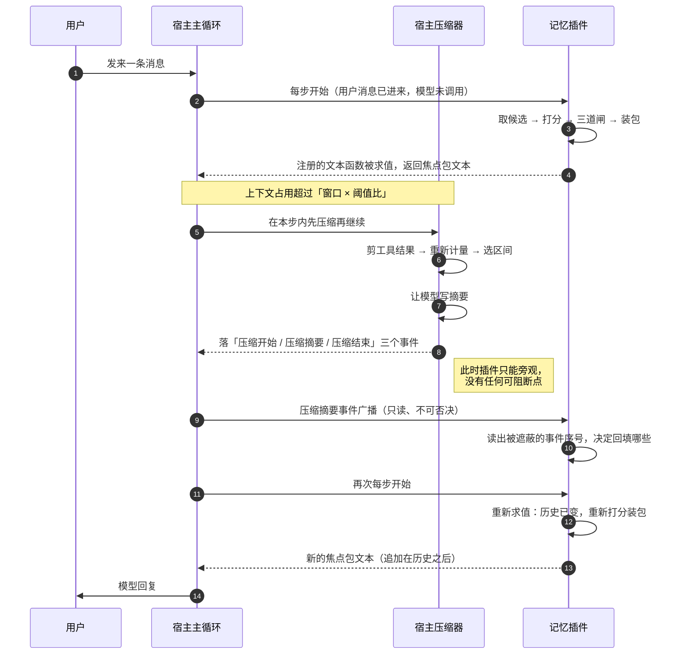

# 02 · 宿主平台约束

> **本篇回答什么**：宿主平台能给这套记忆系统什么、坚决给不了什么，
> 以及**每一条约束各自逼出了什么设计形状**。
> 本篇不做选型论证，只做边界测绘：先核对能力前提，再比较可行架构；宿主约束通常缩小选择，并不证明只有唯一解。
>
> **前置**：00（阅读指引与术语总表）。本篇的术语、编号、常量一律以 00 为准，
> 凡与 00 冲突之处以 00 为准并应修正本篇。
>
> **后置**：03 会直接引用本篇的结论画分层图；04 会引用本篇的存储约束解释
> 「为什么数据面必须单例」；05、06、07 会分别引用第 4 章与第 5 章的钩子边界。

---

## 一、先写「不能」，再写「能」

### 1.1 约束不是障碍，是形状的来源

绝大多数架构文档从「我们打算怎么做」开始写，然后在中途遇到平台限制，
再回头改设计。这套记忆系统的写法相反：**先把宿主给不出什么列清楚，
再看剩下那点空间里还剩几种可能**。

理由很实际。这套系统只有三个真正的自由度：

| 自由度 | 含义 | 谁决定 |
|---|---|---|
| **写在哪** | 记忆状态落到哪个存储里、什么时候写 | 宿主存储模型 + 轮次事件面 |
| **怎么读出来** | 每轮把什么内容、以什么形式送进模型 | 注入通道 + KV 前缀缓存 |
| **什么时候动** | 什么时候巩固、什么时候被唤醒 | 定时与唤醒机制 |

这三个自由度全部由宿主划定。宿主没给的，架构上再怎么设计也变不出来；
宿主给了但用错的，会在很长一段时间里**看起来正常**——这是本篇最想避免的失败形态。

### 1.2 一句总结

> **宿主给的是「一轮对话的骨架」和「一块能持久化的地」，
> 它不给的是「记忆应该长什么样」。**

骨架决定了记忆只能在两个时刻被触碰：模型调用之前（读）、轮次收尾之后（写）。
地决定了记忆只能是一堆按键值组织的数据，没有任何查询语言、没有事务跨表、
没有第二个进程能同时打开它。剩下的全部——卡片、图谱、衰减、巩固——
都是本系统自己长出来的东西，宿主一概不管，也一概不帮。

### 1.3 约束到形状的总表

这张表是全篇的目录。后面每一章展开其中一行或几行。

| # | 宿主事实 | 逼出的设计形状 | 展开在哪 |
|---|---|---|---|
| 1 | 两条注入通道落点不同，一条改前缀一条只追加 | 主通道只能选追加式快照；记忆永不进系统提示词 | 第 3 章 |
| 2 | 「用户消息进来、模型调用之前」只有一个稳定钩子 | 读路径全部挂在这一个点上，且必须足够快 | 第 4 章 |
| 3 | 「模型回复之后」没有专门钩子 | 写路径挂在轮次收尾的旁路，且绝不改写对话 | 第 4 章 |
| 4 | 压缩没有「压缩前」可阻断钩子 | 只能平时增量写 + 听压缩摘要事件回填 + 压缩后重算 | 第 5 章 |
| 5 | 同一存储域全进程只能打开一次 | 多智能体不能一人一个域，必须表内分区 | 第 6 章 |
| 6 | 会话日志天然按会话隔离，存储域不隔离 | 记忆必须自己带归属键，不能指望平台帮你分 | 第 6 章 |
| 7 | 读取端遇到未知且不可忽略的会话事件类型会拒绝整份日志 | 记忆状态绝不写进会话事件 | 第 7 章 C5 |
| 8 | 平台是预览版，会有破坏性变更 | 依赖宿主的部分收敛到唯一一层，其余全部纯函数 | 第 8 章 |

---

## 二、宿主提供的能力清单

下表是「宿主确实给了」的部分。三列分别回答：**它是什么**、**它到哪为止**、
**对本系统意味着什么**。第三列才是重点——同一个能力，边界不同，
长出来的设计完全不同。

| 能力 | 边界 | 对本系统的意义 |
|---|---|---|
| **模型调用与会话日志** | 宿主负责把消息发给模型、把流式回复收回来，并把系统消息、用户消息、助手消息、工具调用与结果按序落进会话日志。日志是模型历史的唯一真相源，**但它的读取接口是给「组装上下文」用的，不是给「分析历史」用的** | 记忆卡不需要自己保存对话原文，只需要保存一个**来源指针**（Source Pointer）指回日志里那条事件。这让记忆库的体积与对话总量解耦 |
| **上下文装配** | 宿主每轮重新装配一次上下文：系统提示词、历史消息、工具定义、运行时快照。装配顺序由宿主决定，插件只能通过两条注册通道往里塞内容 | 记忆注入不是「往数组里 push 一条」，而是「注册一个每轮会被重新求值的函数」。这个差别决定了压缩后能否自愈（第 5 章） |
| **轮次事件面** | 提供轮次开始、每步开始、模型请求、消息落盘、工具三阶段、轮次收尾等事件。其中一部分是**可拦截、可否决**的瀑布式事件，另一部分是**只广播、不可否决**的持久事件 | 记忆的写路径只能挂在「不可否决」或「串行等待」的那一侧。任何试图否决轮次的设计都会与宿主主循环打架（第 4 章） |
| **定时与唤醒** | 支持一次性、固定间隔（最小 60 秒）、每日、每周、五字段定时表达式（cron），时区显式指定，最小粒度 1 分钟。到期后宿主会取回原会话，以插件来源投递一条消息，**把智能体唤醒跑一轮** | 「夜整理」不需要用户在场。这是整套巩固机制能存在的前提——否则衰减、去重、摘要全部只能在用户恰好说话时才跑，而它们本该按自然时间跑 |
| **持久化存储** | 提供「存储域（Storage Domain）」：声明式定义表与布局，得到同步读 + 串行写。后端可路由到纯文本记录文件或内置 SQLite。**同一存储域全进程只允许打开一次** | 记忆库有一块稳定的地。代价是「一个进程一块地」，多智能体共享必须靠表内分区（第 6 章） |
| **上下文压缩** | 上下文接近窗口上限时，宿主自动压缩：剪工具结果、重新计量、选一段区间、让模型写摘要、把摘要作为一条替换式用户消息放回历史。**全程没有给插件留「压缩前」的可阻断点** | 记忆注入的内容会在压缩中「消失」——不是被删，而是被摘要取代。系统必须能接受这件事，并在压缩后自动重建（第 5 章） |
| **可复用的现成插件** | 现成可用的有：人设、时间上下文、定时唤醒、目标与自动续跑、会话日志与派生索引、压缩、作用域与预设、外部工具协议客户端、语音转写、团队协作域 | 时间感、定时、人设三块**不需要自己写**。本系统的边界因此收窄到「记忆」一件事：不重复实现时间读数，不重复实现调度，不改写身份 |

### 2.1 三条「不必自己造」的边界

上表最后一行值得单独说，因为它决定工作量与失败面：

1. **时间读数不自己算**。宿主的现成插件每步注入时刻、时区、距上条消息的时长，
   默认按 10 分钟节流。本系统只消费这个读数，不重新实现时区与夏令时逻辑。
2. **调度不自己写**。定时、间隔、每日、每周、定时表达式全部由宿主提供，
   到期唤醒是官方通路。本系统只负责「被唤醒后做什么」。
3. **身份不改写**。人设由现成插件承载，记忆系统不碰人格层。
   这条不只是省事：人格层在系统提示词里，而系统提示词是 KV 缓存的前缀，
   任何在人格层里的动态内容都会把缓存打掉（第 3 章）。

> 反过来说：**凡是「宿主已经有一个正确实现」的地方，自己再写一份，
> 得到的一定是两份会漂移的真相源。** 这套系统在别处吃过这个亏，
> 所以这条边界是硬性的，不是偏好。

---

## 三、注入通道：两条路，只有一条能走

这是全篇最重要的一章。整套系统的**注入形态**由这一章决定，
而注入形态又决定了缓存成本、上下文稳定性和压缩后的自愈能力。

### 3.1 两条通道的四个差别

宿主给插件两条往上下文里塞内容的注册通道。它们看起来只是「放的位置不同」，
实际上在四个维度上完全不同：

| 维度 | 通道甲：系统提示词段 | 通道乙：运行时上下文快照 |
|---|---|---|
| **落到模型的方式** | 渲染成一条**系统消息**，位于整个上下文的**表面节点 0** | 渲染成一条**带来源标记的用户快照**，**追加在历史之后** |
| **对 KV 前缀缓存的影响** | 内容一变就改写头部，**从首个变化的词元起全部失效** | 不主动改写更早的前缀，保留复用机会；实际命中取决于服务商缓存条件 |
| **排序语义** | 按序号升序 + 名称次序；有稳定但**不透明**的次级排序 | **只按序号升序**，同序号之间没有承诺 |
| **作用域** | 注册落在调用方上下文的作用域层；作用域可遮蔽全局；作用域的键是智能体对象本身 | 同上，但因为是「快照」，作用域隔离天然表现为「不同智能体看到不同快照」 |

补两条关键事实：

- 两条通道的**文本都可以是函数**，每个模型步骤重新求值一次。
  这是「压缩后自愈」的全部机制来源。
- 通道乙的注册序号要**显式给**，且不能与第一方占用的序号撞。
  第一方快照占用 100/110/115/120/125 与 200/210，本系统取 300，
  落在 200 之后的动态尾部。

### 3.2 为什么只能选通道乙：一张图说清

```text
通道甲：把记忆写进系统提示词段
────────────────────────────────────────────────────────────────
上下文序列（从左到右 = 从头部到尾部）

┌──────────┬──────────┬──────────┬──────────┬──────────┐
│ 系统段甲  │ 系统段乙  │ 历史第1轮 │ 历史第2轮 │ 最新用户  │
│ (人设)   │ (记忆)   │          │          │          │
└──────────┴──────────┴──────────┴──────────┴──────────┘
                 ▲
                 │ 记忆一变，改的是这里
                 └──► 首个变化词元之后，全部缓存失效
                      历史越长，失效越贵：越靠前的改动代价越大

  命中情况：只有「系统段甲」这一小段可能命中
  每轮代价：重算 系统段乙 + 全部历史 + 最新消息


通道乙：把记忆追加成运行时快照
────────────────────────────────────────────────────────────────
上下文序列

┌──────────┬──────────┬──────────┬──────────────┬──────────┐
│ 系统段甲  │ 历史第1轮 │ 历史第2轮 │ 记忆快照(本轮) │ 最新用户  │
└──────────┴──────────┴──────────┴──────────────┴──────────┘
                                    ▲
                                    │ 记忆一变，改的是这里
                                    └──► 前面全部不变，只在尾部多一段

  可复用范围：首个变化词元之前的完全相同前缀
  每轮代价：还取决于缓存可用性、模型、有效期与请求设置，不能保证只算尾部
```

### 3.3 三个必须记住的推论

**推论一：记忆内容永远不能进系统提示词。**

不是因为「系统提示词不能变」，而是因为**它变了之后代价与历史长度成正比**。
系统提示词在头部，历史在它后面。头部改一个字，后面几万词元的缓存全部作废。
而记忆是每轮都可能变的——焦点包换一张卡，头部就变了。

反过来说，**人设可以进系统提示词**，因为人设是稳定的。这条边界不是
「动态/静态」的直觉划分，而是「变化频率 × 位置」的乘积：
位置越靠前，允许的变化频率越低。

**推论二：快照必须能被重复求值，且每次求值的结果要落在同一个位置。**

「位置」指的是它在上下文里的相对次序，不是它的内容。内容每轮都变（这是它的职责），
位置每轮都不变（这是它安全的原因）。所以注册序号必须固定，
且**不能依赖同序号之间的排序**——宿主只承诺按序号升序，同序号之间没有承诺。

这条要求听起来很弱，落地时很强：一旦两个快照用了同一个序号，
某天宿主的内部实现换了排序策略，两段内容的相对次序就会翻转。
而翻转的表现是「记忆内容忽然跑到别的地方去了」，没有任何报错。

**推论三：第三条路存在，但只能当备用。**

除了两条注册通道，还有一条正交路径：在「每步开始之前」这个可拦截事件里，
直接往本次步骤的消息数组里追加一条用户消息。它绕过了注册通道，
所以不受序号约束，但也因此**不受宿主保护**：消息序由自己维护，
一旦与宿主自己的追加发生次序冲突，坏的是对话结构本身。

本系统把它列为备用通道，只在主通道出现平台级故障时启用，
且启用时必须显式验证消息序（见第 9 章诚实边界）。

### 3.4 一句话判据

> **能追加就不改写；能改写尾部就不改写头部；能在快照里说清楚，就不要放进系统提示词。**

这条判据在 06 会被复用一次：焦点包的内容取舍也遵循同一个方向——
只放摘要、不放原文，只放结论、不放过程。理由相同：**尾部越短，代价越小**。

---

## 四、轮次事件的权威顺序

### 4.1 时间轴

```text
turn/start
   │
   ├── 认领输入
   ├── 装配提示词与工具
   └── 投影运行时上下文
   │
   ▼
┌──────────────────────────────────────────────────────────────┐
│ agent/pre-step        【唯一稳定钩子：用户消息已进来、模型未调用】 │
│   · 瀑布式：可读可改可否决                                     │
│   · 每步都会走一次（一次轮次可能有多步）                        │
│   · 宿主自己的压缩也挂在这里：先压缩，再继续                     │
└──────────────────────────────────────────────────────────────┘
   │
   ├── step/start
   │     ├── agent/request ──► 已准备好的调用
   │     ├── 系统消息、用户消息落日志
   │     ├── 模型流式回复 ──► 助手消息 / 助手尝试
   │     ├── 工具调用 ──► 预执行 ──► 执行 ──► 后执行 ──► 工具结果
   │     └── step/end
   │
   ▼
┌──────────────────────────────────────────────────────────────┐
│ agent/turn-stopping    【串行、轮次关闭前会等待】               │
│   · 可以 steer（把新消息塞进本轮）                              │
│   · 一旦 steer，宿主会为本轮再跑一步 —— 代价见 4.3              │
└──────────────────────────────────────────────────────────────┘
   │
   ▼
turn/end
```

三条读图要点：

1. **`agent/pre-step` 在模型调用之前，且每次调用之前都会经过。**
   这是读路径唯一可以依赖的位置。它同时也是宿主自己压缩的位置——
   所以记忆读路径必须假设「进来的时候历史可能刚被压缩过」。
2. **模型回复之后没有任何「助手事件」形式的回调。**
   只有轮次收尾（串行、可等待）和若干**持久事件广播**（只读、不可否决）。
3. **持久事件广播的监听器异常会被兜住，监听器不能否决任何事。**
   这既是保护（写记忆不会弄坏对话），也是限制（写记忆不能要求宿主重来）。

### 4.2 「回复之后」为什么没有钩子

这不是宿主的疏忽，而是主循环的结构决定的：模型回复之后，
宿主的下一步动作取决于回复内容本身（要不要调工具、要不要继续、
要不要收尾）。如果在「回复之后、决定之前」插一个可改写的钩子，
插件就有能力改变主循环的判断依据，那等于把主循环的控制权交出去。

于是宿主给了两个替代面，各有各的代价：

| 替代点 | 时机 | 能力 | 代价 |
|---|---|---|---|
| **轮次收尾**（串行等待） | 轮次即将关闭 | 可以等待异步工作完成；可以 steer | 串行，**拖慢收尾**；steer 会强制多跑一步 |
| **助手消息持久事件** | 助手消息落日志后 | 只读，不阻塞，异常被兜住 | **不能保证在本轮结束前跑完**；没有「这一步是最后一步」的信息 |
| **步骤结束持久事件** | 每一步结束 | 只读，粒度细 | 一次轮次可能触发多次，**必须自己判重** |
| **轮次结束持久事件** | 轮次已关闭 | 只读，一次一轮 | 此时回复已经发出，写失败无法补救 |

### 4.3 那个坑：在收尾处改写对话，会强制多跑一步

这是本系统在设计阶段就明确避开的一条路，值得单独写清楚，因为它**看起来是最优解**。

诱人的想法是这样的：轮次收尾时，我已经知道这一轮聊了什么，
把摘要或提醒作为一条新消息塞进去，模型就能「立刻用上」。
宿主也支持这么做——收尾事件可以 steer。

但 steer 的语义是「本轮还没结束，再给模型一条输入」。
宿主于是**为这一轮再跑一步**：再装配一次上下文、再调一次模型、
再走一遍工具与消息落盘、再收尾一次。

后果有三层，一层比一层隐蔽：

1. **成本翻倍**。每一轮都多一次完整的模型调用。
2. **收尾不再是收尾**。第二次收尾又会触发同一个逻辑，
   如果判断条件写得不够严，就会再 steer 一次——**循环**。
   这个循环不会报错，只会让用户觉得「回复越来越慢」。
3. **对话结构被污染**。被塞进去的那条消息会作为真实历史留在会话日志里，
   下一轮它就成了「用户说过的话」的一部分。而它其实是系统自己写的。

第三层与 05 篇的一个主题直接相关：**注入内容被当成用户原话吃回去**。
只要注入内容以「用户消息」形态进入历史，而抽取逻辑又不看来源标记，
系统就会把自己的输出当成新的输入，逐轮自我复制。
本系统对此的防线是白名单式的：只有来源标记为「用户」的消息才进入抽取，
其余一律不认（展开见 05）。

结论：**收尾处只写，不改对话。** 写记忆是旁路动作，
它的产物在**下一轮**的快照里出现，而不是在这一轮里。这多等一轮，
换来的是零额外模型调用、零循环风险、零对话结构污染。

### 4.4 读路径与写路径在时间上的分工

```text
        ┌──────────── 一轮对话 ────────────┐
        │                                  │
   [读] │  pre-step ──► 模型调用 ──► 回复   │ [写]
        │     取候选                         │  收尾旁路
        │     打分                           │  门控
        │     三道闸                         │  抽取
        │     装包                           │  追加日志
        │     注册快照文本（本轮求值一次）     │  更新内存视图
        │                                  │
        └──────────────────────────────────┘
             快（在主路径上）        慢（可以延后，但不能丢）
```

**读必须快**：它在主路径上，用户能感觉到。
**写可以慢**：它不在主路径上，但要保证「写进去的东西不丢、不重、不改写历史」。

这条分工是整个数据面设计的前提（04 会展开）：正因为写可以慢，
才允许把持久提交放在收尾阶段；单行追加仍须完整性校验、持久屏障和提交确认，不能直接等同于事务；
正因为读必须快，才要求读模型全部在内存里、且是纯派生物。

---

## 五、压缩机制：唯一没有钩子的地方

这一章是 02 的第二个重点。压缩是宿主**主动**做的事，插件**无法阻止**，
也无法在它发生之前插入任何逻辑。这带来一组非常具体的配合原则。

### 5.1 触发条件

压缩有两条触发路径，一条常规、一条救火：

| 路径 | 触发点 | 条件 | 特点 |
|---|---|---|---|
| **常规压缩** | 每步开始之前 | 估算上下文占用超过「窗口 × 阈值比」 | 提前发生，来得及做完整摘要 |
| **溢出恢复** | 模型请求报错 | 错误类型是「超出上下文窗口」 | 事后补救，只能压缩后重试 |

第二条路径的存在说明一件事：**估算会失准**。所以系统不能假设
「压缩一定在上下文还没溢出时发生」。

### 5.2 默认参数

| 参数 | 默认值 | 含义 | 谁可以改 |
|---|---|---|---|
| 阈值比 | 0.8 | 占用超过「窗口 × 0.8」即触发常规压缩 | 可按模型覆盖 |
| 尾部保留比 | 0.16 | 压缩后保留最近约 16% 窗口的原文不动 | 可按模型覆盖 |
| 预留量（headroom） | 65536 词元 | 为摘要本身与后续增长预留的空间 | 可按模型覆盖 |

三个数字的分工要说清，否则很容易调错：

- **阈值比**决定「什么时候开始压」。调高 → 压得更晚、更省、但更容易撞溢出；
  调低 → 压得更勤、更贵、但更安全。
- **尾部保留比**决定「压完之后还剩多少原文」。它保护的是**最近的对话连贯性**：
  用户刚说的话不能被压成摘要，否则模型会答非所问。
- **预留量**决定「压完之后还有多少空间可用」。它保证压缩不是「压到刚好卡线」，
  而是留出一段能继续对话的余量。

> 关键洞察：**尾部保留比与预留量是两笔不同的开销，不能合并考虑。**
> 前者是「不能压的部分」，后者是「压完还要留的部分」。
> 把两者混为一谈的配置，会在长会话里表现为「压完立刻又触发压缩」的抖动。

### 5.3 策略流程

```text
① 剪工具结果（可选）
      │  把大块的工具输出替换成占位摘要
      ▼
② 重新计量
      │  剪完之后再算一次占用，可能已经够了，不必摘要
      ▼
③ 选区间
      │  从「保留区之前」往回选一段连续历史作为压缩对象
      ▼
④ 让模型写摘要
      │  对选中的区间生成一段摘要文本
      ▼
⑤ 落三个事件
      │  压缩开始 / 压缩摘要 / 压缩结束
      ▼
⑥ 摘要以「替换式用户消息」的形态回到历史
```

第 ② 步最容易被忽略，但它省的是真金白银：工具输出往往是上下文里最肥的部分，
剪完可能直接降到阈值以下，整次模型摘要就省掉了。

第 ⑥ 步的措辞值得注意：摘要是**替换式**的。它不是「在历史后面加一段总结」，
而是「把那段历史换掉」。所以被压缩掉的那部分原文，在模型可见的上下文里
**真的不存在了**——它还在会话日志里（日志是只追加的），但不再进入上下文。

### 5.4 没有任何「压缩前」可阻断钩子

这是本章的核心事实，必须说三遍：

> **压缩开始之前，插件收不到任何可阻断的通知。**
> **压缩进行之中，插件无法干预。**
> **压缩结束之后，插件才知道发生过什么。**

官方提供的钩子桥也不支持「压缩前 / 压缩后」这类回调。
这不是版本缺失，而是设计取向：压缩是宿主维持自身可用性的最后手段，
不允许第三方在它前面排队。

于是所有「在压缩前把记忆抢救出来」的方案，**在架构上就不成立**。
剩下的只有「事后的三种配合」。

### 5.5 三条配合原则

| 原则 | 做什么 | 为什么这样够 |
|---|---|---|
| **一、平时增量写** | 每轮收尾就把这一轮的候选记忆写进日志，不等压缩 | 压缩只会影响**上下文**，不影响**存储**。写进日志的东西不会被压缩碰到 |
| **二、听压缩摘要事件回填** | 订阅压缩摘要事件，从中读出「这次压掉了哪些会话事件序号」，据此决定要不要补记 | 压缩摘要事件里带着被遮蔽的事件序号列表。这是唯一能知道「丢了什么」的官方来源 |
| **三、压缩后快照自动重新物化** | 主注入通道的文本是函数，每轮重新求值；压缩清空历史后，下一次求值自然产出新的焦点包 | 条件是压缩后再次求值且输入刷新；尾部位置服务于缓存，不能单独证明自愈 |

第三条成立的关键是**压缩之后再次求值，并以新的历史与固定的记忆版本重新生成快照**。
尾部位置服务于缓存布局，不决定求值是否新鲜：两条通道都支持函数文本，因此不能推导
「系统通道必然陈旧、尾部通道必然自愈」。没有再次求值，放在尾部的缓存文本也会陈旧。

### 5.6 压缩与记忆的时序



读图要点：**记忆的两次求值之间夹着一次压缩，而记忆对此完全被动。**
它能做的只有两件事——压缩时收到一条只读广播，压缩后重新算一遍。

### 5.7 两个前提必须分别验证

「压缩后重新物化」要求求值发生在压缩之后，查询与数据版本确实重新获取。
「保护可复用前缀」要求动态内容位于稳定前缀之后，且更早的序列化内容保持一致。
前者是新鲜度，后者是缓存布局；任何一项都不能由另一项推出。

**设计决策·待验证**：同一模型请求只使用一个已发布的快照。压缩改变本请求上下文时，
废弃旧候选结果并建立新请求版本；普通后台提交不让已经冻结的请求反复重算。
删除或撤销授权会使旧结果失效，须重算或受控返回空包；同一版本的重复求值返回同一文本，避免快照累积。

---

## 六、存储模型的约束

### 6.1 一条硬规则：同一存储域，全进程只打开一次

宿主的存储域是「按名字唯一」的：同名域在一个进程里只能被打开一次，
第二次打开直接报「已打开」。这不是可以绕过的检查，而是它保证一致性的方式——
两个打开者各自持有一份内存视图与一个写队列，它们会互相覆盖。

这条规则的直接后果仅是：**同名存储域不能由多个实例重复打开**。
它不排除多个不同名字的存储域，也不自动保证跨进程单写者。

本系列选择「一个共享数据面、一个写入序列、表内归属分区」，因为它便于共享、导出和协调巩固；
这是**设计选择**，不是平台能力的唯一解。独立命名域可以隔离数据，但增加跨域检索、迁移和协调成本。
同一持久目录还须采用 04 的独占写者协议；只在追加前比对水位不能消除两个写者同时通过检查的窗口。

```text
  一个数据面（本系列选型）
  ┌────────────────────────────────────────────┐
  │ 一个写者、一个提交序列、一次版本发布        │
  │ ┌─────────┬─────────┬─────────┬────────┐   │
  │ │归属甲   │归属乙   │归属丙   │显式共享│   │
  │ └─────────┴─────────┴─────────┴────────┘   │
  └────────────────────────────────────────────┘
  读写都验证权限；归属过滤发生在候选截断之前
```

### 6.2 会话日志天然隔离，记忆不会

这是两个完全不同性质的东西，很容易混为一谈：

| | 会话日志 | 记忆存储 |
|---|---|---|
| **隔离方式** | **天然隔离**：每个会话一份，宿主按会话标识路由 | **不隔离**：一个域装所有智能体的全部记忆 |
| **谁负责分区** | 宿主 | **本系统自己** |
| **漏了分区会怎样** | 不可能漏——日志的键就是会话 | 甲的对话可能被乙召回；内容、来源与分数正常不能证明授权正确 |
| **能否事后发现** | — | 在请求身份、授权范围与来源归属的配对检查中检测；人工判断不应是唯一防线 |

第二行是重点：**平台不会替你分，也不会提醒你没分。**
一个漏了归属条件的查询，返回的是「所有智能体的记忆里最相关的那几条」。
这个结果在质量上通常**更好看**——因为候选池更大——于是没人会去修它。

> 与 06 篇反复强调的那条判据同源：**一个缺陷如果让指标变好，
> 它就会活很久。** 跨归属泄漏正是这一类：召回率上升，用户满意度上升，
> 只有隐私与一致性在下降，而这两者都不在任何仪表盘上。

**设计决策·待验证：归属不是普通相关性过滤。** 数据面在候选检索、图遍历、来源展开、
导出、修正与删除入口统一检查授权；未知身份默认拒绝。生活／学习／工作是内容域，不能代替访问权限。
权限过滤先于候选截断、统计和传播，不允许通过隐藏邻居的边数或解释泄露内容。
显式共享记录应保留所有者、授权范围与撤销规则；撤销后派生摘要也按来源依赖闭包处理。

### 6.3 由此得到的存储形状

| 约束 | 落地形状 |
|---|---|
| 一个域装全部 | 每一条记录都自带归属键，且**写入时必填、读取时必带** |
| 域内没有跨表事务 | 需要原子性的东西**放在同一行里**（单行追加，见 04 第 6 章） |
| 只有同步读 + 串行写 | 读路径全部走内存视图，不查存储；存储只负责「落盘与重放」 |
| 后端可能是纯文本记录也可能是 SQLite | 不依赖任何后端特性：不用索引、不用事务、不用查询语言 |
| 派生索引不能当真相源 | 检索索引可丢弃、可重建；真相只有一份（见 04 第 1 章） |

最后一条尤其重要。宿主的会话日志之外，还有一层「派生查询索引」，
它是可丢弃的、**不能当真相源，也不该往里加表**。
本系统的选择是：**自建倒排索引，放在内存里，启动时从日志重建。**
理由不是「不信宿主的索引」，而是「真相源只能有一个」——
两个都能被查询的存储，迟早会有一处写漏。

---

## 七、平台硬约束清单 C1～C9

编号与含义以 00 与 01 为准。下表逐条给出「约束内容」「为什么」「不遵守会怎样」。
第三列是这张表的价值所在：**它把「不该做」翻译成「做了会出什么事」**。

| 编号 | 约束内容 | 为什么 | 不遵守会怎样 |
|---|---|---|---|
| **C1** | 宿主是 DSH 预览版，插件形态是 TypeScript / ESM / 插件容器 | 宿主只加载这一种形态；预览版意味着 API 会变 | 用别的语言或形态写，插件根本不会被加载；**而且不会有明显报错**——它只是不出现在能力列表里 |
| **C2** | 模型是服务商 API，没有权重访问权限 | 只能在上下文层面做可塑性，不能微调、不能改推理 | 任何「训练式记忆」的方案在物理上不成立。强行模拟（把记忆塞进提示词）会撞上 C7 |
| **C3** | 存储走宿主存储域，后端是内置 SQLite 或纯文本记录 | 打包运行时只保证内置模块可用，第三方原生扩展未经验证 | 引入原生扩展 → 打包后加载失败，而开发环境一切正常。**这是「本地绿、上线红」的经典形态** |
| **C4** | 注入主通道是运行时上下文快照（每轮求值、尾部追加、压缩后自愈） | 只有这条通道同时满足「可动态」与「缓存安全」 | 改用系统提示词段 → 每轮重写头部 → KV 缓存全失效，成本随历史长度线性上升（第 3 章） |
| **C5** | 不得写自定义会话事件类型 | 读取端遇到未知且不可忽略的事件类型，会**拒绝整份日志** | 一条自定义事件就能让整个会话打不开。而且它是在**下一次启动**才发作，写的时候毫无征兆 |
| **C6** | 压缩没有「压缩前」阻塞钩子 | 压缩是宿主维持可用性的最后手段，不允许第三方排队 | 任何「压缩前抢救」的设计都是空中楼阁；真按它实现，代码里那段逻辑永远不会被调用，而测试也不会红 |
| **C7** | KV 前缀缓存要求稳定内容在前、动态内容在后 | 缓存按前缀匹配，第一个变化的词元之后全部重算 | 记忆卡进稳定前缀 → 缓存失效 + 焦点被稀释（大量记忆挤占头部，模型注意力被拉向陈旧内容） |
| **C8** | 宿主预览版会有破坏性变更 | 预览版不承诺 API 稳定 | 不设适配层 → 一次宿主升级，全部业务代码都要改。适配层的存在让「升级只改一层」成为可能 |
| **C9** | 单机本地、单用户，规模目标 10 万级记忆卡 | 没有分布式、没有多租户、没有跨机同步 | 按分布式设计 → 引入本不需要的一致性协议，复杂度爆炸而收益为零；反过来，按「几千张卡」设计 → 到 10 万级时重放与召回双双变慢 |

### 7.1 两条容易被读错的约束

**C5 的发作时机。** 它不是在写入时报错，而是在**下一次读取时**报错。
写的时候日志看起来完全正常，行数对、内容对、能读回来——
只有完整重放一次才会发现「有一条读不懂，于是整份拒绝」。
所以这条约束不能靠「试一下能不能写」来验证，只能靠纪律：
**记忆状态只进存储域，不进会话日志。**

**C7 的方向。** 它约束的不是「内容是否动态」，而是「动态内容的位置」。
系统提示词里可以有动态内容（比如时间读数插件就在里面），
但它的变化频率必须极低。真正的判据是：

> **一段内容放进上下文的位置，必须由它的变化频率决定，而不是由它的重要性决定。**

记忆很重要，所以「应该」放在前面——这个直觉恰好是错的。
记忆每轮都变，所以它必须在最后。

---

## 八、由这些约束逼出的六个设计决定

每条一句话，并指向本系列里展开它的那一篇。

| # | 设计决定 | 一句话理由 | 展开 |
|---|---|---|---|
| **D1** | 主注入通道用**追加式运行时快照**，记忆永不进系统提示词 | 只有尾部追加能保住 KV 前缀缓存，且压缩后能自动重新物化 | 03、06 |
| **D2** | 写路径挂在**轮次收尾的旁路**，只写不改对话 | 收尾处改写对话会强制多跑一步，并污染历史结构 | 05 |
| **D3** | 面对压缩**不做阻断、只做配合**：增量写 + 事件回填 + 每轮重算 | 平台没有压缩前钩子，任何「抢救」方案都不成立 | 03、07 |
| **D4** | 数据面在宿主平面**单例**，多智能体靠**表内分区** | 同一存储域全进程只能打开一次，物理上不可能一人一个域 | 04 |
| **D5** | 记忆状态**只进存储域**，绝不写自定义会话事件 | 一条未知事件类型会让整份会话日志打不开，且下次启动才发作 | 04 |
| **D6** | 依赖宿主的部分收敛到**唯一适配层**，其余全部纯函数 | 宿主是预览版；把变更面压到一层，升级才只需要改一层 | 03、12 |

这六条不是六个可以商量的选项，而是**在 C1～C9 之下唯一自洽的一组形状**。
换个说法：如果有人提出一个违反 D1～D6 中任意一条的方案，
他一定同时违反了某条平台约束——只是他没意识到。

---

## 九、给下一篇的接口

03 会拿走本篇的四样东西：

| 本篇产出 | 03 怎么用 |
|---|---|
| 两条通道的对比（第 3 章） | 决定「注入面」在分层图里的位置与依赖方向 |
| 轮次时间轴（第 4 章） | 画一轮对话的完整数据流，标出读/写的挂载点 |
| 压缩的三条配合原则（第 5 章） | 解释「为什么注入面不能持有状态」 |
| 存储的单例约束（第 6 章） | 解释「为什么数据面必须在宿主平面，而不是按智能体挂载」 |

一句话交接：

> **02 划定的是「哪些形状在物理上可行」，03 在这些可行形状里挑一组并画出依赖关系。**
> 凡是 03 里看起来「多余」的一层，通常都能在本篇找到它对应的那条约束。

---

## 十、本篇的诚实边界

写清哪些是已确认的、哪些是推断的、哪些还没验证。

### 10.1 已确认（有明确依据）

- 两条注入通道的落点、排序语义、作用域规则、以及「文本可以是每步求值的函数」。
- 轮次事件面的事件顺序，以及「用户消息进来后、模型调用前」只有每步开始这一个稳定钩子。
- 「模型回复后」没有专门的助手事件，只有轮次收尾与若干持久事件广播。
- 压缩的三条触发/参数事实（阈值比 0.8、尾部保留比 0.16、预留 65536 词元），
  以及「没有压缩前可阻断钩子」。
- 存储域「同名全进程只打开一次」。
- 定时唤醒是官方通路，最小间隔 60 秒。

### 10.2 推断（合理但未端到端验证）

- **压缩后快照是否真的会自动重新追加**：机制上成立（文本是函数、宿主每轮求值），
  但没有在真实宿主上跑过完整的「压缩 → 继续对话」端到端。
  如果它不成立，备用方案是在压缩事件里显式重建焦点包。
- **两条注入通道在同一序号下的相对次序**：文档只说「按序号升序」，
  没有承诺同序号之间的次序。本系统的应对是**不用同序号**，
  所以这条不确定性被绕开而不是被解决。
- **每步开始事件上多个监听器的相对顺序**：行序不等于加载序。
  本系统的应对是**只注册一个监听器**，同样是把不确定性绕开。

### 10.3 未验证（写清风险）

- **桌面打包运行时能否加载非内置模块**：本系列以宿主已有存储能力为基线；新增持久提交与独占写者契约仍须在实际后端验证。这条风险被规避，而不是被解决。
- **目标模型的本地词元计数能力**：模型调用后的用量不能替代调用前对完整快照的计量。
  只有估算时只能保证估算预算，词元硬上限验收为未通过，不能声称不影响正确性。
- **真实宿主上「第二个写入者」的检测**：检测逻辑存在，但真实多进程场景未跑过。
  见 04 第 6 章的诚实边界。

### 10.4 本篇最容易被误读的三句话

1. **「压缩后会自动重建」**——前提是压缩后再次求值，并刷新历史与数据版本；位置在尾部本身不证明新鲜。
2. **「上下文快照是缓存安全的」**——它避免主动改写更早的稳定前缀，保留缓存机会；位置不变不能保证缓存命中。
3. **「宿主不隔离记忆」**——不是「隔离做得不好」，而是**根本没有这个概念**。
   它提供一个域，域里怎么分是你的事。指望平台兜底，等于指望它知道
   「哪些记忆属于哪个智能体」——它不知道，也不该知道。

---
