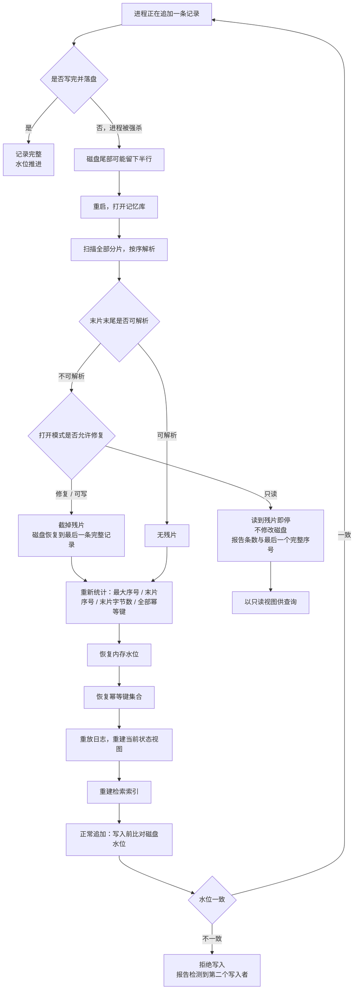
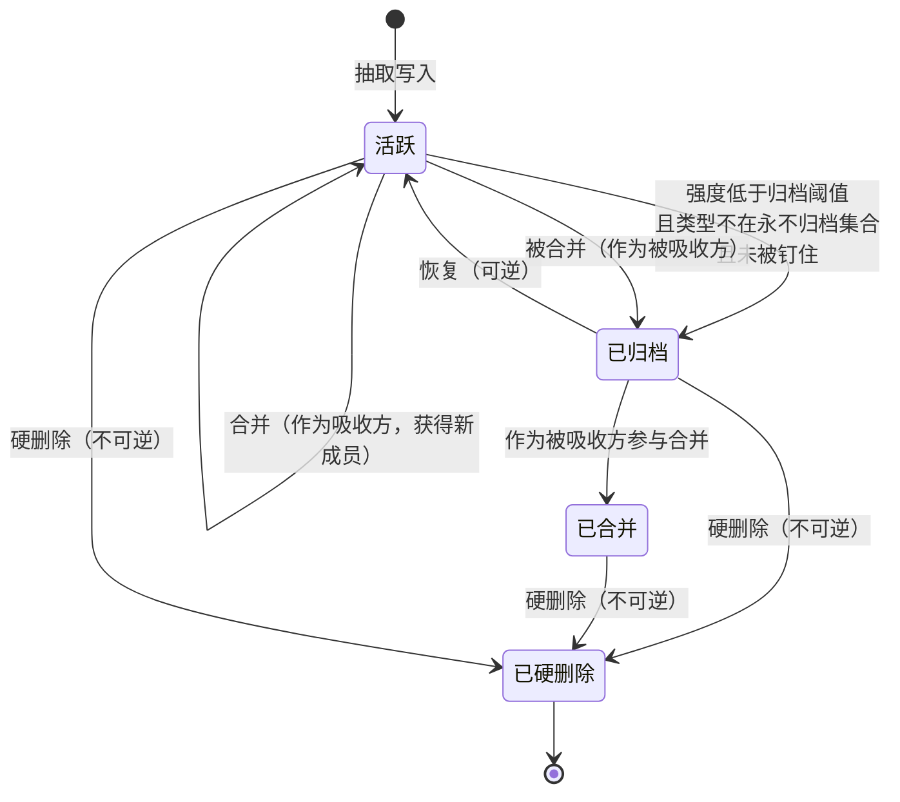

# 04 · 数据模型与事件溯源

> **本篇回答什么**：记忆库的**真相是什么形状**、由哪些字段构成、
> 一次写入如何保证不重不丢、崩溃之后如何自证清白、
> 以及为什么「重放出来的一定和日志里写的一样」是整套系统最不能让步的性质。
>
> **前置**：03（总体架构）。03 给出了分层与依赖方向，本篇展开其中最底下那一层：
> 数据面。03 里「一条日志、两个视图」这句话，本篇负责把它拆成字段、操作与不变量。
>
> **后置**：05 写链路会引用本篇的操作集与幂等键；06 召回链路会引用本篇的读模型；
> 07 巩固与遗忘会引用本篇的状态机；12 会引用本篇第 9 章的导出口径。

---

## 一、为什么是「只追加日志 + 派生读模型」

### 1.1 两种世界观

同一个需求——「记住这张卡现在的样子」——有两种完全不同的实现方式：

| | **一张会变的表** | **一串只追加的记录** |
|---|---|---|
| 真相是什么 | 表里那一行**当前的值** | 日志里**发生过的每一件事** |
| 更新怎么做 | 原地覆盖 | 追加一条新记录 |
| 历史在哪 | 没有。被覆盖掉了 | 就在日志里，一直都在 |
| 「改过什么」怎么答 | 答不了，除非另建一张审计表 | 直接读日志 |
| 「为什么现在是这个值」怎么答 | 答不了 | 重放一遍，每一步都看得见 |
| 崩溃后怎么恢复 | 表可能停在半个事务中间，需要事务日志兜底 | 日志尾部可能残缺，截掉即可 |
| 两个视图不一致怎么办 | 只能祈祷没有 | 全部丢弃，重放一次 |
| 索引坏了怎么办 | 重建，但真相可能也坏了 | 重建，真相不受影响 |
| 存储增长 | 与「当前有多少条」成正比 | 与「历史上发生过多少事」成正比 |
| 读取成本 | 一次查表 | 一次重放（或重放后的内存视图） |

### 1.2 同一件事，两种做法的代价

| 场景 | 一张会变的表的代价 | 只追加日志的代价 |
|---|---|---|
| **一张卡被修正了三次** | 旧文本永久消失。「这条为什么改了」无法回答，只能靠人回忆。要补历史就得再加一张表，而两张表之间没有原子性 | 日志里三条修正记录，每条带原因与时刻。代价是重放时要按序应用三条，而不是读一行 |
| **一次写入写了一半就崩了** | 表停在中间态：字段 A 更新了、字段 B 没更新。这种状态**没有任何自洽性可言**，而系统会把它当成正常状态继续用 | 最多留下半行文本。半行不是一条记录，截掉即可，日志仍然自洽 |
| **检索索引与卡片对不上** | 不知道是索引错了还是卡片错了，两边都是「真相」，于是只能人工比对 | 索引是纯派生物，删掉重建。真相只有一份，不存在「谁对」的问题 |

### 1.3 一条日志、两个视图

```text
                    ┌──────────────────────────────┐
                    │   事件日志（唯一真相源）        │
                    │   只追加 · 有序 · 不可变        │
                    └───────────────┬──────────────┘
                                    │ 重放
                    ┌───────────────┴──────────────┐
                    ▼                              ▼
        ┌───────────────────────┐      ┌───────────────────────┐
        │  视图一：当前状态       │      │  视图二：检索索引       │
        │  卡片集合 + 图谱边集合   │      │  词项 → 卡片标识 的倒排  │
        │  可丢弃、可重建         │      │  可丢弃、可重建         │
        └───────────┬───────────┘      └───────────┬───────────┘
                    │                              │
                    └──────────────┬───────────────┘
                                   ▼
                          ┌─────────────────┐
                          │  行为面：召回     │
                          │  打分 / 闸门 / 装包│
                          └─────────────────┘
```

三条铁律：**日志是唯一真相源**（视图可丢弃，日志一条都不能丢）；
**视图是纯派生物**（同一份日志重放两次，逐字段相同，第 7 章）；
**派生关系单向**（视图不能反写日志，任何状态变化都先变成一条记录）。

### 1.4 代价与它的缓解

只追加日志的代价是**读取要先重放**。规模目标（C9）是 10 万级记忆卡，
全量重放耗时随规模线性增长。缓解分三层：

| 层次 | 做法 | 缓解的是什么 |
|---|---|---|
| **启动时** | 一次性全量重放，把视图建在内存里 | 之后的每次读取都不碰磁盘 |
| **运行中** | 每次追加后增量应用到内存视图 | 不必为一条新记录重放全库 |
| **离线时** | 允许丢弃索引、只重建索引 | 索引腐烂时不必动真相源 |

> 容易搞反的地方：**「重放很慢」不是拒绝事件溯源的理由。**
> 替代方案把「慢」换成了「答不出历史」和「崩溃后不自洽」——
> 前者是性能问题，可以优化；后者是正确性问题，无法优化。

### 1.5 本篇的四个不变量

| # | 不变量 | 保证它的机制 | 在哪一章 |
|---|---|---|---|
| **I1** | 同一件事重复提交，只落一条 | 幂等键 | 第 5 章 |
| **I2** | 一条记录要么完整存在，要么不存在 | 单行追加 + 立即落盘 | 第 6 章 |
| **I3** | 同一份日志重放任意次，结果逐字段相同 | 纯派生 + 未知值透传 | 第 7 章 |
| **I4** | 任何视图都能从日志完整重建 | 导出即导出真相源 | 第 9 章 |

---

## 二、记忆卡的完整字段表

一张记忆卡是一条可独立召回的语义片段，由 22 个字段构成，分六组：
**身份、内容、溯源、强度、生命周期、时间**。

「谁写」一列指的是**哪一类角色**（抽取面 / 巩固面 / 行为面 / 人工），
不指具体模块——按本系列的禁则，不出现模块名。

| # | 字段（中文） | 类型语义 | 取值范围 | 谁写 | 谁读 | 可变 |
|---|---|---|---|---|---|---|
| 1 | **标识** | 稳定字符串，由「域 + 来源 + 类型 + 归一化文本」派生 | 非空 | 抽取面 / 巩固面 | 全部 | 否 |
| 2 | **原文** | 摘要文本，中文为主；进入上下文的就是这一段 | 非空，渲染时按单卡字符上限截断 | 抽取面 / 巩固面 / 人工 | 行为面、渲染 | **是**（经修正） |
| 3 | **归一化文本** | 原文经小写化、标点归一、全半角归一后的结果，**只用于去重与相似度** | 非空 | 抽取面 / 巩固面 | 去重、倒排索引 | **是**（随原文） |
| 4 | **类型** | 记忆类型枚举：事件 / 概念 / 感受 / 承诺 / 经验 / 摘要 | 上述六值，**允许未知但合法的字符串透传** | 抽取面 / 巩固面 | 打分、归档策略、渲染 | **是**（经修正） |
| 5 | **域** | 记忆域：生活 / 学习 / 工作 | 上述三值，同样允许透传 | 抽取面 | 召回过滤、渲染 | **是** |
| 6 | **实体** | 实体锚点集合（人名、项目、文件名、术语），跨层次关联的连接点 | 字符串数组，可为空 | 抽取面 / 摘要 | 打分、图谱连边 | **是** |
| 7 | **标签** | 规则检索与图谱连边用的短标签 | 字符串数组，可为空 | 抽取面 / 摘要 | 打分、检索 | **是** |
| 8 | **显著性** | 写入时评估的「这条信息量有多大」 | 0～1 | 抽取面 | 重要性分 | 否 |
| 9 | **情绪强度** | 写入时评估的「这条有多强的情绪色彩」 | 0～1 | 抽取面 | 重要性分、有效半衰期 | 否 |
| 10 | **置信度** | 写入时评估的「这条有多可信」 | 0～1 | 抽取面 / 摘要 | 置信度分 | 否 |
| 11 | **强度** | 当前生命力，遗忘曲线的主体，每夜衰减 | 0～1 | 巩固面 / 行为面 | 归档判据、重要性分 | **是** |
| 12 | **访问计数** | 被真正使用的次数 | 非负整数 | 行为面 | 重要性分 | **是** |
| 13 | **创建时刻** | 事件发生时刻 | 毫秒时间戳 | 抽取面 | 新鲜度分、日摘要分桶 | 否 |
| 14 | **更新时刻** | 最后一次**内容**变更时刻 | 毫秒时间戳 | 全部写者 | 新鲜度分、幂等键 | **是** |
| 15 | **冲突列表** | 与本卡冲突的其他卡的标识 | 标识数组，可为空 | 行为面（冲突回写） | 冲突惩罚、渲染 | **是** |
| 16 | **状态** | 生命周期状态：活跃 / 已归档 | 两值 | 巩固面 / 人工 | 召回、归档策略 | **是** |
| 17 | **合并指向** | 被合并进哪张卡（本卡作废但保留溯源） | 标识或空 | 巩固面 | 溯源查询、存活卡过滤 | **是**（单向写入） |
| 18 | **来源指针** | 指回原始会话事件，四元组：会话标识 / 轮次 / 步骤 / 事件序号 | 四元组，序号是权威定位依据 | 抽取面 | 溯源、审计 | 否 |
| 19 | **到期信息与重复模式** | 到期时刻 + 重复方式（一次性 / 每日 / 每周 / 定时表达式）+ 定时表达式原文 | 时刻或空；重复方式四值 | 抽取面 / 提醒面 | 到期提醒 | **是** |
| 20 | **钉住标记** | 钉住的卡永不自动归档 | 布尔 | 人工 / 巩固面 | 归档策略 | **是** |
| 21 | **修正历史** | 每次修正保留：时刻、原因、被替换的旧文本、发起者 | 数组，按时间升序，最新在末尾 | 修正路径 | 审计、渲染「改过什么」 | **只追加** |
| 22 | **被压缩来源列表** | 摘要卡记下它压缩了哪些卡（下级卡或下级摘要） | 标识数组，可为空 | 巩固面（摘要路径） | 溯源、层级摘要 | **只追加** |

### 2.1 三组字段的语义差别

最后一列有三种值，区别是设计上的，不是实现上的：

| 可变性 | 含义 | 例子 | 为什么 |
|---|---|---|---|
| **否** | 写入后永不改变。要变只能新建一张卡 | 标识、显著性、情绪强度、置信度、来源指针 | 它们是**写入那一刻的观察**。事后修改等于篡改历史 |
| **是** | 可以原地更新，每次更新追加一条日志 | 强度、访问计数、状态、冲突列表 | 它们是**当前状态**，本来就该随时间变 |
| **只追加** | 只能往里加，不能改已有的项 | 修正历史、被压缩来源列表 | 它们是**历史本身**。改一条历史等于销毁证据 |

> 判断一个字段属于哪一类的问法：**「这个值如果变了，是这件事变了，还是我对这件事的看法变了？」**
> 前者是「是」，后者是「否」，而「我改过几次看法」是「只追加」。

### 2.2 三个字段的特别说明

**来源指针为什么是四元组。** 序号是**会话内**的，跨会话就重了，所以必须有会话标识；
轮次与步骤是给人读的（审计时要能在会话里找到那句话，只给序号等于让人去数第 1387 行）。
四元组里**序号是权威**，其余三个是便利。已知局限：同一轮里产出的多张卡事件序号完全相同
（序号是事件级的，不是句子级的）——这不是缺陷，是定位粒度的事实，测试里被显式断言。

**到期信息为什么必须和重复模式一起落盘。** 提醒响过之后，系统手上只有这张卡，
没有原始语境，算不出「下一次是什么时候」。只存到期时刻的话，「每日提醒」
在响过一次之后就与「一次性提醒」完全无法区分。定时表达式要存**原文**而不是解析结果：
原文是人能核对的（用户看到「每周一至周五九点」能立刻判断对不对），
而且解析器升级后旧卡自动按新规则解释。

**被压缩来源列表为什么复用「合并了哪些卡」这个字段。** 摘要卡的语义是「我压了这几张」，
与「我合并了这几张」在结构上完全同形：都是「本卡由这些卡派生」。复用现成字段的代价是
语义略微外延，收益是不必新增字段、不必新增迁移。这是**有意的复用**，不是巧合。

### 2.3 一张卡的体积

标识固定长度、原文数十至数百字符、归一化文本与原文同量级（不进上下文只进索引）、
标签与实体数个短串、修正历史随修正次数增长、其余标量固定。这条估算的用途不是容量规划，
而是回答一个具体问题：**10 万张卡的读模型能不能全放内存。** 按上述量级估算答案是能；
如果不能，整套「读路径只查内存」的设计就要重做（见第 10 章诚实边界）。

---

## 三、图谱边的字段表

边只有六个字段，比卡简单得多。但它的**关系类型**里藏着本篇最容易误读的一处。

| # | 字段（中文） | 类型语义 | 取值范围 | 谁写 | 谁读 | 可变 |
|---|---|---|---|---|---|---|
| 1 | **标识** | 由「起点 + 终点 + 关系类型」派生 | 非空 | 巩固面 | 去重、剪枝 | 否 |
| 2 | **起点** | 起点卡的标识 | 存在的卡标识 | 巩固面 | 扩散 | 否 |
| 3 | **终点** | 终点卡的标识 | 存在的卡标识 | 巩固面 | 扩散 | 否 |
| 4 | **关系类型** | 边的语义（见 3.2） | 七个值，其中四个有产出点 | 巩固面 | 扩散、溯源 | 否 |
| 5 | **权重** | 边的强度，参与扩散打分 | 0～1，量化到 0.01 格点 | 巩固面 | 扩散 | **是** |
| 6 | **创建时刻** | 建立时刻 | 毫秒时间戳 | 巩固面 | 审计 | 否 |

标识由三个字段派生，是为了让「同一对节点、同一关系类型只有一条边」成为**结构性**保证：
两次写入天然产生同一个标识，第二次被幂等机制丢弃。用查询去重则依赖「先查再写」的时序，
两个写者之间有时间窗。**能用结构保证的，不要用流程保证**——这与第 5 章同源。

### 3.1 七个关系类型：四个在产出，三个是预留

| 关系类型 | 方向 | 状态 | 产出点 | 说明 |
|---|---|---|---|---|
| **话题** | 双向 | **在产出** | 夜整理连边 | 文本高度相似但非重复。相似度低于下限不连，每张卡按最近邻封顶 |
| **实体** | 双向 | **在产出** | 夜整理连边 | 共享实体锚点（同一个人、同一个项目） |
| **取代** | 旧 → 新 | **在产出** | 合并路径 | 修正后的关联：新卡取代旧卡 |
| **蒸馏** | 提炼物 → 来源 | **在产出** | 蒸馏路径 | 从事件里提炼出感受，方向是「感受卡 → 来源事件卡」 |
| **因果** | — | **预留，无产出点** | 无 | 语义判断，规则做不出来 |
| **组成** | — | **预留，无产出点** | 无 | 同上 |
| **对比** | — | **预留，无产出点** | 无 | **不是「没做」，是用别的方式做了**：冲突检测走打分里的冲突惩罚，结论落在卡片分数上而不是边上 |

### 3.2 为什么预留的三种不删掉，也明确不实现

**为什么不删掉枚举值。** 日志是只追加的。删掉一个枚举值不等于删掉死代码，
而是让**已经写在日志里的边**在重放时无处安放。两种处置都糟：

| 处置方式 | 后果 | 为什么糟 |
|---|---|---|
| 反序列化时**拒绝**未知关系 | 整个日志打不开 | 一条边读不出来，全部记忆陪葬 |
| 反序列化时**透传**未知关系 | 内存里出现一个类型系统不认识的值 | 类型开始撒谎：分支判断静默走默认、穷尽性检查失效 |

两难的正解是**保留枚举值**：合法的未知值必须在类型里有位置，这才叫前向兼容。
而「透传导致类型撒谎」这个后果会诱使人改成「拒绝」——那是把第二种后果换成第一种，
**更糟**。这条陷阱值得单独标出来。

**为什么明确不实现。** 三个关系都是语义判断（因果 / 组成 / 结论相反），规则做不出来。
用关键词硬凑会产出**假边**，而图谱是用来溯源的：

> **假边比没有边更糟。** 没有边时你知道「这里没有信息」；
> 假边会让你把溯源指向错的地方，而且无从发现。

「对比」额外说明：它**不是没做，是用别的方式做了**。冲突检测走打分里的冲突惩罚，
结论落在卡片分数上而不是边上。再实现一个「对比边」等于把同一个判断做成两份真相源。

### 3.3 为什么「取代」与「蒸馏」方向相反

```text
  取代：  旧卡 ──────► 新卡        （时间方向：新的取代旧的）
  蒸馏：  感受卡 ────► 来源事件卡    （抽象方向：提炼物指向材料）
```

两者都表示「派生」，但方向必须相反。若同向，图谱上就无法区分「被取代」与「被提炼」，
溯源时会读反——这类错误不报错，只让人在审计时得出相反的结论。

---

## 四、事件日志的操作集

### 4.1 十一种语义动作，八种日志操作

**语义上有十一种「要做的事」，日志里只有八种「记录的形状」**——因为一些语义动作共享形状：

| # | 语义动作 | 对应的日志操作 | 语义 | 幂等键由哪些字段构成 | 重复提交时的行为 |
|---|---|---|---|---|---|
| 1 | **写入卡** | 写入（新增） | 一张新卡进入记忆库 | 操作名 + 标识 + 更新时刻 + 原文 + 冲突列表 + 强度 + 状态 + 访问计数 + 到期时刻 + 重复方式 + 定时表达式 | 键相同则**整条丢弃**，不报错；键不同则作为新记录追加，重放时后者覆盖前者 |
| 2 | **更新卡** | 写入（覆盖） | 同一张卡的字段发生变化 | 同上（同一形状，因为写入本身就是「有则覆盖、无则新增」） | 同上。**这一行是第 5 章的全部问题所在** |
| 3 | **访问** | 访问 | 记一次「这张卡被真正用上了」：访问计数 +1、刷新最后访问时刻、更新强度 | 操作名 + 标识 + 时刻 | 同一时刻重复提交丢弃；不同时刻各记一次 |
| 4 | **修正** | 修正 | 改原文，同时把旧文本存进修正历史 | 操作名 + 标识 + 新原文 + 时刻 | 同刻同文丢弃；同刻不同文视为两次不同修正 |
| 5 | **归档** | 归档 | 移出活跃集，**可逆** | 操作名 + 标识 + 时刻 | 同刻丢弃。不同时刻的重复归档是无害的（状态已是归档） |
| 6 | **恢复** | 恢复 | 从归档回到活跃 | 操作名 + 标识 + 时刻 | 同上 |
| 7 | **合并** | 合并 | 多张卡并入一张；被合并的卡保留指向新卡的溯源，并自动生成「取代」边 | 操作名 + 目标标识 + 被合并标识列表（按序）+ 时刻 | 同刻同目标同成员丢弃；成员列表不同视为不同合并 |
| 8 | **硬删除** | 硬删除 | 不可逆的物理移除；指向它的边与引用一并清理 | 操作名 + 标识 + 时刻 | 同刻丢弃。**它是不可逆的，所以幂等在这里不是优化而是安全网** |
| 9 | **写边** | 写边 | 建立或更新一条图谱边 | 操作名 + 边标识 + **边权** | 同标识同权重丢弃；**同标识不同权重必须落新记录**（见 5.4） |
| 10 | **写摘要** | 写入（类型=摘要） | 日 / 周 / 月三级摘要落卡，来源列表记下它压了哪些卡 | 与「写入卡」同形 | 同形同行为。摘要标识由「域 + 合成来源 + 类型 + 归一化文本」派生，所以同一天同一批来源重算会得到同一张卡 |
| 11 | **蒸馏** | 写入（类型=感受）+ 写边（蒸馏） | 从多张反复出现同一情绪的卡里提炼一张感受卡，并用「蒸馏」边指向来源 | 两个操作各自的键 | 两个操作各自幂等。**任一重复都不会产出第二张感受卡或第二条边** |

### 4.2 三个设计要点

**要点一：写入是「有则覆盖、无则新增」，所以「写入卡」与「更新卡」共享同一种形状。**
这是整套操作集里唯一一处**语义合并**，也是第 5 章所有麻烦的源头。
它带来一个非常自然的错觉：「既然是同一种记录，那幂等键当然也一样」。这句话是错的。

**要点二：所有带时刻的操作，时刻都进幂等键。**
理由不是「时刻是内容的一部分」，而是「同一件事在不同时刻发生，是两件事」。
归档两次、访问两次、修正两次，都该各留一条记录。反过来，**只有时刻进键是不够的**
（第 5 章给出两个反例）。

**要点三：未知操作不改变状态，但也不阻断重放。**
新版本代码读到旧版本日志里没有的操作类型时，必须能打开库。
这是前向兼容的另一半——第 7 章讲「未知值透传」，这里讲「未知操作跳过」。
共同点是：**读模型无权因为「我不认识」而拒绝整份日志。**

### 4.3 一条操作可能改动多张卡

上表的「语义」一列都是**单条记录**的效果。重放时，一条记录可以改动多张卡：
硬删除必须清理三类引用（冲突列表、合并列表、合并指向），否则留下悬空指针；
合并会给每条被吸收的卡补一个合并指向，并生成一条「取代」边。

这在只追加日志里完全合法——**日志里仍然只有一条记录**，
「波及多张卡」只发生在重放这个纯函数里。

---

## 五、幂等键设计

这是本篇最有价值的一章。前面四章都可以从别处推出来，这一章不行。

### 5.1 机制与它唯一的失败模式

日志只追加，所以「同一条记录写两次」在物理上完全合法——它会变成两条记录。
而很多操作重复执行是**语义错误**的：同一张卡被记两次访问，访问计数就多了 1。
幂等键的机制很朴素：每条记录附带一个键，键相同则视为同一件事的重复提交，直接丢弃。

这个机制只有一种失败方式，而它恰好是最难发现的一种：

> **键算得太窄 → 本该是新记录的东西被判成重复 → 静默丢弃。**
> 不报错、不崩溃、不告警。写调用返回「没写」，读回来还是旧值。

为什么它比「抛异常」危险得多：异常会有人来修，静默丢弃不会。系统的行为是**自洽的**——
日志没多、视图没变、幂等键唯一、测试全绿。唯一不对的是：
**用户的修改没生效，而所有人都以为它生效了。**

### 5.2 判据：键必须覆盖「同一标识下所有可能合法变化的字段」

这是本章唯一需要记住的一句话，展开成三个问句：① 这个操作会不会在**同一个标识**下被再次提交？
② 如果会，两次提交之间**可能有哪些字段不同**？③ 那些字段，**每一个**都在键里吗？
第三个问句要求的是**穷尽**，不是「主要的那几个」。

### 5.3 例子一：边权更新被丢

**现象。** 一条边已存在，权重 0.30。现在要改成 0.40。写入返回「未追加」，读回还是 0.30。

**根因。** 边的幂等键只由「操作名 + 边标识」构成，**不含权重**。同一条边改权重，
键与上次完全相同，于是被判成重复提交。

**为什么当时是对的。** 当时只有一个产出点会写边，而它只**新建**边、从不修改已存在的边
（新建前先按标识过滤掉已知的边）。在那个调用模式下，「同一条边只可能被写一次」是事实，
所以键不含权重**永远正确**。

**什么时候失效的。** 当可塑性需要「同一条边随使用增强」时，前提就没了。
第一次真正需要改边权的那天，这个键开始静默丢数据。

**修法。** 把权重纳入键。修完两种行为都正确：新建边仍然幂等（同标识同权重的重复整理
被丢弃），改权重是不同的键，作为新记录追加，重放时后者覆盖前者。

### 5.4 例子二：卡的强度与状态变更被丢

**现象。** 一张卡的强度从 0.60 被衰减到 0.58，写入返回「未追加」，读回还是 0.60。
状态变更、访问计数同理，全部静默丢弃。

**根因。** 卡的幂等键由「操作名 + 标识 + 更新时刻 + 原文 + 冲突列表」构成，
**不含强度、不含状态、不含访问计数**。

**为什么当时是对的（这才是最值得记的部分）。** 每一个真实的改动路径，
都**恰好顺带**更新了「更新时刻」：

| 改动 | 顺带改了什么 | 结果 |
|---|---|---|
| 衰减改强度 | 顺手把更新时刻置为当前 | 键碰巧变了，写入碰巧成功 |
| 归档改状态 | 顺手把更新时刻置为当前 | 同上 |
| 访问改计数 | 时刻字段本身就在变 | 同上 |

于是缺陷**从来没有被走到过**。这不是设计正确，这是**靠巧合安全**。

> **「靠巧合安全」与「靠规则安全」的区别，是这一章最想留下的东西。**
> 前者是「目前所有路径恰好都没踩到」，后者是「没有任何路径能踩到」。
> 前者在测试里表现为全绿，在线上表现为「一直没事」，
> 直到某天有人加了一条只改这一个字段的路径。

### 5.5 为什么长期没被发现

| 原因 | 表现 |
|---|---|
| **调用模式恰好不触发** | 边只新建不改权重；卡的每次改动都顺带改了更新时刻 |
| **注释比实现诚实** | 键的注释明确写着「防止冲突标记回写、强度调整、状态变更被丢弃」，而实现只覆盖了其中一件半。**读注释的人会以为已经修好了，于是没人去看实现** |
| **测试只测了一个方向** | 有「同内容写两次只有一条」的用例，没有「同标识不同内容写两次，读到的是新的」的用例。前者绿，后者根本不存在 |

第三条尤其值得展开。幂等这类逻辑有**两个方向**，只测一个等于没测：

| 方向 | 断言 | 漏掉会怎样 |
|---|---|---|
| 该丢弃的丢弃 | 同内容写两次，库里只有一条 | 重复数据堆积（看得见） |
| **该更新的更新** | **同标识不同内容写两次，读到的是新的** | **更新被静默丢弃**（看不见） |

而且第二个方向**必须从磁盘重放验证**：幂等键影响的是「日志里有没有这条记录」，
只看内存视图可能看不出差别——内存视图可能被另一条路径顺手改了。

### 5.6 判据不是「现在有没有出问题」，而是「有没有一条路径能只改这个字段」

这句话把「靠巧合安全」变成了一个**可执行的检查**：把某个字段单独改掉、
其它字段一律不动，会发生什么？

- 这条路径存在、且键里没有这个字段 → **缺陷还在**，只是还没被走到。
- 这条路径不存在 → 也只是「现在不存在」。下一个需求可能就把它造出来。

所以正确的写法不是「按当前调用模式拼键」，而是「按字段的**可变性分类**拼键」：

| 字段类别 | 要不要进键 | 理由 |
|---|---|---|
| 标识类 | 要 | 不同标识是不同的事 |
| 不可变字段 | 不必，但无害 | 它们不会单独变 |
| **可变字段** | **全部要** | 它们**可能单独变**，这正是缺陷的来源 |
| 只追加字段 | 不必 | 追加本身就是新记录 |

按这张表检查，「更新时刻」属于可变字段，进了键；「强度」「状态」「访问计数」
同样属于可变字段，**也必须进键**——它们当时被漏掉，不是因为判断错，
而是因为**没有做这个分类，只按「看起来重要的字段」挑了几个**。

### 5.7 同一个形状的第三次重演

这个缺陷后来以完全相同的结构又出现了一次。第三次是到期时刻：推进「下一次到期」时
只改到期时刻，其它字段全不变 ⇒ 键相同 ⇒ 判重复 ⇒ 静默丢弃 ⇒ 每日提醒永远停在第 N 天。

| 次数 | 分支 | 键里漏了什么 | 后果 |
|---|---|---|---|
| 一 | 写边 | 边权 | 改权重被丢 |
| 二 | 写入 | 强度 / 状态 / 访问计数 | 改强度、改状态被丢 |
| 三 | 写入 | 到期时刻 / 重复方式 / 定时表达式 | 推进提醒被丢 |

> 两条推论：**一、修一个幂等键缺陷时，把同一个操作集里所有分支都看一遍。**
> 同一个人用同一种思路写下的多个分支，错法往往一样。
> **二、注释声称的行为，必须有一条测试真的去验它。**
> 否则注释会持续替实现撒谎，而且比沉默更能阻止别人发现问题。

### 5.8 全操作集的键构成表

最后一列是**审计问题**：有没有一条反向测试守着它——没有的那几行就是下一轮要补的地方。

| 操作种类 | 键必须包含的字段 | 漏掉会怎样 | 有没有反向测试守着 |
|---|---|---|---|
| **写入（新增）** | 操作名、标识、更新时刻、原文、冲突列表、强度、状态、访问计数、到期时刻、重复方式、定时表达式 | 新增变体的任何一处差异被丢弃（见 5.4） | **有**（逐字段变异验证，含只改单个字段的用例） |
| **写入（更新）** | 同上 | 更新被静默丢弃，读回旧值 | **有**（同上，且必须从磁盘重放验证） |
| **访问** | 操作名、标识、时刻 | 同一时刻的两次访问被合并成一次（这是**期望行为**） | 部分：只测了「同刻丢弃」，未测「异刻各记一次」的边界 |
| **修正** | 操作名、标识、新原文、时刻 | 同刻不同文的两次修正被合并（罕见但合法） | 部分 |
| **归档** | 操作名、标识、时刻 | 不同时刻的重复归档被丢弃（无害） | 未单独验证（风险低） |
| **恢复** | 操作名、标识、时刻 | 同上 | 未单独验证（风险低） |
| **合并** | 操作名、目标标识、成员列表（按序）、时刻 | 同刻不同成员的合并被丢弃 | 未单独验证 |
| **硬删除** | 操作名、标识、时刻 | 不同时刻的重复硬删除被丢弃（无害） | 未单独验证（风险低） |
| **写边** | 操作名、边标识、**边权** | **改边权被静默丢弃**（5.3） | **有**（含纯函数级「只改权重时键必须变」） |
| **写摘要** | 与「写入」同形 | 同日摘要重算被判重复（这是**期望行为**） | 有（隐含在摘要幂等用例里） |
| **蒸馏** | 写入键 + 边键，各自独立 | 重复蒸馏产出第二张感受卡 | 有（蒸馏幂等用例） |

表里标「部分 / 未单独验证」的地方是诚实的：它们目前靠「调用模式不会触发」安全，
和 5.5 批评的形态是同一个。**它们不是已知缺陷，但是已知的未覆盖区。**

> 一句话总结：**一个幂等键正确与否，取决于「将来谁会用它写什么」，不取决于键本身。**
> 写幂等键、写去重、写缓存键时都要问一遍：「有没有人会拿同一个标识写不同内容？」
> 有，键就必须覆盖那个「不同」。

---

## 六、崩溃恢复与原子性

### 6.1 单行追加的原子性

一条记录是一行文本。写入方式是「打开文件、追加一行、立即落盘、关闭文件」，
不持有常驻句柄。这给出的保证是：**崩溃最多留下半行，不会留下半条记录。**

```text
   ✗ 一次写入分成多次写（危险）

   [写入字段 A] ──崩溃──► 磁盘上：字段 A 是新的，字段 B 是旧的
                          这不是「半条记录」，这是一个自相矛盾的完整记录
                          系统会把它当正常状态继续用

   ✓ 一条记录一次写完（本系统）

   [写入整行] ──崩溃──► 磁盘上：完整的一行，或者半行
                          半行不是记录（解析失败），截掉即可
```

为什么「半行」可修复而「半个事务」不可修复：
**半行能被识别成「这不是一条记录」，而半个事务在语法上完全合法。**

### 6.2 分片滚动

日志按字节上限滚动成多个分片，判据是「当前分片字节数 + 本条记录字节数 > 上限」。
分片只影响**文件组织**，不影响**序号**：序号在全部记录上单调递增、跨分片连续，
重放时按分片序号的数值顺序读，不依赖文件名的字符串排序。

容易出错的地方：分片序号要**从文件名解析出来**，而不是用「文件个数」。
手工删过中间分片时，个数与序号不相等，用个数会得出错误的末片序号，
进而让并发检测（6.4）误判成「没有第二个写者」。

### 6.3 尾部残片修复

打开库时最后一个分片可能以半行结尾，处理方式取决于打开模式：

| 打开模式 | 用途 | 遇到残片 |
|---|---|---|
| **只读** | 离线查询 | 读到残片即停止，**不修改磁盘** |
| **修复** | 离线重建 | 允许截掉残片 |
| **可写** | 插件运行 / 夜整理 | 允许截掉残片后继续追加 |

三种模式必须分开，因为「读一下」和「修一下」是两件事。合并成一个模式，
会得到「只想查一眼却改了磁盘」这种后果——本系统在别处已吃过
「只读入口污染了访问计数」的亏。

### 6.4 并发写者检测：磁盘水位与内存水位比对

同一存储域全进程只能打开一次（02 第 6 章），但**跨进程**没有这层保护：两个进程可以各开
一次、各自从同一水位开始分配序号，于是磁盘上出现 `1, 1, 2, 2` 这样的序号——
**每一条记录都合法，整体却错了**。检测办法是每次追加前比对两个水位：

```text
   内存水位：本进程认为「最后一片是第 N 片，它应该有 B 字节」
   磁盘水位：实际读到的「最后一片是第 M 片，它实际有 C 字节」

   相等 ──► 继续追加
   不等 ──► 抛错，拒绝写入，并给出三段说明（成因 / 恢复办法 / 长期方案）
```

三个必须说清的点：

**第一，它消除的不是竞态，是「损坏必然发生且无人知晓」。** 检查与写入之间仍有极窄的时间窗。
这个机制把「第二个实例一写就损坏」变成「只有极窄窗口内损坏，其余情况一律响亮失败」。
它的价值不在于拦住了多少次，而在于**把静默损坏换成一个说得清的错误**。

**第二，为什么只检查最后一个分片。** 旧分片一旦滚动就再也不会被写入，大小不变，
查了也永远「一致」；外部写者能留下的痕迹只有两种——末片变长，或多出新的分片，
两种都已覆盖。逐片检查把成本从「与分片数无关」做成「与分片数成正比」，
而检测能力**增量为零**。实测：当前写法约为一次落盘的 4%～6%，几乎不随分片数变化；
改成逐片比对会涨到 40% 以上。**改错一次就是十倍代价，而且改完代码看起来更「严谨」、
测试全绿、没人会怀疑。**

**第三，为什么不会误伤自己。** 每次成功写入后同步更新内存水位，所以本进程自己的写入
不会触发误报；打开时水位与磁盘严格一致，之后的任何增长只可能来自外部。

### 6.5 崩溃到恢复的完整路径



图里三个「非显然」的步骤：

1. **修复之后必须重新统计全部水位**（末片序号、末片字节数、最大序号），而不是
   「在残片前的位置继续」。少恢复任何一项，下一次追加就会写错位置。
2. **幂等键集合必须一起恢复**。只恢复序号不恢复键，重启后同一个操作会被当成新记录，
   幂等直接失效——表现是「重复数据慢慢变多」，几周后才发现。
3. **重建索引排在重放之后**。索引从状态派生、状态从日志派生，顺序反了就会用旧状态
   建出一份错索引，而它看起来完全正常。

### 6.6 一条必须承认的局限

**在主流桌面平台上，强杀进程撕裂不了一次同步写。**

这不是设计结论，是实测结论：把记录做得很大、把强杀时机随机延后，
文件长度对记录长度取模**恒为零**，一次都没有落在记录中间。所以「残片修复」
在真实强杀场景下**产不出残片**，只能由手工构造的用例覆盖。这件事必须写成断言：

> **「本平台强杀产不出残片」本身是一条断言。**
> 它的作用是防止后人误删手工构造的残片用例——因为「强杀测试从来没红过」
> 会被误读成「残片修复没用」。

---

## 七、重放与确定性

### 7.1 读模型是纯派生物，这句话的含义比听起来强

「纯派生物」不只是「可以从日志重建」，它要求更强的一条：

> **同一份日志，无论重放多少次、在什么机器上、什么时间重放，
> 得到的读模型必须逐字段相同。**

这是 ST-1（重启一致：连续 10 次召回结果完全一致）的全部基础。如果重放不确定，
那么「同样的查询给同样的结果」就不可能成立——因为查询读的是读模型，读模型每次都不同。

### 7.2 破坏确定性的四种方式

| 方式 | 例子 | 表现 |
|---|---|---|
| **引入随机** | 标识用随机数、排序用随机打散 | 每次重放标识不同，去重全部失效 |
| **引入当前时刻** | 重放时用「现在」当某字段的默认值 | 同一份日志，今天重放与明天重放结果不同 |
| **依赖集合遍历顺序** | 直接按哈希集合的顺序输出 | 顺序随运行时变化，人读输出抖动 |
| **投影层改写事实** | 把不认识的值「修正」成默认值 | **日志写 A、重放成 B** |

前三种是显式的，容易在评审时被发现。第四种是隐式的，是本节重点。

### 7.3 未知枚举值的前向兼容原则

场景很具体：旧版本的代码读到了新版本写的一条日志，其中某个枚举字段的值是
旧版本不认识的字符串。三种处理方式：

| 处理方式 | 行为 | 后果 |
|---|---|---|
| **拒绝** | 整份日志打不开 | 一条记录读不懂，全部记忆陪葬 |
| **兜底成默认值** | 把它当成「事件」类型 | **日志写 A、重放成 B** |
| **原样透传** | 保留原字符串，继续重放 | 正确 |

本系统选第三种。理由必须写透，因为它看起来只是「宽容一点」：

**第一，兜底会让同一条日志产生两种结果。** 日志里写的是 A，重放出来是 B。
那么「重放」这个动作就不再是「还原」，而是「解释」。一旦允许解释，
读模型就不再是日志的函数，确定性直接破裂。

**第二，这种不一致事后无从发现。** 日志看着正常（它本来就没被改），
视图看着正常（它自洽、类型合法、渲染有输出）。只有把日志和视图**并排比**
才看得出不一致，而没有任何一个正常的运维动作会这么做。

**第三，兜底会掩盖上游的写入错误。** 如果某天抽取面真的写错了一个类型值，
兜底会把它悄悄变成「事件」，于是缺陷被吸收、永远不暴露。而透传会让它在渲染时
以原样出现，**一眼就能看出「这个类型我不认识」**。

> 一句话：**兜底把「一个可以发现的错误」换成了「一个不可发现的错误」。**

### 7.4 三种情况必须分开

| 情况 | 处理 | 理由 |
|---|---|---|
| **已知成员** | 原样保留 | 正常路径 |
| **未知但合法的字符串** | **原样透传** | 前向兼容：旧版本读到新版本写的值，必须忠实搬运 |
| **缺失 / 非字符串** | 兜底默认值 | 此时**确实没有信息可保留**，兜底才成立 |

第三行是兜底唯一合法的地方。判据是：**「有没有信息被丢掉？」**
有信息 → 透传；没信息 → 兜底。

### 7.5 由此产生的下游要求：渲染层不能靠隐式兜底

透传有一个必然后果：**不认识的类型会一路传到渲染层。** 如果渲染层用
「分支判断 + 隐式默认」的写法（认识六种就写六个分支，其余走默认），
未知类型会渲染成空白或未定义——而「未定义」出现在人读输出里比降级更难查，
因为它看起来像渲染 bug。所以渲染层的规则是相反的：

> **不发明中文、不假装认识，把真相原样打印出来。**

认识六种就写六个好看的名字，第七种就打印它的原样字符串。读者看到
「这个类型我不认识」时，正确反应是「去看看上游写了什么」，而不是「渲染坏了」。
这与 02 的一条判据同源：**一个报错的观测点比没有观测点更危险，因为它会被人相信。**

### 7.6 类型系统在这里会说谎，而且是有意的

透传意味着：类型声明说这个字段必然是那六个值之一，而运行时它可能是第七个。
这是**刻意的**前向兼容，不是漏校验。两点要记住：

1. **不要为了「让类型诚实」而删掉那个断言。** 删掉会让所有消费方都要处理
   「任意字符串」，代价扩散到全系统；断言集中在投影层一处，代价最小。
2. **也不要以为它已经开放。** 将来真需要开放这个字段时，正确做法是把它改成
   「字符串 + 已知值提示」，而不是删断言。

> 更一般的教训：**类型系统与真相源是两个东西。**
> 类型系统描述「我们认为世界是什么样的」，日志描述「世界实际发生了什么」。
> 两者冲突时，**日志优先**。

### 7.7 确定性的三条工程约束

| 约束 | 内容 | 为什么 |
|---|---|---|
| **纯函数** | 打分、去重、衰减、归档判定全部无副作用、无 IO、不读时钟 | 可重复调用得到相同结果，这是可测性的前提 |
| **显式时刻** | 所有需要「现在」的地方，时刻都从参数传入 | 不传时钟，就无法在测试里构造「三天后」 |
| **稳定排序** | 任何输出集合都带确定的次级排序键 | 主键相同时的次序不能依赖运行时 |

第二条在实践中会被反复违反，因为「取一下当前时间」写起来太自然了。判据是：
**一个函数如果今天跑和明天跑结果不同，它就不是纯函数**，不管它有没有副作用。

---

## 八、记忆卡的生命周期状态机

### 8.1 四个状态

| 状态 | 含义 | 能否被召回 | 能否回到活跃 |
|---|---|---|---|
| **活跃** | 正常参与召回与巩固 | 能 | — |
| **已归档** | 移出活跃集，强度已被压低 | 不能（除非显式包含归档） | **能**（恢复） |
| **已合并** | 被去重合并进另一张卡，本卡作废但保留溯源 | 不能 | **不能**（合并是单向的） |
| **已硬删除** | 物理移除 | 不能 | **不能**（不可逆） |

### 8.2 状态转移图



### 8.3 四条必须说清的规则

**规则一：归档不等于删除。** 归档只是「标记 + 压低强度 + 移出活跃集」。
卡还在，字段还在，来源指针还在，随时可以恢复，恢复后能正常召回（ST-7）。
这条规则的价值在于它把「遗忘」变成**可逆操作**；不可逆的删除只留给一种场景：
隐私要求。这也是为什么「硬删除」是独立操作而不是「归档 + 清理」。

**规则二：永不归档的四种类型**——感受、承诺、概念、经验。理由各不相同，
但指向同一件事：

| 类型 | 为什么永不归档 |
|---|---|
| **感受** | 它是「细节忘了但感受留下」的产物。归档它等于把记忆系统的最终产物删掉 |
| **承诺** | 承诺是未来的义务。归档一个未完成的承诺等于让系统毁约，而且不会有人知道 |
| **概念** | 概念是长期可复用的抽象。它的价值不随时间衰减，衰减模型对它不适用 |
| **经验** | 经验是从多次事件里提炼的结论。提炼成本高，归档等于把提炼白做 |

此外，任何被**钉住**的卡也不归档，不论类型。钉住是人工的兜底手段。

**规则三：合并保留溯源，且是单向的。** 被合并的卡不会消失，它被标记成
「已归档 + 合并指向新卡」，并自动生成一条「取代」边。于是从新卡能查到它由哪些卡
合并而来，从旧卡能查到它去了哪里。单向的意思是合并之后不能「拆开」：
日志里会留下完整的合并记录，理论上可以重放出「合并之前」的视图，
但**系统不提供拆开操作**——因为拆开之后，那几张卡的标识已被新卡占用过，
会产生归属歧义。

**规则四：「已合并」不是一个独立的状态值。** 状态字段只有「活跃 / 已归档」两个值，
「已合并」在存储上表现为**「已归档 + 合并指向非空」**这两个字段的组合。
为什么不设成第三个状态值：状态是**一个字段**，而「已合并」需要携带「合并到哪去了」
这个额外信息。用一个值表达两件事，就得在别处再存一次去向，于是同一个事实有两个
存放位置。用组合表达则「是否已合并」是**派生判断**（合并指向非空即已合并），
不存在第二份真相。代价是：任何判断「这张卡是不是存活卡」的地方都必须同时检查
状态与合并指向，而这条判断被收在一个地方，不允许各处自己写（写两遍就会有一处漏）。

### 8.4 存活卡的定义

**存活卡 = 状态为活跃，且未被合并进其他卡。** 图谱与召回只处理存活卡。

两个条件都不能省：只判状态会漏掉「已归档但被合并」的卡；只判合并指向会漏掉
所有归档卡，而归档卡才是数量最多的那批。

> 这条定义是 06 与 07 的共同前提：06 召回时的候选池、07 夜整理时的处理对象，
> 都必须是存活卡。任何一处放宽，都会让「已经归档的卡重新出现」或
> 「已被合并的卡与新卡同时被召回」——后者表现为**同一件事说两遍**。

---

## 九、导出与重建

### 9.1 两种导出口径

| 口径 | 导出什么 | 文件内容 | 用途 | 能恢复什么 |
|---|---|---|---|---|
| **视图导出** | 当前状态 | 卡片集合 + 边集合 | 迁移、人读审阅、跨工具交换 | 能恢复「现在是什么样」，**恢复不了「怎么变成这样的」** |
| **真相源导出** | 历史 | 全部日志记录，按序号升序 | 备份、重建、审计 | 能恢复**一切**，包括修正历史与合并过程 |

> **视图导出导出的是「答案」，真相源导出导出的是「推导过程」。**
> 只要过程在，答案可以重新算出来。反过来不成立。

### 9.2 文件格式的语义

两种导出都是「一行一条记录」，第一行是头部，声明格式版本、导出时刻与记录条数。

| 部分 | 语义 | 校验要点 |
|---|---|---|
| **头部** | 格式版本、导出时刻、条数 | 版本不认识就拒绝导入，不要猜 |
| **记录行** | 一条记录一行 | 按序号升序；序号连续 |
| **尾部** | 无特殊标记 | **不写「结束」标记**——半截文件靠「头部声明的条数与实际读到的条数不符」识别 |

最后一条是刻意的：如果写一个「结束」标记，那么一个被截断在标记之前的文件
看起来就像「完整但少了几条」。用条数比对，截断会立刻暴露。

### 9.3 重建流程

```text
   ① 清空目标库（或指向一个空目录）
        ▼
   ② 导入日志记录，按序号升序追加
        │  幂等键在这里起作用：重复导入不会产生重复记录
        ▼
   ③ 校验：读到的条数 == 头部声明的条数
        ▼
   ④ 重放，重建当前状态视图
        ▼
   ⑤ 重建检索索引
        ▼
   ⑥ 自洽校验
        · 卡片标识不重复
        · 每条边的两端都存在
        · 序号从 1 起严格连续
```

第 ② 步的幂等是重建能重复执行的原因。没有它，「导入两次」会让所有数据翻倍，
而翻倍之后的重放结果**看起来仍然正常**——只是每张卡出现两次。

第 ⑥ 步里**「序号从 1 起严格连续」是最有牙的一条**：丢任何一条已确认记录
→ 留下缺口 → 红；重写任何一条 → 产生重复 → 红。而「条数 ≥ 预期」单独用是
**无牙**的：实现把记录全丢光时 `0 >= 0` 仍然成立，必须配连续性。

### 9.4 为什么「导出即导出真相源」让 ST-8 变得可验

ST-8 的验收口径是：**全量导出后重建，抽查 100 条一致。**

> **先说清定位**：ST-8 的原文只要求「备份可恢复、重建后一致」。
> 本节论证的是**导出真相源能把 ST-8 变成一条有牙的验收**——这是本设计
> 对它的加强，不是它的原文要求。二者不冲突：满足本节口径的方案必然满足原文。

如果导出的是**视图**，这条验收有一个致命缺陷：**它无法区分「重建正确」与
「两边都错」。** 视图导出的是当前状态，重建之后比较的也是当前状态。如果原始库的
状态本身就与日志不一致（比如投影层曾静默改写了一个值），那么导出得到的就是那个
错误的值，重建得到的是同一个错误的值——**抽查 100 条全一致，验收通过。**

如果导出的是**真相源**，情况就不同了：

| 比较对象 | 视图导出 | 真相源导出 |
|---|---|---|
| 重建后的状态 vs 导出前的状态 | 一致（但可能两边都错） | 一致（且这个一致是**推导出来的**） |
| 重建后的状态 vs 日志内容 | **无法比较**（导出里没有日志） | 可以比较 |
| 修正历史是否保留 | 保留（在字段里） | 保留（在记录里） |
| 合并过程是否可复现 | 只能看到结果 | 可完整复现 |

关键在于：**真相源导出让「重建」变成一个可验证的运算，而不是一次复制。**
视图导出走的是 `导出 → 重建 → 比较`，比较的是两个快照；
真相源导出走的是 `导出 → 重放 → 比较`，比较的是「一份过程算出的结果」与
「另一份过程算出的结果」。后者能抓到**投影层改写事实**这一类缺陷，前者抓不到——
因为投影层的错误在视图导出时已经被固化进文件，它变成了「输入」而不是「被测对象」。

> 这就是「导出即导出真相源」的全部价值：
> **它让重建这条路径本身成为被测对象，而不是让重建变成一个搬运工。**

### 9.5 导出与真相源的三条关系

| 关系 | 内容 |
|---|---|
| **导出不改变真相源** | 导出是只读操作。它不写日志、不刷新访问计数、不改任何字段 |
| **导出可重复** | 同一时刻导出两次，除导出时刻字段外逐字节相同 |
| **导出可截断但不能伪造** | 截断的导出会被条数校验发现；但导出文件本身**没有防伪能力**，任何能改文件的人都能改内容。这不是本系统的职责边界 |

第二条要求导出时的**排序必须稳定**，按序号升序是唯一的稳定序。

---

## 十、本篇的诚实边界

> 这一章不是「未来工作」，是**这一层现在做不到、而且不打算假装做到的地方**。
> 分三部分：10.1 三个脆弱点（机制本身的缺口）、10.2 五条明确的边界
> （哪些事这一层根本不承诺）、10.3 一句话交给下一篇。

### 10.1 三个脆弱点

**脆弱点一：幂等键的完整性靠人，不靠机器。**

第 5 章给出的判据是「可变字段全部进键」。但**没有任何机制能自动检查
「你是不是漏了一个可变字段」**——它取决于写代码的人有没有做那个分类。
三次重演证明了这一点：同一个形状的错误在三个分支上原样发生，
每次都通过测试、每次都在真实路径上「恰好安全」。缓解手段只有两条，都是流程
而不是机制：① 修一个分支时把同集所有分支看一遍；② 反向测试必须覆盖
「只改一个字段」的路径。

**脆弱点二：并发写者检测有窗口，而且它只检测不阻止。**

检查与写入之间的时间窗仍然存在，两个进程恰好挤进这个窗口时序号依然会坏。
本机制把「必然损坏」换成「极窄窗口内损坏 + 其余情况响亮失败」，
但**没有消除损坏的可能性**。真正消除它的办法是跨进程锁，而那会引入
「锁没释放怎么办」这一整类新问题。本系统选择接受这个窗口，理由是：正常使用下
（一个插件实例 + 一个离线命令行）同时写库的概率极低，而检测机制足以让人在出问题时
知道发生了什么。

**脆弱点三：重放的成本随历史线性增长，而历史只增不减。**

日志只追加，所以它永远在变长。10 万张卡对应的日志条数远多于 10 万（每张卡至少有
写入、若干次访问、可能还有修正与状态变更）。当前缓解是「启动时重放一次，
之后增量应用」，但这意味着**启动时间随历史增长**——一个用了三年的库，
启动可能要几秒，这条曲线目前没有拐点。

可选方向是「定期写检查点（快照），从最近的检查点开始重放」，但它引入一个新问题：
**检查点本身是不是真相源？** 如果不是，它就必须能被丢弃重建（那它只是缓存，
收益有限）；如果是，那真相源就有两份了。这个问题目前**没有解决**，列在开放问题里。

### 10.2 本篇的诚实边界

**已实现且已验证的：**

| 性质 | 验证方式 |
|---|---|
| 单行追加的原子性 | 真实强杀进程，断言「磁盘条数 ≥ 确认条数」且「序号从 1 起严格连续」 |
| 幂等（写入 / 写边 / 到期推进） | 逐字段变异验证，含「只改单个字段时键必须变」的纯函数级用例 |
| 尾部残片修复 | 手工构造残片用例（真实强杀产不出残片，见 6.6） |
| 并发写者检测 | 构造「外部多出一个空分片」的场景，断言被拒绝 |
| 未知枚举值透传 | 构造未知类型值，断言重放后原样保留 |
| 导出重建一致 | 全量导出 → 重建 → 抽查 |
| 来源指针可定位 | 断言卡片的来源指针与日志里那条记录的来源**逐字段一致**（不只是「非空」） |

**已设计但未验证的：**

| 项 | 未验证的部分 | 风险 |
|---|---|---|
| 10 万级规模 | 只在小规模上跑过。10 万卡的重放耗时与内存占用是**估算**，不是实测 | 若估算错，整套「读路径只查内存」的设计要重做 |
| 跨进程并发 | 检测逻辑存在，但真实多进程同时写的场景没有系统跑过 | 窗口内损坏的概率未量化 |
| 检查点机制 | 只是方向，没有实现 | 见脆弱点三 |
| 「已合并」作为组合状态 | 逻辑上正确，但没有大规模数据验证「有没有漏判存活卡的地方」 | 漏判会让已合并的卡被召回，表现为「同一件事说两遍」 |

**明确的设计意图（不是缺陷，但会被误读）：**

1. **类型系统允许未知值**（7.6）。这是刻意的前向兼容，不是漏校验。
2. **硬删除会波及别的记录**（4.3）。这是正确行为，不是副作用泄漏。
3. **「已合并」不是一个状态值**（8.3 规则四）。这是为了避免同一个事实存两处。
4. **并发检测只查末片**（6.4）。这是刻意的成本取舍，不是漏检。
5. **强杀测试不覆盖残片**（6.6）。这是平台的实测局限，被写成断言而不是被隐藏。

### 10.3 一句话交给下一篇

> **04 定义的是「真相的形状」与「它不能被怎样对待」。**
> 05 会在这套形状之上，回答第一个具体问题：
> **一轮对话里，到底哪些句子值得变成一张卡？**
