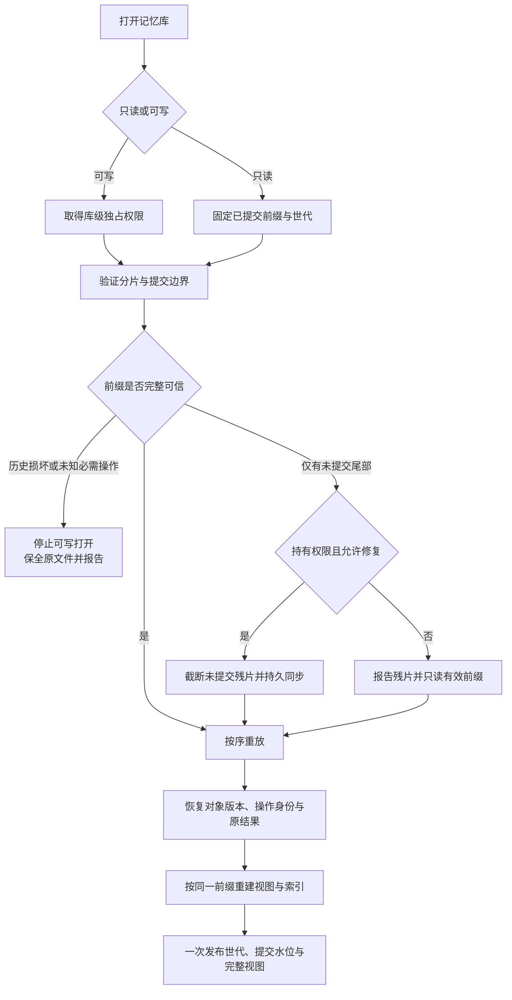
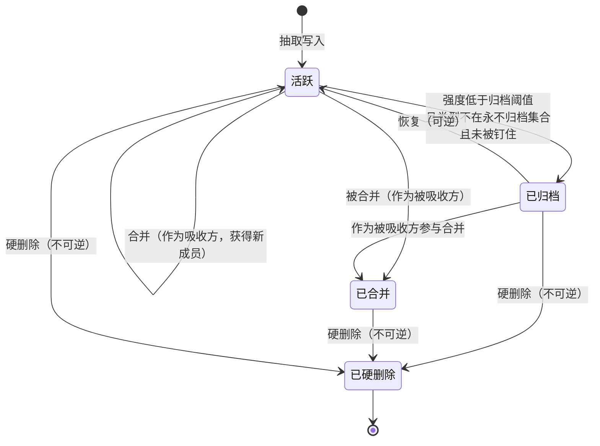

# 04 · 数据模型与事件溯源

> **本篇回答什么**：记忆库的**真相是什么形状**、由哪些字段构成、
> 一次写入如何保证不重不丢、崩溃之后如何自证清白、
> 以及为什么「重放出来的一定和日志里写的一样」是整套系统最不能让步的性质。
>
> **前置**：03（总体架构）。03 给出了分层与依赖方向，本篇展开其中最底下那一层：
> 数据面。03 里「一条日志、两个视图」这句话，本篇负责把它拆成字段、操作与不变量。
>
> **后置**：05 写链路会引用本篇的操作集与幂等键；06 召回链路会引用本篇的读模型；
> 07 巩固与遗忘会引用本篇的状态机；12 会引用本篇第 9 章的导出口径。

---

## 一、为什么是「只追加日志 + 派生读模型」

### 1.1 两种世界观

同一个需求——「记住这张卡现在的样子」——有两种完全不同的实现方式：

| | **一张会变的表** | **一串只追加的记录** |
|---|---|---|
| 真相是什么 | 表里那一行**当前的值** | 日志里**发生过的每一件事** |
| 更新怎么做 | 原地覆盖 | 追加一条新记录 |
| 历史在哪 | 需要历史表或审计记录 | 直接保留业务事件；隐私净化是受控例外 |
| 「改过什么」怎么答 | 查询审计记录 | 查询业务事件 |
| 「为什么现在是这个值」怎么答 | 取决于保留了哪些历史 | 沿已记录的业务事件回溯；未记录的原因仍无法推知 |
| 崩溃后怎么恢复 | 事务数据库依靠自身提交与恢复协议 | 事件日志也必须有提交与恢复协议，见第 6 章 |
| 两个视图不一致怎么办 | 在一致性边界内重建或校验 | 固定日志前缀后重新投影，并排查投影规则 |
| 索引坏了怎么办 | 从可信主数据重建 | 从可信日志重建；日志自身损坏不能靠重放治好 |
| 存储增长 | 与「当前有多少条」成正比 | 与「历史上发生过多少事」成正比 |
| 读取成本 | 一次查表 | 一次重放（或重放后的内存视图） |

### 1.2 同一件事，两种做法的代价

| 场景 | 一张会变的表的代价 | 只追加日志的代价 |
|---|---|---|
| **一张卡被修正了三次** | 当前表之外还要保留历史；同一数据库内可以用事务维持两者原子性 | 日志里三条修正记录，每条带原因与时刻。代价是重放时要按序应用三条，而不是读一行 |
| **一次写入写了一半就崩了** | 事务数据库按提交边界恢复；普通文件覆盖本身没有这项保证 | 同样需要持久提交边界；行分隔只能帮助识别尾部，不能替代原子性与持久性协议 |
| **检索索引与卡片对不上** | 不知道是索引错了还是卡片错了，两边都是「真相」，于是只能人工比对 | 索引是纯派生物，删掉重建。真相只有一份，不存在「谁对」的问题 |

### 1.3 一条日志、两个视图

```text
                    ┌──────────────────────────────┐
                    │   事件日志（唯一真相源）        │
                    │   只追加 · 有序 · 不可变        │
                    └───────────────┬──────────────┘
                                    │ 重放
                    ┌───────────────┴──────────────┐
                    ▼                              ▼
        ┌───────────────────────┐      ┌───────────────────────┐
        │  视图一：当前状态       │      │  视图二：检索索引       │
        │  卡片集合 + 图谱边集合   │      │  词项 → 卡片标识 的倒排  │
        │  可丢弃、可重建         │      │  可丢弃、可重建         │
        └───────────┬───────────┘      └───────────┬───────────┘
                    │                              │
                    └──────────────┬───────────────┘
                                   ▼
                          ┌─────────────────┐
                          │  行为面：召回     │
                          │  打分 / 闸门 / 装包│
                          └─────────────────┘
```

三条铁律：**已提交日志是真相源**（视图可丢弃，日志只能按受控隐私净化协议重写）；
**视图是纯派生物**（同一日志前缀与同一投影规则重放两次，逐字段相同，第 7 章）；
**派生关系单向**（视图不能反写日志，任何状态变化都先变成一条记录）。

### 1.4 代价与它的缓解

只追加日志的代价是**读取要先重放**。规模目标（C9）是 10 万级记忆卡，
全量重放耗时随规模线性增长。缓解分三层：

| 层次 | 做法 | 缓解的是什么 |
|---|---|---|
| **启动时** | 一次性全量重放，把视图建在内存里 | 之后的每次读取都不碰磁盘 |
| **运行中** | 每次追加后增量应用到内存视图 | 不必为一条新记录重放全库 |
| **离线时** | 允许丢弃索引、只重建索引 | 索引腐烂时不必动真相源 |

> 容易搞反的地方：**「重放很慢」不是拒绝事件溯源的理由。**
> 也不能反过来把事件溯源当作可靠性的证明。事务数据库同样可以可靠地保留历史；
> 选择事件溯源，是为了让业务事件与派生视图的关系显式，而不是获得免费的原子性。

### 1.5 本篇的四个不变量

| # | 不变量 | 保证它的机制 | 在哪一章 |
|---|---|---|---|
| **I1** | 同一操作的重试不重复生效，新操作不被旧键吞掉 | 稳定操作标识、负载指纹、重放恢复去重表 | 第 5 章 |
| **I2** | 已确认操作必在可恢复的已提交前缀中；复合动作不部分可见 | 独占写者、完整性校验、持久提交后确认 | 第 6 章 |
| **I3** | 同一日志前缀、投影规则与版本产生逐字段相同的状态 | 显式版本、纯投影、稳定排序 | 第 7 章 |
| **I4** | 每个视图都能从其声明的日志世代与提交前缀重建 | 前缀快照、版本化投影、受检检查点 | 第 9 章 |

---

## 二、记忆卡的完整字段表

一张记忆卡是一条可独立召回的语义片段。下表列出既有的 22 项业务字段，分六组：
**身份、内容、溯源、强度、生命周期、时间**。它不是完整持久协议：推荐方案还须保存对象修订、独立强度结算时刻、受理操作身份与协议版本等元数据，见 2.4。

「谁写」一列指的是**哪一类角色**（抽取面 / 巩固面 / 行为面 / 人工），
不指具体模块——按本系列的禁则，不出现模块名。

| # | 字段（中文） | 类型语义 | 取值范围 | 谁写 | 谁读 | 可变 |
|---|---|---|---|---|---|---|
| 1 | **标识** | 稳定字符串，由「域 + 来源 + 类型 + 归一化文本」派生 | 非空 | 抽取面 / 巩固面 | 全部 | 否 |
| 2 | **原文** | 摘要文本，中文为主；进入上下文的就是这一段 | 非空，渲染时按单卡字符上限截断 | 抽取面 / 巩固面 / 人工 | 行为面、渲染 | **是**（经修正） |
| 3 | **归一化文本** | 原文经小写化、标点归一、全半角归一后的结果，**只用于去重与相似度** | 非空 | 抽取面 / 巩固面 | 去重、倒排索引 | **是**（随原文） |
| 4 | **类型** | 记忆类型枚举：事件 / 概念 / 感受 / 承诺 / 经验 / 摘要 | 上述六值，**允许未知但合法的字符串透传** | 抽取面 / 巩固面 | 打分、归档策略、渲染 | **是**（经修正） |
| 5 | **域** | 记忆域：生活 / 学习 / 工作 | 上述三值，同样允许透传 | 抽取面 | 召回过滤、渲染 | **是** |
| 6 | **实体** | 实体锚点集合（人名、项目、文件名、术语），跨层次关联的连接点 | 字符串数组，可为空 | 抽取面 / 摘要 | 打分、图谱连边 | **是** |
| 7 | **标签** | 规则检索与图谱连边用的短标签 | 字符串数组，可为空 | 抽取面 / 摘要 | 打分、检索 | **是** |
| 8 | **显著性** | 写入时评估的「这条信息量有多大」 | 0～1 | 抽取面 | 重要性分 | 否 |
| 9 | **情绪强度** | 写入时评估的「这条有多强的情绪色彩」 | 0～1 | 抽取面 | 重要性分、有效半衰期 | 否 |
| 10 | **置信度** | 写入时评估的「这条有多可信」 | 0～1 | 抽取面 / 摘要 | 置信度分 | 否 |
| 11 | **强度** | 当前生命力，遗忘曲线的主体，每夜衰减 | 0～1 | 巩固面 / 行为面 | 归档判据、重要性分 | **是** |
| 12 | **访问计数** | 被真正使用的次数 | 非负整数 | 行为面 | 重要性分 | **是** |
| 13 | **创建时刻** | 事件发生时刻 | 毫秒时间戳 | 抽取面 | 新鲜度分、日摘要分桶 | 否 |
| 14 | **更新时刻** | 最后一次**内容**变更时刻 | 毫秒时间戳 | 全部写者 | 新鲜度分、幂等键 | **是** |
| 15 | **冲突列表** | 与本卡冲突的其他卡的标识 | 标识数组，可为空 | 行为面（冲突回写） | 冲突惩罚、渲染 | **是** |
| 16 | **状态** | 生命周期状态：活跃 / 已归档 | 两值 | 巩固面 / 人工 | 召回、归档策略 | **是** |
| 17 | **合并指向** | 被合并进哪张卡（本卡作废但保留溯源） | 标识或空 | 巩固面 | 溯源查询、存活卡过滤 | **是**（单向写入） |
| 18 | **来源指针** | 指回原始会话事件，四元组：会话标识 / 轮次 / 步骤 / 事件序号 | 四元组，序号是权威定位依据 | 抽取面 | 溯源、审计 | 否 |
| 19 | **到期信息与重复模式** | 到期时刻 + 重复方式（一次性 / 每日 / 每周 / 定时表达式）+ 定时表达式原文 | 时刻或空；重复方式四值 | 抽取面 / 提醒面 | 到期提醒 | **是** |
| 20 | **钉住标记** | 钉住的卡永不自动归档 | 布尔 | 人工 / 巩固面 | 归档策略 | **是** |
| 21 | **修正历史** | 每次修正保留：时刻、原因、被替换的旧文本、发起者 | 数组，按时间升序，最新在末尾 | 修正路径 | 审计、渲染「改过什么」 | **只追加** |
| 22 | **当前修订的来源列表** | 当前摘要或合并产物实际依据的精确来源集合 | 来源标识与对应修订的集合，可为空 | 巩固面 | 溯源、层级摘要、删除依赖 | **是**（整版替换；旧版本入历史） |

### 2.1 三组字段的语义差别

最后一列有三种值，区别是设计上的，不是实现上的：

| 可变性 | 含义 | 例子 | 为什么 |
|---|---|---|---|
| **否** | 写入后永不改变。要变只能新建一张卡 | 标识、显著性、情绪强度、置信度、来源指针 | 它们是**写入那一刻的观察**。事后修改等于篡改历史 |
| **是** | 可以原地更新，每次更新追加一条日志 | 强度、访问计数、状态、冲突列表 | 它们是**当前状态**，本来就该随时间变 |
| **只追加** | 正常运行只能新增历史项，隐私净化是受控例外 | 修正历史、各版来源快照 | 历史不能被当前修订覆盖；但当前修订的依据集合可以整版替换 |

> 判断一个字段属于哪一类的问法：**「这个值如果变了，是这件事变了，还是我对这件事的看法变了？」**
> 前者是「是」，后者是「否」，而「我改过几次看法」是「只追加」。

### 2.2 三个字段的特别说明

**来源指针为什么是四元组。** 序号是**会话内**的，跨会话就重了，所以必须有会话标识；
轮次与步骤是给人读的（审计时要能在会话里找到那句话，只给序号等于让人去数第 1387 行）。
权威定位键是**会话标识与事件序号的组合**；轮次与步骤帮助人类导航，单独的事件序号不能跨会话定位。已知局限：同一轮里产出的多张卡事件序号完全相同
（序号是事件级的，不是句子级的）——这不是缺陷，是定位粒度的事实，测试里被显式断言。

**到期信息为什么必须和重复模式一起落盘。** 提醒响过之后，系统手上只有这张卡，
没有原始语境，算不出「下一次是什么时候」。只存到期时刻的话，「每日提醒」
在响过一次之后就与「一次性提醒」完全无法区分。定时表达式要存**原文**而不是解析结果：
原文是人能核对的（用户看到「每周一至周五九点」能立刻判断对不对），
并同时固定时区与解析规则版本。升级解析器不能静默重解释旧承诺；确需变更时，以一次可审计的修正迁移旧规则。否则同一条「九点提醒」会因环境或版本变化而改变语义。

**当前来源与历史来源必须分开。** 摘要与合并都可以复用「本修订由哪些来源派生」的关系，但每版保存精确来源集合及来源修订，重算时整版替换当前集合；旧集合随旧修订保留。只追加所有历史来源的并集会把已撤销的材料继续说成当前依据。每版还需记录生成策略与覆盖水位，隐私净化按 8.5 清理受影响的历史材料。

### 2.3 一张卡的体积

标识固定长度、原文数十至数百字符、归一化文本与原文同量级（不进上下文只进索引）、
标签与实体数个短串、修正历史随修正次数增长、其余标量固定。这条估算的用途不是容量规划，
而是回答一个具体问题：**10 万张卡的读模型能不能全放内存。** 按上述量级估算答案是能；
如果不能，整套「读路径只查内存」的设计就要重做（见第 10 章诚实边界）。

### 2.4 推荐的持久协议元数据

| 元数据 | 用途与边界 |
|---|---|
| 对象修订 | 每次已提交的对象变更递增，承载预期版本核对；不以毫秒时刻代替 |
| 强度结算时刻 | 指明强度已经结算到何时，独立于内容更新时刻；衰减、访问和恢复按同一明确时刻顺序结算 |
| 当前依赖依据 | 来源标识及修订、生成策略版本、输入覆盖水位；支持重算、失效与隐私闭包 |
| 受理绑定与操作结果 | 稳定来源身份、首次规则版本、操作身份、同提交结果或重建依据；按 5.9 与 05 第 6 章处理重试 |
| 日志世代与协议版本 | 区分正常追加与净化替换，恢复时只解释已声明的合法世代与规则 |

这些元数据是本轮推荐协议，未由既有 22 项业务字段自动提供；不能用「字段已存在」宣称并发核对与独立衰减已经实现。

---

## 三、图谱边的字段表

下表是既有边的六项基础业务字段，不是新协议的完整边记录。推荐方案还须保存构建依据与来源修订，不能靠端点仍存活就证明旧边仍然正确。

| # | 字段（中文） | 类型语义 | 取值范围 | 谁写 | 谁读 | 可变 |
|---|---|---|---|---|---|---|
| 1 | **标识** | 由「起点 + 终点 + 关系类型」派生 | 非空 | 巩固面 | 去重、剪枝 | 否 |
| 2 | **起点** | 起点卡的标识 | 存在的卡标识 | 巩固面 | 扩散 | 否 |
| 3 | **终点** | 终点卡的标识 | 存在的卡标识 | 巩固面 | 扩散 | 否 |
| 4 | **关系类型** | 边的语义（见 3.2） | 七个值，其中四个有产出点 | 巩固面 | 扩散、溯源 | 否 |
| 5 | **权重** | 边的强度，参与扩散打分 | 0～1，量化到 0.01 格点 | 巩固面 | 扩散 | **是** |
| 6 | **创建时刻** | 建立时刻 | 毫秒时间戳 | 巩固面 | 审计 | 否 |

标识由三个字段派生，是为了让「同一对节点、同一关系类型只有一条边」成为**结构性**保证：
相同端点与关系映射到同一个槽位，但这只保证边的身份唯一，不保证重复操作不生效。权重改变必须形成新操作；相同操作的重试才应去重。双向关系先将端点按固定顺序规范化，避免「甲—乙」与「乙—甲」各存一条。分配操作顺序与更新槽位仍须经过独占写者，不能靠确定标识代替并发控制。

**推荐的关系依据**：每条派生边保存关系种类、两端被读取的对象修订、直接来源集合及其修订、构建策略版本与构建水位。读取时先核对授权和存活资格，再核对这些依据是否与本次卡片快照兼容；修订不符且没有显式兼容规则的边立即失效，不参与传播或溯源解释，并排队重建。

例如一张卡从「项目甲」修正为「项目乙」，它仍然活跃也仍有权被读，但旧实体边已可能为假。端点资格校验只能防止无权或退役节点，不能防止关系语义陈旧。话题、实体等内容派生边按当前依据重建；取代、蒸馏等溯源关系按所记录的历史修订解释，不能套用当前正文冒充当时的依据。

### 3.1 七个关系类型：四个在产出，三个是预留

| 关系类型 | 方向 | 状态 | 产出点 | 说明 |
|---|---|---|---|---|
| **话题** | 双向 | **在产出** | 夜整理连边 | 文本高度相似但非重复。相似度低于下限不连，每张卡按最近邻封顶 |
| **实体** | 双向 | **在产出** | 夜整理连边 | 共享实体锚点（同一个人、同一个项目） |
| **取代** | 旧 → 新 | **在产出** | 合并路径 | 修正后的关联：新卡取代旧卡 |
| **蒸馏** | 提炼物 → 来源 | **在产出** | 蒸馏路径 | 从事件里提炼出感受，方向是「感受卡 → 来源事件卡」 |
| **因果** | — | **预留，无产出点** | 无 | 语义判断，规则做不出来 |
| **组成** | — | **预留，无产出点** | 无 | 同上 |
| **对比** | — | **预留，无产出点** | 无 | **不是「没做」，是用别的方式做了**：冲突检测走打分里的冲突惩罚，结论落在卡片分数上而不是边上 |

### 3.2 为什么预留的三种不删掉，也明确不实现

**为什么不删掉枚举值。** 日志是只追加的。删掉一个枚举值不等于删掉死代码，
而是让**已经写在日志里的边**在重放时无处安放。两种处置都糟：

| 处置方式 | 后果 | 为什么糟 |
|---|---|---|
| 反序列化时**拒绝**未知关系 | 整个日志打不开 | 一条边读不出来，全部记忆陪葬 |
| 反序列化时**透传**未知关系 | 内存里出现一个类型系统不认识的值 | 类型开始撒谎：分支判断静默走默认、穷尽性检查失效 |

两难的正解是**保留枚举值**：合法的未知值必须在类型里有位置，这才叫前向兼容。
而「透传导致类型撒谎」这个后果会诱使人改成「拒绝」——那是把第二种后果换成第一种，
**更糟**。这条陷阱值得单独标出来。

**为什么明确不实现。** 三个关系都是语义判断（因果 / 组成 / 结论相反），规则做不出来。
用关键词硬凑会产出**假边**，而图谱是用来溯源的：

> **假边比没有边更糟。** 没有边时你知道「这里没有信息」；
> 假边会让你把溯源指向错的地方，而且无从发现。

「对比」额外说明：它**不是没做，是用别的方式做了**。冲突检测走打分里的冲突惩罚，
结论落在卡片分数上而不是边上。再实现一个「对比边」等于把同一个判断做成两份真相源。

### 3.3 为什么「取代」与「蒸馏」方向相反

```text
  取代：  旧卡 ──────► 新卡        （时间方向：新的取代旧的）
  蒸馏：  感受卡 ────► 来源事件卡    （抽象方向：提炼物指向材料）
```

这是本系统选定的方向约定，并非数学必然：带关系类型的边即使同向也能区分含义。真正的约束是写入、遍历与渲染采用同一约定；未知关系保留但不参加无法解释的遍历。

---

## 四、事件日志的操作集

### 4.1 十一种语义动作，八种日志操作

下表保留已有内容键方案的结构，以解释历史缺口；其中「时刻 + 内容」不能作为最终去重身份。推荐契约统一由 5.9 的稳定操作标识提供，表中字段进入负载指纹。第 6 章新增的提交协议同属设计要求，不能据此宣称已实现。

**语义上有十一种「要做的事」，日志里只有八种「记录的形状」**——因为一些语义动作共享形状：

| # | 语义动作 | 对应的日志操作 | 语义 | 幂等键由哪些字段构成 | 重复提交时的行为 |
|---|---|---|---|---|---|
| 1 | **写入卡** | 写入（新增） | 一张新卡进入记忆库 | 操作名 + 标识 + 更新时刻 + 原文 + 冲突列表 + 强度 + 状态 + 访问计数 + 到期时刻 + 重复方式 + 定时表达式 | 键相同则**整条丢弃**，不报错；键不同则作为新记录追加，重放时后者覆盖前者 |
| 2 | **更新卡** | 写入（覆盖） | 同一张卡的字段发生变化 | 同上（同一形状，因为写入本身就是「有则覆盖、无则新增」） | 同上。**这一行是第 5 章的全部问题所在** |
| 3 | **访问** | 访问 | 记一次「这张卡被真正用上了」：访问计数 +1、刷新最后访问时刻、更新强度 | 操作名 + 标识 + 时刻 | 同一时刻重复提交丢弃；不同时刻各记一次 |
| 4 | **修正** | 修正 | 改原文，同时把旧文本存进修正历史 | 操作名 + 标识 + 新原文 + 时刻 | 同刻同文丢弃；同刻不同文视为两次不同修正 |
| 5 | **归档** | 归档 | 移出活跃集，**可逆** | 操作名 + 标识 + 时刻 | 同刻丢弃。不同时刻的重复归档是无害的（状态已是归档） |
| 6 | **恢复** | 恢复 | 从归档回到活跃 | 操作名 + 标识 + 时刻 | 同上 |
| 7 | **合并** | 合并 | 多张卡并入一张；被合并的卡保留指向新卡的溯源，并自动生成「取代」边 | 操作名 + 目标标识 + 被合并标识列表（按序）+ 时刻 | 同刻同目标同成员丢弃；成员列表不同视为不同合并 |
| 8 | **硬删除** | 硬删除 | 不可逆的物理移除；指向它的边与引用一并清理 | 操作名 + 标识 + 时刻 | 同刻丢弃。**它是不可逆的，所以幂等在这里不是优化而是安全网** |
| 9 | **写边** | 写边 | 建立或更新一条图谱边 | 操作名 + 边标识 + **边权** | 同标识同权重丢弃；**同标识不同权重必须落新记录**（见 5.4） |
| 10 | **写摘要** | 写入（类型=摘要） | 日 / 周 / 月三级摘要落卡，来源列表记下它压了哪些卡 | 与「写入卡」同形 | 同形同行为。摘要标识由「域 + 合成来源 + 类型 + 归一化文本」派生，所以同一天同一批来源重算会得到同一张卡 |
| 11 | **蒸馏** | 写入（类型=感受）+ 写边（蒸馏） | 从多张反复出现同一情绪的卡里提炼一张感受卡，并用「蒸馏」边指向来源 | 两个操作各自的键 | 两个操作各自幂等。**任一重复都不会产出第二张感受卡或第二条边** |

### 4.2 三个设计要点

**要点一：写入是「有则覆盖、无则新增」，所以「写入卡」与「更新卡」共享同一种形状。**
这是整套操作集里唯一一处**语义合并**，也是第 5 章所有麻烦的源头。
它带来一个非常自然的错觉：「既然是同一种记录，那幂等键当然也一样」。这句话是错的。

**要点二：事件时刻属于负载，不等于操作身份。**
同一毫秒可以发生两个真实动作；同一个动作重试也可能跨越多个毫秒。重试必须携带首次分配的操作标识与原始事件时刻，不能在重试时重新取时钟。

**要点三：未知操作与未知展示标签分开处理。**
未知类型标签可以原样保存；未知的状态变更操作不能跳过后继续写库，因为后续操作可能依赖它。遇到不支持的日志协议或必需操作时，保留原始记录并停止可写打开；允许查看已解释前缀，但必须明确标成不完整视图，不能宣称全库一致。

### 4.3 一条操作可能改动多张卡

上表的「语义」一列都是**单条记录**的效果。重放时，一条记录可以改动多张卡：
硬删除必须清理三类引用（冲突列表、合并列表、合并指向），否则留下悬空指针；
合并会给每条被吸收的卡补一个合并指向，并生成一条「取代」边。

这在只追加日志里完全合法——**日志里仍然只有一条记录**，
「波及多张卡」发生在纯投影里，但必须以一个提交单位发布。合并的目标更新、来源退役与关联边，蒸馏的结果卡与来源边，都不能因为「每条分别幂等」就被认为具备整体原子性。推荐将一个有界业务动作封装为一条复合事件；超出单事件上限时拒绝该动作并报告，不能静默拆成可部分成功的多条提交。

---

## 五、幂等键设计

这是本篇最有价值的一章。前面四章都可以从别处推出来，这一章不行。

### 5.1 内容键机制的一类失败模式

日志只追加，所以「同一条记录写两次」在物理上完全合法——它会变成两条记录。
而很多操作重复执行是**语义错误**的：同一张卡被记两次访问，访问计数就多了 1。
幂等键的机制很朴素：每条记录附带一个键，键相同则视为同一件事的重复提交，直接丢弃。

这个机制的一类失败方式，是不同的合法更新碰巧共用一个键：

> **键算得太窄 → 本该是新记录的东西被判成重复 → 静默丢弃。**
> 不报错、不崩溃、不告警。写调用返回「没写」，读回来还是旧值。

为什么它比「抛异常」危险得多：异常会有人来修，静默丢弃不会。系统的行为是**自洽的**——
日志没多、视图没变、幂等键唯一、测试全绿。唯一不对的是：
**用户的修改没生效，而所有人都以为它生效了。**

### 5.2 内容覆盖是必要检查，但不是充分条件

这是本章唯一需要记住的一句话，展开成三个问句：① 这个操作会不会在**同一个标识**下被再次提交？
② 如果会，两次提交之间**可能有哪些字段不同**？③ 那些字段，**每一个**都在键里吗？
第三个问句要求的是**穷尽**，不是「主要的那几个」。

即使覆盖所有字段，仍有反例：同一张卡先写状态甲，再写状态乙，再合法地改回甲。若全局按内容键去重，第三次会命中第一次的键而被吞掉。以下逐字段案例解决的是「变化字段漏入键」，没有解决操作身份；完整方案见 5.9。

### 5.3 例子一：边权更新被丢

**现象。** 一条边已存在，权重 0.30。现在要改成 0.40。写入返回「未追加」，读回还是 0.30。

**根因。** 边的幂等键只由「操作名 + 边标识」构成，**不含权重**。同一条边改权重，
键与上次完全相同，于是被判成重复提交。

**为什么当时是对的。** 当时只有一个产出点会写边，而它只**新建**边、从不修改已存在的边
（新建前先按标识过滤掉已知的边）。在那个调用模式下，「同一条边只可能被写一次」是事实，
所以键不含权重**永远正确**。

**什么时候失效的。** 当可塑性需要「同一条边随使用增强」时，前提就没了。
第一次真正需要改边权的那天，这个键开始静默丢数据。

**修法。** 把权重纳入键。修完两种行为都正确：新建边仍然幂等（同标识同权重的重复整理
被丢弃），改权重是不同的键，作为新记录追加，重放时后者覆盖前者。

### 5.4 例子二：卡的强度与状态变更被丢

**现象。** 一张卡的强度从 0.60 被衰减到 0.58，写入返回「未追加」，读回还是 0.60。
状态变更、访问计数同理，全部静默丢弃。

**根因。** 卡的幂等键由「操作名 + 标识 + 更新时刻 + 原文 + 冲突列表」构成，
**不含强度、不含状态、不含访问计数**。

**为什么当时是对的（这才是最值得记的部分）。** 每一个真实的改动路径，
都**恰好顺带**更新了「更新时刻」：

| 改动 | 顺带改了什么 | 结果 |
|---|---|---|
| 衰减改强度 | 顺手把更新时刻置为当前 | 键碰巧变了，写入碰巧成功 |
| 归档改状态 | 顺手把更新时刻置为当前 | 同上 |
| 访问改计数 | 时刻字段本身就在变 | 同上 |

于是缺陷**从来没有被走到过**。这不是设计正确，这是**靠巧合安全**。

> **「靠巧合安全」与「靠规则安全」的区别，是这一章最想留下的东西。**
> 前者是「目前所有路径恰好都没踩到」，后者是「没有任何路径能踩到」。
> 前者在测试里表现为全绿，在线上表现为「一直没事」，
> 直到某天有人加了一条只改这一个字段的路径。

### 5.5 为什么长期没被发现

| 原因 | 表现 |
|---|---|
| **调用模式恰好不触发** | 边只新建不改权重；卡的每次改动都顺带改了更新时刻 |
| **注释比实现诚实** | 键的注释明确写着「防止冲突标记回写、强度调整、状态变更被丢弃」，而实现只覆盖了其中一件半。**读注释的人会以为已经修好了，于是没人去看实现** |
| **测试只测了一个方向** | 有「同内容写两次只有一条」的用例，没有「同标识不同内容写两次，读到的是新的」的用例。前者绿，后者根本不存在 |

第三条尤其值得展开。幂等这类逻辑有**两个方向**，只测一个等于没测：

| 方向 | 断言 | 漏掉会怎样 |
|---|---|---|
| 该丢弃的丢弃 | 同内容写两次，库里只有一条 | 重复数据堆积（看得见） |
| **该更新的更新** | **同标识不同内容写两次，读到的是新的** | **更新被静默丢弃**（看不见） |

而且第二个方向**必须从磁盘重放验证**：幂等键影响的是「日志里有没有这条记录」，
只看内存视图可能看不出差别——内存视图可能被另一条路径顺手改了。

### 5.6 判据不是「现在有没有出问题」，而是「有没有一条路径能只改这个字段」

这句话把「靠巧合安全」变成了一个**可执行的检查**：把某个字段单独改掉、
其它字段一律不动，会发生什么？

- 这条路径存在、且键里没有这个字段 → **缺陷还在**，只是还没被走到。
- 这条路径不存在 → 也只是「现在不存在」。下一个需求可能就把它造出来。

所以正确的写法不是「按当前调用模式拼键」，而是「按字段的**可变性分类**拼键」：

| 字段类别 | 要不要进键 | 理由 |
|---|---|---|
| 标识类 | 要 | 不同标识是不同的事 |
| 不可变字段 | 不必，但无害 | 它们不会单独变 |
| **可变字段** | **全部要** | 它们**可能单独变**，这正是缺陷的来源 |
| 只追加字段 | 不必 | 追加本身就是新记录 |

按这张表检查，「更新时刻」属于可变字段，进了键；「强度」「状态」「访问计数」
同样属于可变字段，**也必须进键**——它们当时被漏掉，不是因为判断错，
而是因为**没有做这个分类，只按「看起来重要的字段」挑了几个**。

### 5.7 同一个形状的第三次重演

这个缺陷后来以完全相同的结构又出现了一次。第三次是到期时刻：推进「下一次到期」时
只改到期时刻，其它字段全不变 ⇒ 键相同 ⇒ 判重复 ⇒ 静默丢弃 ⇒ 每日提醒永远停在第 N 天。

| 次数 | 分支 | 键里漏了什么 | 后果 |
|---|---|---|---|
| 一 | 写边 | 边权 | 改权重被丢 |
| 二 | 写入 | 强度 / 状态 / 访问计数 | 改强度、改状态被丢 |
| 三 | 写入 | 到期时刻 / 重复方式 / 定时表达式 | 推进提醒被丢 |

> 两条推论：**一、修一个幂等键缺陷时，把同一个操作集里所有分支都看一遍。**
> 同一个人用同一种思路写下的多个分支，错法往往一样。
> **二、注释声称的行为，必须有一条测试真的去验它。**
> 否则注释会持续替实现撒谎，而且比沉默更能阻止别人发现问题。

### 5.8 既有内容键的覆盖表

最后一列是**审计问题**：有没有一条反向测试守着它——没有的那几行就是下一轮要补的地方。

| 操作种类 | 键必须包含的字段 | 漏掉会怎样 | 有没有反向测试守着 |
|---|---|---|---|
| **写入（新增）** | 操作名、标识、更新时刻、原文、冲突列表、强度、状态、访问计数、到期时刻、重复方式、定时表达式 | 新增变体的任何一处差异被丢弃（见 5.4） | **有**（逐字段变异验证，含只改单个字段的用例） |
| **写入（更新）** | 同上 | 更新被静默丢弃，读回旧值 | **有**（同上，且必须从磁盘重放验证） |
| **访问** | 操作名、标识、时刻 | 同一时刻的两次访问被合并成一次（这是**期望行为**） | 部分：只测了「同刻丢弃」，未测「异刻各记一次」的边界 |
| **修正** | 操作名、标识、新原文、时刻 | 同刻不同文的两次修正被合并（罕见但合法） | 部分 |
| **归档** | 操作名、标识、时刻 | 不同时刻的重复归档被丢弃（无害） | 未单独验证（风险低） |
| **恢复** | 操作名、标识、时刻 | 同上 | 未单独验证（风险低） |
| **合并** | 操作名、目标标识、成员列表（按序）、时刻 | 同刻不同成员的合并被丢弃 | 未单独验证 |
| **硬删除** | 操作名、标识、时刻 | 不同时刻的重复硬删除被丢弃（无害） | 未单独验证（风险低） |
| **写边** | 操作名、边标识、**边权** | **改边权被静默丢弃**（5.3） | **有**（含纯函数级「只改权重时键必须变」） |
| **写摘要** | 与「写入」同形 | 同日摘要重算被判重复（这是**期望行为**） | 有（隐含在摘要幂等用例里） |
| **蒸馏** | 写入键 + 边键，各自独立 | 重复蒸馏产出第二张感受卡 | 有（蒸馏幂等用例） |

表里标「部分 / 未单独验证」的地方是诚实的：它们目前靠「调用模式不会触发」安全，
和 5.5 批评的形态是同一个。**它们不是已知缺陷，但是已知的未覆盖区。**

> 一句话总结：**一个幂等键正确与否，取决于「将来谁会用它写什么」，不取决于键本身。**
> 写幂等键、写去重、写缓存键时都要问一遍：「有没有人会拿同一个标识写不同内容？」
> 有，键就必须覆盖那个「不同」。

### 5.9 推荐契约：操作身份、负载指纹和对象版本分工

三种身份分别回答三个问题，不能用一把内容哈希包办：

| 量 | 回答的问题 | 规则 |
|---|---|---|
| 卡或边标识 | 改的是哪个对象？ | 创建后稳定；修正文本不重算对象标识 |
| 操作标识 | 是新动作，还是同一动作的重试？ | 在第一次提交前分配并持久保留；重试原样复用 |
| 负载指纹 | 同一操作是否被偷偷改了内容？ | 覆盖完整规范化负载、目标标识、协议版本与预期对象版本 |

写者串行执行前先验证可信请求主体及当前授权；操作身份的命名空间绑定库、归属和可信主体，不能由调用方任意跨归属复用。未见过操作标识则校验前置版本并提交；已见且指纹相同则在当前权限允许时返回原提交结果，不再追加；已见但指纹不同则拒绝为冲突，不能把它当成功重试。新提交、重复提交和冲突查询的所有分支都先做当前鉴权，不能凭持有操作标识获得原结果。规范化序列必须无歧义地保留字段边界、缺失值和数组的语义顺序；集合字段先稳定排序。

**推导反例与修复**：负载依次为甲、乙、甲，三个不同操作标识应产生三次提交，最终为甲；把其中任一操作原样重试，提交数仍为三。两个同毫秒的真实访问若操作标识不同，应累计两次；同一次访问在下一毫秒重试，仍只累计一次。这四条比「重复写入卡数不变」更有区分力。

内容指纹可以用摘要压缩，但固定长度摘要存在碰撞可能。保留规范化负载或可核对的原记录；同标识不同负载必须报冲突，不能以「哈希相等」证明数学上的绝对相等。

**防止过期覆盖**：一个基于对象版本五计算的更新，不能在版本六之后覆盖整张卡。写者只接受其声明的预期版本仍然匹配的更新；冲突后按新状态重算。通过当前鉴权后，去重判断先于对象版本校验，因此已经提交成功的重试不因对象后来升级而误报版本冲突。跨多张卡的复合事件须在同一串行边界内核对全部前置版本。

操作原结果须与业务效果在同一提交中持久化，或在该提交中保留足以按固定规则确定性重建原结果的完整依据；不能确认成功后才补记回执。隐私净化清除受影响操作原结果、负载指纹和重建依据中的敏感内容，仅保留不含原文或负载摘要的最小拒绝重放标记。后续对此操作身份的重试统一返回「已净化，不允许重放」，不再比较旧负载、不返回旧结果，也不重新执行业务效果。当前权限校验仍先执行。

去重表由已提交日志恢复，不能随重启清空。若未来要裁剪历史，检查点必须保存仍可重试的操作标识及结果，或明确引入重试期限与过期拒绝规则；静默忘记旧键会把旧重试变成新操作。普通运行世代选用保留合法日志与去重表的简单方案，检查点仅加速恢复，不改变正常重试语义。隐私净化是显式例外：受影响操作转为上述拒绝重放标记，不能一边承诺擦除敏感内容，一边承诺永远重现原始结果。

---

## 六、崩溃恢复与原子性

### 6.1 单行是编码边界，提交才是可靠性边界

一条记录占一行便于定位尾部，但「一次写完」「关闭文件」本身都不能证明掉电后的持久性。推荐以独占写者串行执行以下提交协议；这是设计要求，不是本轮实现验证的结果：

```text
取得库级独占写权限
       ↓
核对日志世代、提交水位、操作身份与预期对象版本
       ↓
形成一条复合记录：序号、操作身份、版本、完整负载、原结果或其确定重建依据、长度与校验值
       ↓
完整追加，检查实际写入量，完成底层持久同步
       ↓
推进持久提交水位；新建或切换分片还要持久发布对应元数据
       ↓
原子发布当前视图与索引的新水位
       ↓
确认成功；重试结果已在对应提交内持久保留
```

底层须明确承诺同步与元数据发布的故障语义；若运行环境不能提供可证明的边界，就采用已提供事务与恢复能力的存储设施，不能把文件关闭当作替代证明。一次业务动作若只包含一张卡，仍走同一协议。

设已向外确认的操作集合为 A，恢复后已提交操作集合为 C，则要求 **A ⊆ C**，并且每个操作最多生效一次。不要求两者相等：持久提交后、确认送达前崩溃，允许出现「已提交但调用方不知道」。调用方凭原操作标识查询或重试消除歧义，不能凭超时断言没写入。

### 6.2 分片滚动与世代

日志按字节上限滚动；序号只对已提交业务记录连续分配，重试不占新序号。分片按数值编号读取，必须检查缺片、重复编号和世代，而不是用文件个数推算末片。

新分片必须先完成持久发布再接受确认；旧分片封存后不再追加。一个单事件已超过上限时明确拒绝，不让分片滚动陷入循环。隐私净化会产生新的日志世代；正常滚动不改变世代。

### 6.3 尾部残片修复：不能把中段损坏当作尾巴

| 情况 | 处理 |
|---|---|
| 末片末尾存在可证明未提交的残片 | 只读打开只报告；取得独占权限后，修复模式可以截断至已验证提交边界 |
| 中段校验失败、序号缺口、缺少封存分片 | 停止可写打开并保全原文件，进入恢复流程；不能跳过后继续重放 |
| 一行语法可解析，但长度、校验值、版本或提交边界不合法 | 不算有效记录；按所在位置与提交证据分类，不能只靠语法解析判定完整 |
| 已确认前缀出现损坏 | 不能通过截断宣称无损恢复，应从可信备份恢复并报告确认数据风险 |

修复是一次写操作，必须与插件写入、离线命令、净化和恢复互斥。只读模式不修复任何文件。校验值用于发现意外损坏，不提供对恶意改写者的防伪能力。

### 6.4 并发：独占写者是前提，水位比对是诊断

两个写者可以同时读到相同水位，再同时写入；所以检查水位无法把「检查后追加」变成原子动作。窗口是否「极窄」没有证明，也不能用于可靠性承诺。

推荐一库一个写者，库级独占权限覆盖打开与恢复、序号分配、幂等核对、追加与同步、滚动、修复和世代切换。进程内的异步任务也进入同一串行队列。拿不到权限就拒绝可写打开，离线命令可使用只读前缀快照。若必须运行多进程写入，则统一转交给同一个写服务；不让多个进程各持内存视图直接追加。

磁盘水位与内存水位比对仍有诊断价值：发现不遵守协议的外部修改就停止写入。只检查末片的适用前提是旧片封存且没人绕过权限修改；它检测不了等长改写或历史片损坏。原有末片比对开销观测约为一次落盘的 4%～6%，逐片比对超过 40%；该观测只描述那组输入，不能证明互斥性、检测完备性或所有规模的性能。

独占机制须按目标平台明确进程崩溃后的释放规则；不能仅凭超时删除锁文件并允许另一个写者进入。跨机器或共享文件系统不在本轮承诺内。

### 6.5 恢复与发布顺序



视图与索引必须标记同一世代和提交水位。一轮读取固定该快照，不能用新视图搭配旧索引。日志已提交但视图更新失败时，停止该写者的正常服务并从日志重建；不能先报失败、随后用新的操作标识再写一遍。

### 6.6 强杀测试能证明什么

原有探针在所用环境与输入中未观察到残片，记录长度取模始终为零；这只能说明**该次观测没有命中部分写入**，不能推出「主流平台强杀不会撕裂写入」，更不能外推为断电、磁盘耗尽或设备故障下的保证。

验收需要分别覆盖：已提交未确认、追加中断、同步失败、分片切换中断、视图发布失败，以及手工构造的尾部残片和中段损坏。每次先证明故障点确实被触发，再检查已确认集合包含关系、操作只生效一次、跨对象不部分可见。未运行的故障场景在第 10 章保持待验。

---

## 七、重放与确定性

### 7.1 读模型是纯派生物，这句话的含义比听起来强

「纯派生物」不只是「可以从日志重建」，它要求更强的一条：

> **固定日志世代、已提交前缀、投影规则版本及规范化约定后，无论何时重放，读模型必须逐字段相同。**
> 跨版本迁移要有显式转换规则，不能宣称任意新旧版本自动得到相同视图。

这是 ST-1 的必要基础，但并非充分条件；比较召回还须固定查询、查询时刻、配置、分词版本和排序规则。如果重放不确定，
那么「同样的查询给同样的结果」就不可能成立——因为查询读的是读模型，读模型每次都不同。

### 7.2 破坏确定性的四种方式

| 方式 | 例子 | 表现 |
|---|---|---|
| **引入随机** | 标识用随机数、排序用随机打散 | 每次重放标识不同，去重全部失效 |
| **引入当前时刻** | 重放时用「现在」当某字段的默认值 | 同一份日志，今天重放与明天重放结果不同 |
| **依赖集合遍历顺序** | 直接按哈希集合的顺序输出 | 顺序随运行时变化，人读输出抖动 |
| **投影层改写事实** | 把不认识的值「修正」成默认值 | **日志写 A、重放成 B** |

前三种是显式的，容易在评审时被发现。第四种是隐式的，是本节重点。

### 7.3 未知枚举值的前向兼容原则

场景很具体：旧版本的代码读到了新版本写的一条日志，其中某个枚举字段的值是
旧版本不认识的字符串。三种处理方式：

| 处理方式 | 行为 | 后果 |
|---|---|---|
| **拒绝** | 整份日志打不开 | 一条记录读不懂，全部记忆陪葬 |
| **兜底成默认值** | 把它当成「事件」类型 | **日志写 A、重放成 B** |
| **原样透传** | 保留原字符串，继续重放 | 正确 |

本系统选第三种。理由必须写透，因为它看起来只是「宽容一点」：

**第一，兜底会让同一条日志产生两种结果。** 日志里写的是 A，重放出来是 B。
那么「重放」这个动作就不再是「还原」，而是「解释」。一旦允许解释，
固定兜底规则仍然可以是确定函数，但它已经不忠实于原记录。**确定性只保证重复计算一致，不保证算得正确**；两者必须分别验收。

**第二，这种不一致事后无从发现。** 日志看着正常（它本来就没被改），
视图看着正常（它自洽、类型合法、渲染有输出）。只有把日志和视图**并排比**
才看得出不一致，而没有任何一个正常的运维动作会这么做。

**第三，兜底会掩盖上游的写入错误。** 如果某天抽取面真的写错了一个类型值，
兜底会把它悄悄变成「事件」，于是缺陷被吸收、永远不暴露。而透传会让它在渲染时
以原样出现，**一眼就能看出「这个类型我不认识」**。

> 一句话：**兜底把「一个可以发现的错误」换成了「一个不可发现的错误」。**

### 7.4 三种情况必须分开

| 情况 | 处理 | 理由 |
|---|---|---|
| **已知成员** | 原样保留 | 正常路径 |
| **未知但合法的字符串** | **原样透传** | 前向兼容：旧版本读到新版本写的值，必须忠实搬运 |
| **缺失的可选字段** | 仅在对应旧协议明确规定时补默认值 | 默认规则须固定且可追溯 |
| **必需字段缺失 / 非法类型** | 拒绝该记录进入正常投影，报告损坏或不兼容 | 没有信息不等于可以发明信息 |

字段能否默认由协议决定，不能只问「有没有信息」。未知展示标签可以保留；未知域、状态或关系若会改变访问范围、生命周期或遍历权限，则保留原值但不参与无法解释的自动动作，不能按默认成员放行。

### 7.5 由此产生的下游要求：渲染层不能靠隐式兜底

透传有一个必然后果：**不认识的类型会一路传到渲染层。** 如果渲染层用
「分支判断 + 隐式默认」的写法（认识六种就写六个分支，其余走默认），
未知类型会渲染成空白或未定义——而「未定义」出现在人读输出里比降级更难查，
因为它看起来像渲染 bug。所以渲染层的规则是相反的：

> **不发明中文、不假装认识，把真相原样打印出来。**

认识六种就写六个好看的名字，第七种就打印它的原样字符串。读者看到
「这个类型我不认识」时，正确反应是「去看看上游写了什么」，而不是「渲染坏了」。
这与 02 的一条判据同源：**一个报错的观测点比没有观测点更危险，因为它会被人相信。**

### 7.6 让类型表达兼容性，而不是掩盖未知值

推荐在数据契约中显式区分「已知成员」与「保留原值的未知成员」。持久数据忠实保存原字符串；业务规则只接受自己理解的成员，展示层可以打印未知标签并提示兼容性状态。

不能先把任意字符串强称为已知成员，再要求所有消费者猜测这个保证是否可信。那会让穷尽分支与安全默认值失去意义。类型与日志冲突时保留日志证据，同时让类型诚实地表达不确定性；未知必需操作仍按 4.2 停止可写处理。

### 7.7 确定性的三条工程约束

| 约束 | 内容 | 为什么 |
|---|---|---|
| **纯函数** | 打分、去重、衰减、归档判定全部无副作用、无 IO、不读时钟 | 可重复调用得到相同结果，这是可测性的前提 |
| **显式时刻** | 所有需要「现在」的地方，时刻都从参数传入 | 不传时钟，就无法在测试里构造「三天后」 |
| **稳定排序** | 任何输出集合都带确定的次级排序键 | 主键相同时的次序不能依赖运行时 |

第二条在实践中会被反复违反，因为「取一下当前时间」写起来太自然了。判据是：
**同样的全部输入在今天和明天计算，结果必须相同**。显式传入不同的查询时刻后得到不同结果，并不违反纯函数性质。

---

## 八、记忆卡的生命周期状态机

### 8.1 四个状态

| 状态 | 含义 | 能否被召回 | 能否回到活跃 |
|---|---|---|---|
| **活跃** | 正常参与召回与巩固 | 能 | — |
| **已归档** | 移出活跃集，强度已被压低 | 不能（除非显式包含归档） | **能**（恢复） |
| **已合并** | 被去重合并进另一张卡，本卡作废但保留溯源 | 不能 | **不能**（合并是单向的） |
| **已硬删除** | 当前世代中对象及其派生敏感内容已净化；原标识被删除屏障禁止复活 | 不能 | **不能**（普通恢复不允许） |

### 8.2 状态转移图



### 8.3 四条必须说清的规则

**规则一：归档不等于删除。** 归档只是「标记 + 压低强度 + 移出活跃集」。
卡还在，字段还在，来源指针还在，随时可以恢复，恢复后能正常召回（ST-7）。
这条规则的价值在于它把「遗忘」变成**可逆操作**；不可逆的删除只留给一种场景：
隐私要求。这也是为什么「硬删除」是独立操作而不是「归档 + 清理」。

**规则二：永不归档的四种类型**——感受、承诺、概念、经验。理由各不相同，
但指向同一件事：

| 类型 | 为什么永不归档 |
|---|---|
| **感受** | 它是「细节忘了但感受留下」的产物。归档它等于把记忆系统的最终产物删掉 |
| **承诺** | 承诺是未来的义务。归档一个未完成的承诺等于让系统毁约，而且不会有人知道 |
| **概念** | 概念是长期可复用的抽象。它的价值不随时间衰减，衰减模型对它不适用 |
| **经验** | 经验是从多次事件里提炼的结论。提炼成本高，归档等于把提炼白做 |

此外，任何被**钉住**的卡也不归档，不论类型。钉住是人工的兜底手段。

**规则三：合并保留溯源，且是单向的。** 被合并的卡不会消失，它被标记成
「已归档 + 合并指向新卡」，并自动生成一条「取代」边。于是从新卡能查到它由哪些卡
合并而来，从旧卡能查到它去了哪里。单向的意思是合并之后不能「拆开」：
日志里会留下完整的合并记录，理论上可以重放出「合并之前」的视图，
但**系统不提供拆开操作**——因为拆分必须定义合并后的修正、访问与衍生结果如何分摊。本系统尚未定义这套逆操作契约，并非标识在数学上无法恢复。

**规则四：「已合并」不是一个独立的状态值。** 状态字段只有「活跃 / 已归档」两个值，
「已合并」在存储上表现为**「已归档 + 合并指向非空」**这两个字段的组合。
为什么不设成第三个状态值：状态是**一个字段**，而「已合并」需要携带「合并到哪去了」
这个额外信息。用一个值表达两件事，就得在别处再存一次去向，于是同一个事实有两个
存放位置。用组合表达则「是否已合并」是**派生判断**（合并指向非空即已合并），
不存在第二份真相。代价是：任何判断「这张卡是不是存活卡」的地方都必须同时检查
状态与合并指向，而这条判断被收在一个地方，不允许各处自己写（写两遍就会有一处漏）。

### 8.4 存活卡的定义

**存活卡 = 状态为活跃，且未被合并进其他卡。** 图谱与召回只处理存活卡。

两个条件都不能省：只判合并指向会把普通归档卡纳入；只判状态在所有写路径严格保证「有合并指向必归档」时虽可暂时等价，却不能表达完整业务契约，也防不住不兼容数据。两者统一核对，并另行排除删除屏障命中的标识。

> 这条定义是 06 与 07 的共同前提：06 召回时的候选池、07 夜整理时的处理对象，
> 都必须是存活卡。任何一处放宽，都会让「已经归档的卡重新出现」或
> 「已被合并的卡与新卡同时被召回」——后者表现为**同一件事说两遍**。

### 8.5 隐私硬删除：追加墓碑不能擦除历史

只在视图里移除对象或追加删除记录，会阻止正常召回，却仍把原文留在旧日志、修正历史、摘要、感受、索引和备份中。因此必须区分两个完成点：**逻辑不可见**与**管理范围内的物理净化**；前者不能冒充后者。

推荐按以下有界流程执行，且全过程与写入互斥：

1. 先在不随库备份替换或回退的本地可信登记中持久保存删除请求、删除屏障、净化世代与受影响操作的拒绝重放标记，再推进库内删除任务。后续读写、导入和恢复都核对该登记的最新代次，立即停止目标召回；不能只把屏障存进随后可能被旧备份替换的库。
2. 沿来源依赖求传递闭包。若卡甲被摘要乙引用、乙又被周摘要丙引用，乙与丙都在影响范围。该闭包同时覆盖文本修正历史、合并材料、感受及索引；无法判定是否仍泄漏时暂时隔离派生物，按剩余未删除来源重算或一并移除。
3. 在新世代暂存区生成净化后的可信基线、删除屏障与剩余事件，校验不存在被删除原文及悬空敏感引用。该基线是受控替换旧历史后的新真相源，不是普通检查点；被删除部分的完整历史审计明确让位于隐私要求。
4. 持久发布新世代，再逐一退役管理范围内的旧日志、旧索引、旧检查点与可控备份。任一步中断后由持久删除进度继续，不能只删除当前视图后就宣告完成。

本地登记只保留恢复防复活所需的最小不敏感标记，不需要远端服务。它与库一起丢失或无法证明为最新时，系统就缺少“旧备份之后是否发生删除”的信息；此时不能由备份内容推断没有删除。净化完成的报告必须同时确认登记已持久保留，不能在清理旧副本时一并清掉屏障。

设初始删除对象集为 D₀，派生关系为「材料指向产物」，定义 Dₙ₊₁ = Dₙ ∪ {产物｜存在材料属于 Dₙ 且该产物依赖它}。有限库中该序列单调增长，最多加入全部对象后达到不动点；逐条验证最终保留物不存在指向被删材料的敏感依赖。依赖未完整记录时，这个推导不再足以证明无泄漏，应扩大隔离范围，不能把缺失的边当作不存在依赖。

“物理净化”仅指管理范围内文件不再保留这些内容，不等于证明存储介质的残留字节已不可恢复。外部导出副本、宿主原始会话、设备快照与介质级擦除需要各自控制方处理。完成报告分别列出逻辑屏蔽、当前世代净化、旧副本退役和范围外副本；不得仅因一次删除事件已提交就宣称全部隐私数据已经消失。

---

## 九、导出与重建

### 9.1 两种导出口径

| 口径 | 导出什么 | 文件内容 | 用途 | 能恢复什么 |
|---|---|---|---|---|
| **视图导出** | 当前状态 | 卡片集合 + 边集合 | 迁移、人读审阅、跨工具交换 | 能恢复「现在是什么样」，**恢复不了「怎么变成这样的」** |
| **真相源导出** | 当前允许保留的权威历史 | 当前合法世代的可信基线及后续已提交日志，按声明顺序 | 备份、重建、审计 | 恢复允许保留的状态、修正历史与合并过程；不恢复已经净化的敏感历史 |

> **视图导出导出的是「答案」，真相源导出导出的是「推导过程」。**
> 只要过程在，答案可以重新算出来。反过来不成立。

### 9.2 固定前缀与完整性

导出先固定日志世代与已提交水位 H，再只读输出该前缀；导出期间的新提交不混入。头部声明格式与投影版本、世代、水位、记录条数及负载校验摘要，正文按序号升序。条数可以发现尾部截断，摘要可以发现意外内容改动；两者都不代替可信来源或恶意篡改防护。

结束标记与预声明条数都能检测不同形式的截断，不能声称结束标记天然无效。本设计使用预声明条数与摘要，不再增加另一套结束标记。视图导出按对象标识稳定排序，历史导出按事件序号排序；这两种序不能混为一谈。

### 9.3 在暂存库重建，校验通过后发布

```text
① 从独立可信登记取得最新删除屏障，再固定导出及目标初始版本；登记不可得只允许隔离只读恢复
       ↓
② 在独立空暂存库读取全部记录；原目标库继续保留
       ↓
③ 校验条数、摘要、提交边界、序号及重复操作的一致性
       ↓
④ 按声明的投影版本重放，重建状态与索引
       ↓
⑤ 校验对象、引用、删除屏障与同一水位下的视图摘要
       ↓
⑥ 取得独占权限，核对目标版本未变并校验最新删除屏障，再持久发布；成功后逐一退役旧副本
```

发布采用比较并交换：在同一独占边界内核对目标库当前世代、提交水位与独立可信登记的删除屏障代次是否仍等于步骤①记录的值；目标原先不存在也作为一个明确版本，但“目标不存在”不等于“从未删除”。最新登记缺失、不可验证或已随旧备份回退时，只能隔离只读恢复，不发布为普通可召回库，也不能宣称防复活。任一变化都拒绝本次发布并重新取目标版本重建，不能覆盖暂存期间的新写入或删除。即使目标版本未变，也要以当前删除屏障过滤导出中可能复活的对象及其派生内容；不满足屏障则先重新净化暂存库，再校验发布。

重复恢复应重建同一快照或复用同一操作身份，不产生第二次业务效果。不能先清空目标、边写边验证，直到文件末尾才发现备份被截断。历史恢复与「把外部数据合并进现有库」是不同操作；后者必须定义对象冲突和操作标识命名空间，不能靠幂等键自动决定。

连续序号能发现前缀内部缺口，不能单独发现尾部被整条删短；尾部完整性要和头部声明的水位及条数核对。新隐私世代从其可信基线水位继续，不能不加区分地要求所有世代永远保留自一开始的原始记录。

### 9.4 为什么「导出即导出真相源」让 ST-8 变得可验

ST-8 的验收口径是：**全量导出后重建，抽查 100 条一致。**

> **先说清定位**：ST-8 的原文只要求「备份可恢复、重建后一致」。
> 本节论证的是**导出真相源能把 ST-8 变成一条有牙的验收**——这是本设计
> 对它的加强，不是它的原文要求。二者不冲突：满足本节口径的方案必然满足原文。

如果导出的是**视图**，这条验收有一个致命缺陷：**它无法区分「重建正确」与
「两边都错」。** 视图导出的是当前状态，重建之后比较的也是当前状态。如果原始库的
状态本身就与日志不一致（比如投影层曾静默改写了一个值），那么导出得到的就是那个
错误的值，重建得到的是同一个错误的值——**抽查 100 条全一致，验收通过。**

如果导出的是**真相源**，情况就不同了：

| 比较对象 | 视图导出 | 真相源导出 |
|---|---|---|
| 重建后的状态 vs 导出前的状态 | 一致（但可能两边都错） | 一致（且这个一致是**推导出来的**） |
| 重建后的状态 vs 日志内容 | **无法比较**（导出里没有日志） | 可以比较 |
| 修正历史是否保留 | 保留（在字段里） | 保留（在记录里） |
| 合并过程是否可复现 | 只能看到结果 | 可完整复现 |

关键在于：**真相源导出让「重建」变成一个可验证的运算，而不是一次复制。**
视图导出走的是 `导出 → 重建 → 比较`，比较的是两个快照；
真相源导出走的是 `导出 → 重放 → 比较`，比较的是「一份过程算出的结果」与
「另一份过程算出的结果」。后者保留了复核投影所需的证据，但若两次都使用同一个错误投影器，仍然会得到同一个错误答案。必须额外用独立规则断言、人工核对的样本或已知预期的事件序列检验投影语义；单纯往返一致只能证明一致，不能证明正确。

> 这就是「导出即导出真相源」的全部价值：
> **它让重建这条路径本身成为被测对象，而不是让重建变成一个搬运工。**

### 9.5 导出与真相源的三条关系

| 关系 | 内容 |
|---|---|
| **导出不改变真相源** | 导出是只读操作。它不写日志、不刷新访问计数、不改任何字段 |
| **导出可重复** | 固定同一世代、提交水位、格式版本与排序后，除导出时刻外逐字节相同 |
| **完整性与真实性分开** | 条数、水位及摘要检测截断或意外变化；能同时改正文和摘要的人仍可伪造，真实性依赖可信导出与传输边界 |

第二条要求排序规则明确且稳定。历史按唯一序号，视图按唯一对象标识；稳定序并非只能有一种。

---

## 十、本篇的诚实边界

> 这一章不是「未来工作」，是**这一层现在做不到、而且不打算假装做到的地方**。
> 分三部分：10.1 三个脆弱点（机制本身的缺口）、10.2 五条明确的边界
> （哪些事这一层根本不承诺）、10.3 一句话交给下一篇。

### 10.1 三个需要显式承担的代价

**代价一：操作身份必须穿过重试边界。** 逐字段内容键能发现一类缺陷，却无法处理甲→乙→甲或同毫秒的多个动作。5.9 的操作标识、负载指纹、预期版本与原结果需要一起保留；只改键算法而不改重试协议，不能获得相同保证。

**代价二：独占写者及发布协议需要目标平台验收。** 水位检测只能发现部分违规修改，不能替代互斥。6.1 的同步与元数据边界、6.4 的独占释放规则、8.5 的世代切换都需要故障注入；本轮只给出设计，不虚称已解决平台落地。

**代价三：完整历史与隐私净化不能同时无条件承诺。** 正常运行保留历史，隐私净化按删除范围受控替换真相源并保留不含敏感原文的删除证据。历史与去重状态随使用增长，必须计入容量预算。

普通检查点不必成为第二份真相源。推荐把它当可丢弃缓存，保存日志世代、前缀水位、投影版本、状态与去重表的完整性摘要；验证失败就回退全量重放。启动成本从全量历史长度转为检查点校验加尾部长度，缓存身份并不削弱正常命中的性能收益。只有准备裁剪历史时才需要重新定义权威基线、重试期限与恢复契约；这一步不与普通检查点混做。

### 10.2 证据账本与待验方案

本篇引用的既有小规模观测不等于对新增协议的实装证明；本轮未读取实现，也未运行系统探针。下面把证据与设计分开：

| 项 | 已有证据能说明什么 | 不能据此推出什么 |
|---|---|---|
| 强杀探针 | 所用输入中未见残片；恢复后检查了确认条数与序号 | 掉电持久性、所有平台的一次写入原子性 |
| 内容键逐字段用例 | 覆盖过的单字段更新不会被旧内容键吞掉 | 甲→乙→甲、跨毫秒重试、同毫秒独立动作均正确 |
| 手工残片用例 | 构造的未提交尾部可以按预期处理 | 中段损坏可无损跳过 |
| 水位异常用例 | 所构造的外部增长或空分片能被发现 | 跨进程互斥或等长改写检测完备 |
| 导出重建与来源指针对照 | 覆盖样本的往返一致与字段一致 | 投影语义没有同源错误、备份必然完整 |

| 本轮推荐设计 | 验收必须提供的证据 |
|---|---|
| 稳定操作身份与对象版本 | 重试不重复；甲→乙→甲成功；同毫秒两次访问计二；旧版本更新明确冲突 |
| 独占写者与持久提交 | 两进程同时竞争只允许一个写者；已确认集合在每个故障点恢复后仍被包含 |
| 复合事件与一致视图发布 | 合并与蒸馏在故障后全部生效或全部不生效；索引和状态水位相同 |
| 受控隐私净化 | 删除依赖闭包、历史原文与管理副本均按报告退役；旧备份不能复活对象 |
| 检查点缓存 | 命中结果等同全量重放；损坏、跨世代或版本不符时可安全回退 |
| 暂存恢复 | 截断、校验失败或版本不支持时原目标库不变；发布中断后仍有可信世代；最新独立删除登记不可得时只允许隔离只读恢复 |
| 十万级容量 | 分别测量卡、边、历史、去重表、检查点的启动时间与峰值内存，不能只估卡数 |

### 10.3 一句话交给下一篇

> **04 定义的是「真相的形状」与「它不能被怎样对待」。**
> 05 会在这套形状之上，回答第一个具体问题：
> **一轮对话里，到底哪些句子值得变成一张卡？**
