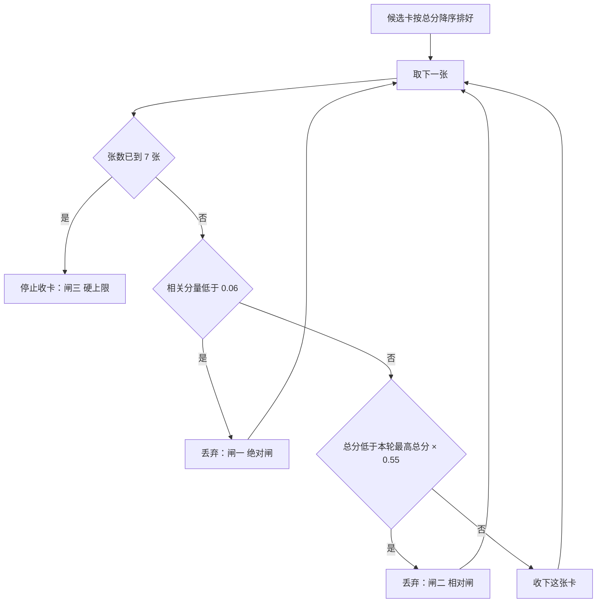
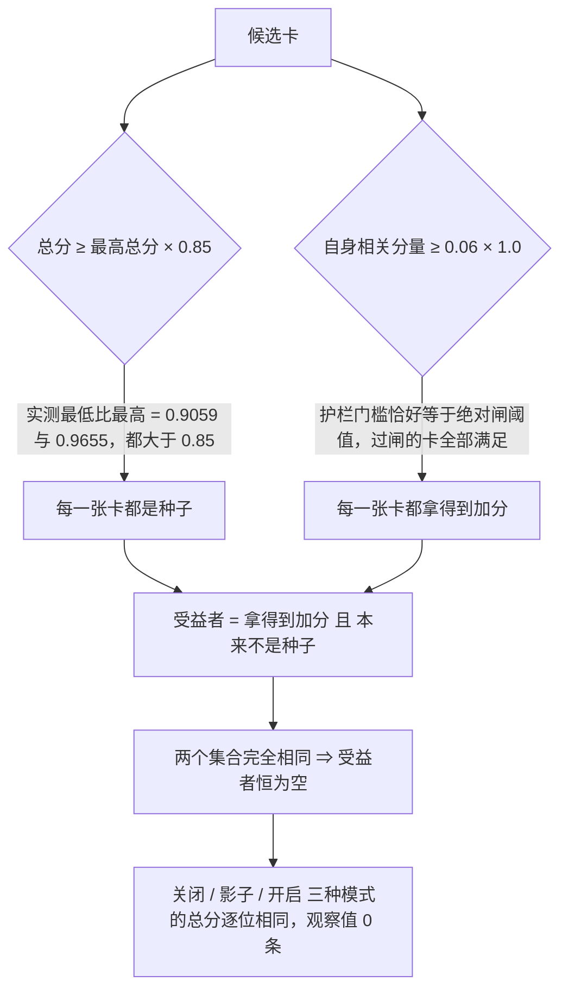

# 06 · 召回链路

> 本篇讲**每一轮对话里，系统怎么从几千张卡中选出 3～7 张，并让它们进入模型的上下文**。
> 这是全系列唯一一篇讲「取得回」的：05 讲「进得来」，07 讲「存得住、忘得掉」，08 讲「图怎么连、能量怎么传」。
> 本篇不含任何源代码，只含结构、判据、公式、框图与实测数据。术语与编号以 00 篇为准。

---

## 一、召回的位置：它站在主路径上

### 1.1 一句话

**召回发生在模型开口之前，且每一轮都发生一次。**

用户说一句话，系统先拿这句话去记忆库里选卡，把选出来的卡拼成一段文本追加到对话尾部，
然后才调用模型。模型看到的是「对话历史 + 一段记忆快照」，而不是「对话历史 + 一个搜索工具」。

这条顺序带来三个硬性要求，它们不是风格偏好，是位置决定的：

| 必须 | 含义 | 它排除了什么 | 违反后的症状 |
|---|---|---|---|
| **必须快** | 它在主路径上，用户正在等回复 | 任何需要多次往返、需要模型参与、需要全库扫描的做法 | 每轮多几百毫秒。用户不会说「召回慢」，只会说「今天有点卡」 |
| **必须确定** | 同状态、同查询、同参数，连续 10 次结果逐位相同 | 随机数、哈希顺序、集合迭代顺序、浮点累加顺序 | 用户说「昨天记得今天忘了」，而系统无法判断是数据问题还是算法问题 |
| **必须可解释** | 每条卡能说出「各分项多少分、为什么进来」 | 黑盒排序、只有最终分数的排序 | 用户问「你为什么想起这个」，系统答不出来，于是无法定位是召回错了还是内容错了 |

三条要求对应 01 的 P1（确定性代码而非提示词技巧）、P3（读取可解释）、P6（门控先于检索），
以及验收项 ST-1（重启一致）与 FR-B4（可解释）。

### 1.2 召回七阶段

```text
                                  本轮用户文本 + 当前时间 + 本轮目标
                                  │
                                  ▼
     ┌────────────────────────────┬───────────────────────────┐
     │ ① 构造查询                                             │
     │    归一化 → 切词项 → 取目标词项 → 记录域               │
     │    产出：查询对象（原始文本 / 词项集 / 目标词项 / 域） │
     └────────────────────────────┬───────────────────────────┘
                                  │
                                  ▼
     ┌────────────────────────────┬───────────────────────────┐
     │ ② 取候选                                               │
     │    倒排索引按词项命中取候选，上限 400 张               │
     │    候选池 ∩ 存活卡（活跃、未合并）                     │
     └────────────────────────────┬───────────────────────────┘
                                  │
                                  ▼
     ┌────────────────────────────┬───────────────────────────┐
     │ ③ 打分（五分量 + 冲突惩罚）                            │
     │    每个候选算出：总分、相关分量、各分项                │
     │    分母恒为全部正向权重之和 1.00（见 03 篇）           │
     └────────────────────────────┬───────────────────────────┘
                                  │
                                  ▼
     ┌────────────────────────────┬───────────────────────────┐
     │ ④ 扩散激活（08 篇）                                    │
     │    选种子 → 沿图传播 → 给部分卡加分                    │
     │    加分只进总分，绝不进相关分量                        │
     │    三种模式：关闭 / 影子（算但不生效）/ 开启           │
     └────────────────────────────┬───────────────────────────┘
                                  │
                                  ▼
     ┌────────────────────────────┬───────────────────────────┐
     │ ⑤ 三道闸                                               │
     │    闸一 绝对闸：相关分量 ≥ 0.06                        │
     │    闸二 相对闸：总分 ≥ 本轮最高总分 × 0.55             │
     │    闸三 硬上限：最多 7 张，精确截断                    │
     └────────────────────────────┬───────────────────────────┘
                                  │
                                  ▼
     ┌────────────────────────────┬───────────────────────────┐
     │ ⑥ 装包                                                 │
     │    预算 = 900 − 100 = 800 token                        │
     │    单卡截断到 160 字；第一张就超预算时再截到 80 字     │
     └────────────────────────────┬───────────────────────────┘
                                  │
                                  ▼
     ┌────────────────────────────┬───────────────────────────┐
     │ ⑦ 渲染                                                 │
     │    注入文本（给模型看，只含卡片摘要，不含分数解释）    │
     │    人读渲染（给人看，含分数构成与影子观察值）          │
     └────────────────────────────┬───────────────────────────┘
```

**这七个阶段的顺序不能调换**，理由分散在后面各章：

- ② 必须在 ③ 之前，因为打分只对候选做——否则每轮要打全库。
- ③ 必须在 ④ 之前，因为扩散的种子来自打分结果。
- ④ 必须在 ⑤ 之前，因为扩散的加分要参与相对闸的比较。
- ⑤ 必须在 ⑥ 之前，因为装包只处理已经过闸的卡。
- ⑥ 必须在 ⑦ 之前，因为渲染要按装包后的截断文本算长度。

### 1.3 本篇回答什么

| 问题 | 在哪一章 |
|---|---|
| 为什么召回要算两个分数，而不是一个？ | 第 2 章 |
| 三道闸各看哪个分数，为什么不能统一？ | 第 3 章 |
| 扩散激活为什么只能改总分？ | 第 4 章 |
| 条数上限和 token 预算，哪个才是真闸门？ | 第 5 章 |
| 「可解释」到底要解释几层？ | 第 6 章 |
| 影子模式是什么，为什么默认是它？ | 第 7 章 |
| 「同输入十次逐位相同」怎么做到的？ | 第 8 章 |
| 一个机制怎么会在数学上恒为空而不报错？ | 第 9 章 |
| 这条链路最脆弱的地方在哪？ | 第 10 章 |

**前置篇目**：03（一轮对话的完整数据流、打分分母恒含全部维度、注入通道）、
04（卡的字段与事件日志）、09（公式全集与常量标定依据）。
本篇会用到的常量默认值一律以 00 篇的全局常量表为准，这里只写名称与含义。

### 1.4 查询是怎么构造的

查询不是一个字符串，是四样东西：

| 成分 | 来源 | 用途 | 缺席时的影响 |
|---|---|---|---|
| 原始文本 | 本轮用户输入 | 归一化、切词项 | 不可能缺席 |
| 词项集合 | 归一化后切分（中文二元组、英文整词） | 语义分 | 不可能缺席 |
| 目标词项 | 本轮的任务目标 | 目标分 | **贡献 0，但权重仍留在分母里** |
| 域 | 当前会话的域 | 候选池裁剪 | 不做硬过滤（见 10 章边界） |

**「目标」这一项是一个曾经真实发生过的陷阱。** 它有一个默认空值，于是调用方忘了传也不会报错，
而目标分恒为 0。结果是**召回看起来更好了**——因为少了一个分量在拉低分数。

> 这是最危险的一类缺陷：**缺陷伪装成改进**。分数变好看、测试全绿、
> 没有任何人会觉得需要去修它。这类缺陷只能靠「逐个参数追踪它到底有没有被赋值」发现，
> 不能靠观测指标发现。

所以「目标缺席时贡献 0、但权重留在分母」不是数学上的自然选择，是**防御性设计**：
如果缺席时把权重从分母里摘掉，那么「上游漏传目标」这个缺陷会让每张卡统一涨 11%，
更容易进焦点包——缺陷反而让召回看起来更好，于是永远没人去修它。

---

## 二、两个分量：本篇最容易读错的一章

### 2.1 两条公式

**总分（排序用）**：

```text
正向权重和 = 0.42 + 0.18 + 0.20 + 0.10 + 0.10 = 1.00

归一化分数 = ( 语义分 × 0.42
             + 重要性分 × 0.18
             + 新鲜度分 × 0.20
             + 目标分 × 0.10
             + 置信度分 × 0.10 ) / 1.00

总分 = clamp01( 归一化分数 − 冲突惩罚 × 0.25 )
```

**相关分量（判断够不够格用）**：

```text
相关权重和 = 0.42 + 0.10 = 0.52

相关分量 = clamp01( ( 语义分 × 0.42 + 目标分 × 0.10 ) / 0.52 )
```

两个公式只差一件事：**分子里留了哪几个分量**。

- 总分把五个正向分量全算进去，再扣冲突惩罚。
- 相关分量只留「与查询有关」的两个：语义分（这张卡和查询的词项重合多少）与
  目标分（这张卡和本轮目标的词项重合多少）。

**分母恒为全部正向权重之和 1.00，即使某个分量本轮为 0。** 这条规则是 03 篇的主题，
它被违反过一次，代价是所有卡的分数统一放大 11%，一张本来 0.168 的死卡变成 0.187、
越过了当时的阈值 0.18，于是无关卡开始进包。

> **原则**：一个分数如果要在不同输入之间比较，它的计算结构就必须与输入无关。
> 「某些输入下换一个公式」等于让同一个阈值在不同轮次指代不同含义。

### 2.2 关键事实：总分里有 48% 与查询无关

把正向权重拆开看：

| 分量 | 权重 | 与查询有关吗 | 它回答的问题 |
|---|---|---|---|
| 语义分 | 0.42 | **有关** | 这张卡的文本和查询重合多少 |
| 目标分 | 0.10 | **有关** | 这张卡和本轮目标重合多少 |
| 重要性分 | 0.18 | **无关** | 这张卡自己有多重要（显著性、情绪、访问频次） |
| 新鲜度分 | 0.20 | **无关** | 这张卡有多新 |
| 置信度分 | 0.10 | **无关** | 这张卡的来源有多可信 |
| 冲突惩罚 | −0.25（只扣分） | 无关 | 这张卡被标了几处冲突 |

```text
与查询有关的权重和 = 0.42 + 0.10 = 0.52   （52%）
与查询无关的权重和 = 0.18 + 0.20 + 0.10 = 0.48   （48%）
```

**这 0.48 是每张卡共同的地板。** 它的直接后果是：

```text
一张语义完全为 0（与查询毫无关系）的卡，总分仍可达到：
    0.18 × 重要性 + 0.20 × 新鲜度 + 0.10 × 置信度
各分项取 0.5 → 0.2400
各分项取 1.0 → 0.4800
```

也就是说：**「总分低」不等于「不相关」，「总分高」也不等于「相关」。**

### 2.3 一个可复核的算例

三张卡，同一个查询：

| 卡 | 语义分 | 目标分 | 重要性 | 新鲜度 | 置信度 | 冲突惩罚 | 总分 | 相关分量 |
|---|---|---|---|---|---|---|---|---|
| A 真正相关 | 1.00 | 0.50 | 0.30 | 0.90 | 0.90 | 0 | **0.794** | **0.904** |
| B 完全无关但很重要很新 | 0.00 | 0.00 | 0.90 | 1.00 | 1.00 | 0 | **0.462** | **0.000** |
| C 完全无关且平庸 | 0.00 | 0.00 | 0.50 | 0.50 | 0.50 | 0 | **0.240** | **0.000** |

（以上全部为推导值，可逐项复算：A = 0.42+0.054+0.18+0.05+0.09 = 0.794；
B = 0.162+0.20+0.10 = 0.462；C = 0.09+0.10+0.05 = 0.240。）

看这张表要读出两件事：

1. **B 的总分（0.462）是 A 的 58%**，尽管它与查询没有任何词项重合。任何架在总分上的
   绝对阈值，都必须在「0.462 该不该进包」这个问题上给出答案——而这个答案与相关性无关。
2. **C 的总分 0.240 高于旧的绝对阈值 0.18**。一张完全无关、各项平庸的卡，
   光靠「存在」就拿到了 0.24。

### 2.4 实测：两群在总分上重叠三分之一

在真实语料上跑全量扫描（173 张卡 × 15 个查询 = 2595 个样本）：

| 样本群 | 定义 | 总分区间 | 样本数 |
|---|---|---|---|
| 无关卡 | 语义分 = 0 | **0.313050 ～ 0.376728** | 2331 |
| 相关卡 | 语义分 > 0 | **0.345161 ～ 0.472320** | 84 |

**重叠 33.3%。** 换一份异构语料复验（防止只是本语料的性质）：0.376728 对 0.365951，
重叠 27.8%——**结论与语料无关**。

```text
同一批候选卡在「总分」上的分布（横轴 0.30 → 0.48，每格约 0.02）

           0.30      0.34      0.38      0.42      0.46
             │         │         │         │         │
             ▼         ▼         ▼         ▼         ▼
  无关卡     ████████████████████
            └──── 0.313 ～ 0.377 ────┘
  相关卡               ██████████████████████
                      └──── 0.345 ～ 0.472 ────┘
                       ▲
                       └─ 0.345 ～ 0.377 这一段两群都在：重叠 33.3%
```

另一组更极端的观测：**12 个完全不相关的句子对，总分最低 0.3295，无一低于 0.18**。
换句话说，旧的绝对阈值 0.18 从来没有拒绝过任何一张卡——全量扫描里低于 0.18 的样本是 **0 个**。

```text
同一批候选卡在「相关分量」上的分布

  0.00      0.06                        1.00
   │         │                           │
   ▼         ▼                           ▼
   ├─────────┤  无关卡：全部贴在 0 附近
   │█████████│
   ├─────────┼───────────────────────────┤
   │         │  相关卡：从 0.06 往上全有
   │         │███████████████████████████
             ▲
             └─ 绝对阈值 0.06：两群在这里被干净地分开
```

### 2.5 结论：两把尺子，两个问题

| 尺子 | 回答的问题 | 用在哪 | 为什么不能用另一把 |
|---|---|---|---|
| **相关分量** | 「这张卡和本轮的问题**有没有关系**」 | 闸一（绝对闸）、扩散的种子判据与加分护栏 | 总分里 48% 与查询无关，无关卡也能拿 0.31 以上，不存在分界点 |
| **总分** | 「这张卡在**本轮这批卡里**排第几」 | 排序、闸二（相对闸） | 相关分量把新鲜度与重要性剔掉了，「旧而相关」会被系统性淘汰 |

一句话：

> **「够不够格」用相关分量判断；「在本轮里排第几」用总分。**

这两句话如果混着用，会得到两个方向的错误，而且两个错误都**不报错**：

- 拿总分判断够不够格 ⇒ 无关卡永远过闸（阈值变成恒真），机制静默失效。
- 拿相关分量判断排第几 ⇒ 相关但陈旧、相关但不重要的卡被误杀，召回率静默下降。

### 2.6 相关分量的一个已知收缩（代价）

相关分量的分母恒为 0.52，而目标分缺席时贡献 0。于是：

```text
目标缺席时：
    相关分量 = 语义分 × 0.42 / 0.52 = 语义分 × 0.8077

即：无目标时相关分量系统性打 80.8 折。
而绝对阈值 0.06 是对相关分量标定的，所以：

    无目标时，语义分必须 ≥ 0.06 / 0.8077 = 0.0743 才过闸
    有目标时，语义分可以更低
```

**这不是 bug**，是「分母恒定」的必然代价。但它意味着**同一个查询加不加目标，
过闸难度相差 23.8%**。

这个代价必须写出来，因为它决定了一件容易被忽略的事：**「绝对阈值 0.06」不是一个
可以直接和语义分比较的数字。** 它与语义分的换算是 0.0743，而这取决于本轮有没有目标。
任何拿 0.06 去和语义分比的地方，都是一处静默的尺子错配。

---

## 三、三道闸

### 3.1 三道闸分别是什么

```text
相对闸的基准 = 本轮最高总分 × 0.55

按总分从高到低逐张检查，三道闸依次问：
    张数已经到 7 张了吗？        → 是：停（闸三 硬上限）
    相关分量低于 0.06 吗？       → 是：丢（闸一 绝对闸）
    总分低于「最高总分 × 0.55」？ → 是：丢（闸二 相对闸）
    三条都不是                  → 收
```

| 闸 | 作用对象 | 阈值 | 基准 | 换成另一把尺子的后果 |
|---|---|---|---|---|
| 闸一 绝对闸 | **相关分量** | 0.06 | 无（绝对量） | 换回总分：无关卡 0.313 起，全部过闸，**阈值恒真**，闸门退化成不存在 |
| 闸二 相对闸 | **总分** | 0.55 | 本轮最高总分 | 换成相关分量：相关分量的相对离散度更大（同批候选：相关分量 0.546、总分 0.856），同一阈值苛刻得多，**误杀「相关但旧」的真相关卡** |
| 闸三 硬上限 | 张数 | 7 | 无 | 换成 token 预算单独管：短卡时无人限制张数（见第 5 章） |

**三道闸取最严，且用两把不同的尺子。** 这不是不一致，是它们问的问题不同：

- 闸一问「有没有关系」——与查询有关，所以用相关分量。
- 闸二问「比本轮最好的差多少」——这是排序概念，天然含新鲜度与重要性，所以用总分。
- 闸三问「最多给几张」——与分数无关，是纯粹的预算约束。



### 3.2 为什么绝对闸必须换成相关分量

这不是一个「更精确」的选择，是一次**止血**。原来的绝对闸架在总分上，而总分被另一处
逻辑精确地钉在了阈值上。

**起因**：冲突惩罚曾经带一个「封顶」，形式是「扣分最多扣到总分恰好等于绝对阈值」。
它的意图是「别把一张卡扣到阈值以下」，看起来是在保护召回。

**实际发生的事**（161 张真实卡、33 张带冲突）：

| 观测 | 数值 |
|---|---|
| 总分恰好等于阈值的卡 | **10 / 161**，全部带冲突 |
| 带冲突卡中被钳住的比例 | 30.3% |
| 封顶前的分差 | 0.031008 |
| 封顶后的分差 | **0.000000** |
| 语义分 0.180 与语义分 0.000 的卡 | 拿到**完全相同**的总分 |

```text
封顶前：  卡甲 0.211 ┐
                    ├─ 分差 0.031，排序有意义
          卡乙 0.180 ┘

封顶后：  卡甲 0.180 ┐
                    ├─ 分差 0.000，排序退化成按标识
          卡乙 0.180 ┘
                    ▲
              两者都恰好压在阈值 0.18 上
```

于是「全低分时不硬塞」（FR-B2 的后半句）在数学上**不可能失败**：
每一张被扣分的卡都被抬回阈值，阈值不再是筛子，而是**地板**。
全量扫描 173 张卡 × 15 个查询，低于阈值的样本 0 个，而且**每个查询的最低分恰好是 0.180000**
——那个精确到 1e-9 反复出现的数字，就是钳位在留指纹。

**修法的形状**：

1. **删掉封顶**。冲突惩罚原样扣分，不按任何阈值封顶。
2. **新增相关分量**，它**完全不含冲突项**。于是「冲突不隐藏」（FR-B5）改由**结构**保证：
   闸门看相关分量，而相关分量里没有冲突，所以冲突在数学上**无法影响一张卡的去留**，
   只影响它排第几。这比「算一个恰好不越界的上限」可靠得多——后者依赖两个参数的具体数值。
3. **绝对闸换尺子**：比对相关分量，阈值从 0.18 降到 0.06（0.06 是对相关分量标定的，
   0.18 是对总分标定的旧值）。

修好之后，一张「无关但新鲜」的卡会被闸一干净地挡住：它的相关分量是 0，
而绝对阈值是 0.06。这个判据**有牙**，因为它守的是一条结构性质，不是一个数值巧合。

> **为什么这个缺陷能藏几个月**：它有两个耦合的部分。
> 「封顶把总分钳在阈值上」让「阈值有效」的假象被反复强化，
> 于是没有人去问「这个阈值本身能不能分开相关与无关」。
> 只删封顶不够（总分依然不可分），只换尺子也不够（封顶还在，阈值依然被当地板用）。
> **两个必须一起修。**

### 3.3 为什么相对闸不能一起换尺子

修完绝对闸之后，一个很自然的想法是「统一尺子」——两道闸都看相关分量，更一致。
**实测立刻误伤。**

```text
某个验收场景：
    目标卡的相关分量 0.1113，相对闸算出的门槛 0.1121
    → 差 0.0008，被挡出包

    同一张卡的总分 0.3925，相对闸门槛 0.2522
    → 本该轻松通过
```

**根因**：相关分量的**相对离散度**比总分大（同批候选：相关分量 0.546、总分 0.856）。
原因是相关分量剔掉了 48% 的共同地板，剩下的部分差异更剧烈。
同一个相对阈值 0.55，在相关分量这把尺子上苛刻得多。

三组变体的实测对照：

| 变体 | 进包张数 | 噪声卡 | 无关组进包 | 空包次数 |
|---|---|---|---|---|
| A 旧（绝对闸@总分，相对闸@总分） | 67 | 0 | **4** | 4 |
| **B 最小改动（绝对闸@相关分量，相对闸@总分）** | **61** | **0** | **0** | 5 |
| C 全挪（绝对闸@相关分量，相对闸@相关分量 0.55） | 47 | 0 | 0 | 5 |

C 比 B 多丢 16 张，其中包括「语义分 0.130 的真相关卡」。
**⇒ 选 B。**

> **推论：两道闸不是「同一个判据写了两遍」，它们问的是不同的问题。**
> 绝对闸问「有没有关系」（只该看与查询有关的量）；
> 相对闸问「比本轮最好的差多少」（该含新鲜度与重要性）。
> 把它们统一成一把尺子，等于强迫相对闸放弃自己的语义。

### 3.4 闸三：硬上限与精确截断

条数上限是 7。它的行为是**精确截断**：第 7 张之后一律不再收，不管第 8 张多高分。

这条「精确」值得单独强调，因为它容易被写成「大约不超过」。
一条「张数不超过 7」的断言在余量为 0 时也是绿的——把上限改成 100、或者让硬上限整条失效，
它照样绿。**「余量为 0」和「断言有牙」是两件事。**

守它的正确写法是构造一个必然超出上限的输入，然后断言**恰好等于 7**，
并且断言第 8 张确实被丢弃（而不是「恰好只有 7 张候选」）。

### 3.5 三道闸的失效方式各不相同

这是设计上最需要注意的一点：三道闸的失效**都不报错**，但症状完全不同。

| 闸 | 失效后的症状 | 为什么难发现 |
|---|---|---|
| 闸一 绝对闸 | 无关卡开始进包，且分数看起来「都挺正常」 | 它不崩，只是焦点包变糊。用户感觉「模型今天有点跑题」 |
| 闸二 相对闸 | 相关但旧的卡静默消失 | 空包与「本来就没有」长得一样。系统不会说「我挡掉了 6 张」 |
| 闸三 硬上限 | 焦点包变长，token 上升 | 上下文变长是**渐进的**，只有 ST-6（连续 50 轮 token 波动 ≤ ±10%）能抓 |

**三道闸的失效模式里有一个共同点：它们都表现为「结果变差」，而不是「过程出错」。**
这就是为什么本篇反复强调「判据要能被反向验证」——只能靠把判据改坏、确认测试精确变红，
才能证明这条判据真的在起作用。

---

## 四、扩散激活在召回里的位置

### 4.1 它只改一个数

扩散激活（Spreading Activation）在图谱上做一件事：从本轮最强的几张卡（种子）出发，
沿边把能量传出去，给**某些**卡加一点分。

它对打分的全部影响是这一行：

```text
新总分     = clamp01( 旧总分 + 加分 )
相关分量   = 不变            ← 关键
```

**加分只进总分，绝不进相关分量。** 这不是实现细节，是 01「冲突一：R2 专注 vs R5 联想」
那条取舍在数学层面的落点。

### 4.2 为什么不能让它进相关分量

绝对闸架在相关分量上，而绝对闸是 R2（专注当前位置）的唯一实现。
如果扩散能推高相关分量，那么：

```text
一张本来不该进包的卡
                                              │
        │ 被邻居「带出来」，相关分量被推过 0.06
        ▼
绕过绝对闸，进包
        │
        ▼
直接违反源-U6（污染上下文）与 R2
```

**「联想只加分、不放行」的完整含义是**：联想只能把「本来就已经相关、但排序靠后」的卡拉上来，
**不可能把一张不相关的卡拉进包**。

代价也必须写清：联想的表达力被限制在「重排序」而不是「扩召回」。
真正意义上的「因为想起 A，所以第一次想起了完全不相干的 B」——**做不到**。

为什么接受这个代价：R2 是最硬的一条（见 01 篇对 R2 与 R8 的定位），而 R5 的验收词是「效果」不是「算法」。
重排序已经能产生可感知的联想效果，而扩召回会直接违反源-U6。

> **一条可迁移的原则**：**护栏不能和它要守的判据走同一个通道。**
> 如果护栏改的是判据读的那个量，那它就不是护栏，是后门。

### 4.3 一个必须知道的连带效应

扩散只改总分，而绝对闸看相关分量——那么扩散还能改变焦点包的**成员**吗？

能，但只通过一条路：**相对闸留在总分上**。一张卡被加分后，它的总分越过了相对闸的门槛，
于是它进包了。这条路是扩散唯一能影响成员的方式。

这条路径曾经断过两次，两次的症状完全一样（扩散算了但什么都没变）：

| 断法 | 表现 |
|---|---|
| 相对闸也挪到相关分量 | 扩散加分进不了相关分量，于是永远越不过相对闸 ⇒ 只能重排、不能换人 |
| 种子判据用错尺子 | 种子集合恒等于全集 ⇒ 没有受益者 ⇒ 加分恒为空（见第 9 章） |

**第一次的修法**是「相对闸留在总分」，**不是**给扩散加一个「豁免相对闸」的补丁。
那个补丁一度存在，后来删掉了——**少一个未测分支，比多一个「看起来更安全」的分支好。**

**第二次的修法是第 9 章的主题。**

### 4.4 护栏与被护栏的量必须同尺

扩散有两条门槛，它们必须用同一把尺子：

| 门槛 | 判据 | 尺子 |
|---|---|---|
| 种子筛选 | 相关分量 ≥ 本轮最高相关分量 × 0.85 | 相关分量 |
| 加分护栏 | 自身相关分量 ≥ 绝对阈值 × 自身分护栏比例 | 相关分量 |

加分护栏的作用是：**只有本来就够格的卡才配拿到联想加分**。
「自身分护栏比例」被配置校验强制 ≥ 1，于是护栏门槛 ≥ 绝对阈值 0.06——
即「能加分的卡，自身必须已经能过绝对闸」。

这条护栏的设计意图是对的，但它**坏过两次，两次都是尺子错配**：

| 坏法 | 后果 | 失效方式 |
|---|---|---|
| 护栏比的是总分，门槛是 0.06 | 总分 0.31 起，护栏**恒真**，无关卡也能拿加分 | 多放行 |
| 种子判据用总分（第 9 章） | 所有卡都是种子，受益者恒空 | **全放行，看起来像正常工作** |

**注意第二行的区别**：护栏失效是「多放行」，种子失效是「全放行」。
后者更难发现，因为「什么都不发生」最像正常工作。

---

## 五、装包与 token 预算

### 5.1 预算结构

```text
token 预算 900（硬上限，整段注入的总量）
  ├─ 头尾固定开销 100     ← 标题行、时间块、分隔符；空包时不渲染
  └─ 卡片可用 800
       ├─ 单卡字符上限 160 字   ← 第一级截断
       ├─ 兜底截断 80 字        ← 第二级：第一张就装不下时重试
       └─ 条数上限 7 张         ← 与 token 预算各管一段长度
```

**固定开销 100 不是拍脑袋的常量。** 实测：一张 60 字卡 = 164 token，两张 60 字卡 = 228 token，
差值 64 是单卡增量成本，于是 `164 − 64 = 100`——与配置值精确相等。
但它只在**非空包**时生效（空包是 0），所以不能从空包反推。

> 这仍然是一个**硬编码常量**，而 token 上限是**硬上限**。头尾文案一变它就失真。
> 这是一个已知的边界（见第 10 章）。

### 5.2 两级截断

```text
第一级：单卡文本截断到 160 字（单卡字符上限）
        —— 这是截断上限，不是典型长度。典型卡文本是 40～100 字。

第二级：若「第一张卡」就装不进预算（此时包还是空的），
        再把文本截到 max(8, floor(160 / 2)) = 80 字，重试一次。
```

**两级截断意味着降低单卡字符上限会同时影响两级。** 把上限从 160 降到 100，
不只是「长卡被截得更短」，还会改变第二级截断的落点（80 → 50）。

**为什么要保留「单卡超预算也要装一张」这条规则**：如果严格按预算装，一张 500 字的卡
会让焦点包变成空包——而空包意味着这一轮完全没有记忆。装一张截断的卡比什么都不装好。
这是**刻意的降级**，不是漏洞。

### 5.3 实测：哪个闸门真的生效

固定 token 预算 900、固定开销 100、条数上限 7、单卡字符上限 160，
只改卡文本长度：

| 卡文本长度 | 实际装入 | 包 token | 单卡成本 | 受限于 |
|---|---|---|---|---|
| 20 字 | 7 | 268 | 24 | **条数上限** |
| 50 字 | 7 | 478 | 54 | **条数上限** |
| 80 字 | 7 | 688 | 84 | **条数上限** |
| 100 字 | 7 | 828 | 104 | **条数上限** |
| 120 字 | **6** | 844 | 124 | token 预算 |
| **160 字** | **4** | 756 | 164 | token 预算 |
| 200 字 | 4 | 752 | 163 | token 预算 |

读这张表要注意三件事：

1. **100 字时包已经用到 828/900**，只差 72 token 就会碰到上限。所以「条数上限生效」
   在这个长度上已经是**擦边**生效，不是宽松生效。
2. **160 字时只装 4 张，而 200 字时还是 4 张、token 反而更少（752 < 756）**。
   因为第二级截断把 200 字的卡截到 80 字，单卡成本反而降到 163。
   **「文本更长」不等于「占更多 token」**——截断把这条直觉打破了。
3. **120 字装 6 张，844 token**；**160 字装 4 张，756 token**。
   两者 token 相近，张数差 2。这说明**token 预算是「总量闸」，条数上限是「密度闸」**，
   它们约束的不是同一件事。

### 5.4 结论：两个上限必须同时存在

```text
短卡（≤ 100 字）：条数上限是真闸门
    ┌──────────────────────────────────────────┐
    │ 7 张卡只用了 268 ～ 828 token            │
    │ token 预算 800 还有余量（20/50/80 字时） │
    │ → 谁在限制张数？只有「7」这个数字        │
    └──────────────────────────────────────────┘

长卡（≥ 120 字）：token 预算是真闸门
    ┌───────────────────────────────────────────┐
    │ 7 张卡要 868+ token，超了 800             │
    │ → 谁在限制张数？token 预算                │
    │ → 条数上限「7」在这段长度上永远碰不到     │
    └───────────────────────────────────────────┘
```

**缺一个都会在另一段长度区间失效：**

| 去掉哪个 | 在哪段长度失效 | 失效后果 |
|---|---|---|
| 去掉条数上限 | 短卡（≤ 100 字） | 800 token 能装 30 张 20 字的卡，密度崩掉，直接违反 R8（3～7 张不是 50 张） |
| 去掉 token 预算 | 长卡（≥ 120 字） | 7 张 160 字的卡要 1148 token，突破硬上限，违反源-U6 |

这就是为什么「哪个闸门生效」这个问题**没有固定答案**——它是一个关于输入的函数。
而这个性质带来一个测试上的陷阱：**两个判据交替生效，各自的测试都容易写成「只测自己生效的那一半」。**
必须有一条测试**同时覆盖两种长度**，确保两个闸门都被真的走到。

> 这一条还有一个更细的教训：本节第一版推算写的是「单卡最多约 160 token，
> 800/160 = 5，所以满配装 5 张」。**实测是 4 张**——因为还有固定字段开销，
> 单卡实际成本 164 而非 160。**推算值必须回探针核。**

### 5.5 空包

空包时 token 占用为 **0**，因为头尾模板不渲染。

这条性质看起来是小事，它有两个实际影响：

1. **不能从空包反推固定开销。** 想测固定开销必须用「一张卡」与「两张卡」的差值。
2. **空包必须是显式的。** FR-B6 要求「空召回必须给出明确信号，不臆造」。
   空包不是「返回一段空的记忆文本」，而是「明确说这一轮没有相关记忆」。
   两者对模型的影响完全不同：前者会让模型以为记忆里就是空的，后者告诉它「这次没找到」。

---

## 六、可解释性

### 6.1 三个层次，缺一层就不算可解释

FR-B4 的判据是「能回答『为什么想起这条』」。这句话拆开是三个问题：

| 层 | 问题 | 输出什么 | 缺了会怎样 |
|---|---|---|---|
| ① 分数来自哪里 | 各分项得了多少分 | 五个分项 + 冲突惩罚 + 权重 + 总分 + 相关分量 | 只能看到一个总分，无法判断是哪一项把它抬上来的 |
| ② 为什么它进了包 | 它过了哪道闸、卡在什么位置 | 本轮最高总分、相对闸门槛、条数上限 | 分数高但没进包时无法解释；分数低但进包时也无法解释 |
| ③ 联想加分算不算 | 扩散给它加了多少 | **独立一行，显式标注「当前未生效」** | 折进分数构成 ⇒ 解释**说谎** |

### 6.2 分数构成是字段级的，不是一句描述

| 输出项 | 内容 | 是否参与排序 |
|---|---|---|
| 语义分 × 权重 | 语义分、0.42、乘积 | 是 |
| 重要性分 × 权重 | 重要性分、0.18、乘积 | 是 |
| 新鲜度分 × 权重 | 新鲜度分、0.20、乘积 | 是 |
| 目标分 × 权重 | 目标分、0.10、乘积（目标缺席时明确标「未提供」） | 是 |
| 置信度分 × 权重 | 置信度分、0.10、乘积 | 是 |
| 冲突惩罚 × 权重 | 冲突数、惩罚值、0.25、乘积 | 是（只扣） |
| **总分** | 归一化分数 − 惩罚，与排序用的值**逐位相同** | 是 |
| **相关分量** | (语义×0.42 + 目标×0.10) / 0.52 | 是（闸一用） |
| 影子观察值 | 假设加分、假设总分、假设排名、实际排名、来源卡 | **否**（影子模式下不生效） |

**「总分」这一行必须与排序用的值逐位相同。** 这条曾经被违反过：一张卡在人读渲染里
报出**两个互相矛盾的总分**——头行取的是加分后的值，末行取的是加分前的值，差额恰好等于加分。
14 张卡的语料、5 张的焦点包里 **3 张如此**。

> 这比「少一行」更糟：少一行是漏了，**两行矛盾是自相矛盾**，读者只会认为系统算错了。
> FR-B4 的判据是能回答「为什么想起这条」，而这里给出的答案是错的。

### 6.3 渲染文本的结构示意

```text
┌────────────────────────────────────────────────────────────────┐
│ 记忆（焦点包） · 7 张 / 828 token                              │
├────────────────────────────────────────────────────────────────┤
│ 当前时间：〈日期〉 〈时刻〉（周几）                            │
├────────────────────────────────────────────────────────────────┤
│ 1. [事件] 约定缓存过期时间设成 300 秒，注意踩坑                │
│    语义   0.500 × 0.420 = 0.210                                │
│    重要性 0.600 × 0.180 = 0.108                                │
│    新鲜度 0.930 × 0.200 = 0.186                                │
│    目标   0.000 × 0.100 = 0.000   （本轮未提供目标）           │
│    置信度 0.800 × 0.100 = 0.080                                │
│    冲突   −0.000 × 0.250 = −0.000                              │
│    总分 0.449        相关分量 0.712                            │
│    [影子] 若开启扩散：+0.120 → 0.569，排名 3 → 1（当前未生效） │
│    [影子] 激活来自 2 张种子卡                                  │
├────────────────────────────────────────────────────────────────┤
│ 2. [事实] ...                                                  │
├────────────────────────────────────────────────────────────────┤
│ 3. [感受] ...                                                  │
└────────────────────────────────────────────────────────────────┘
```

三条约束各有测试守：

1. 影子行不混进分数构成（两者语义不同）。
2. 「总分」那一行永远显示**实际值**，假设值只出现在带前缀的那一行。
3. 必须明说「当前未生效」——这一行长得像分数的一部分，读者极易误读。

> 这张图里**没有**「本次被各道闸挡掉多少张」这一行。不是漏画，是当前确实没有
> （见 6.5 第三条）。

### 6.4 联想加分为什么必须分层呈现

这是 01「冲突六：可解释 vs 分数真实」那条取舍的落点。

分数构成是在打分阶段算的，而联想加分发生在打分**之后**。于是「解释里写的分数」
和「实际排序用的分数」天然不一致。

**两种做法，只有一种是对的：**

| 做法 | 结果 | 为什么 |
|---|---|---|
| 把联想折进分数构成 | 解释**说谎**：它声称的构成里有一部分不来自这张卡自身 | 读者会以为这张卡的语义分更高，而实际没有 |
| **分两层 + 显式标注** | 解释变长，但有被误读的风险 | 实际值永远真实，假设值单独一行且标明「未生效」 |

**为什么接受「文本变长 + 可能被误读」这个代价**：折进去的那个方案让解释**在结构上**
就不可能正确——不是措辞问题，是它宣称的因果关系不成立。

还有一条更强的理由：**联想加分不是这张卡自身的属性。** 它来自「邻居匹配上了」，
是外部证据。折进归一化分子等于把外部证据算成自身匹配度，而归一化的定义就是
「这张卡自己匹配得如何」。**折进去等于改了这个量的定义。**

### 6.5 两条渲染路径必须分开

| 路径 | 消费方 | 内容 | 为什么 |
|---|---|---|---|
| 注入文本 | 模型 | 只含卡片摘要（类型标签 + 截断文本） | 模型不需要分数解释；解释会烧 token 预算，还会污染上下文（源-U6） |
| 人读渲染 | 人（命令与终端） | 含分数构成、影子观察值、来源卡 | 人要的是「为什么」 |

这两条路径必须**各有各的测试**。只测「注入文本里没有解释」是不够的——
把解释整个删掉也能让这条测试变绿。必须配一条「人读渲染里确实有」的阳性对照。

实测 4 个查询、注入文本 452～1949 字，「扩散」「因为想起了」「关联卡」「权重 1.000」
四个关键词**全部无泄漏**，同时人读渲染确实含「因为想起了」——两条路径真的分开了。

**三条已知的洞**（必须写出来，否则读者会以为可解释是完整的）：

1. **冲突惩罚在惩罚一个不可信的量。** 产生冲突标记的判据方向是反的：
   真冲突（相似度 0.524）被判为「不冲突」，三对无关的（0.15～0.19）被判为「冲突」。
   所以这一行显示的数字是**准确的**，但它衡量的东西不可信。
   这是 10 的开放问题，不是本篇能修的。
2. **被各道闸挡掉的数量不可观测。** 相对闸会系统性淘汰「旧而相关」的卡，
   实测某组候选里 **97.0% 的组**存在「相关分量高于已选最低卡却被丢弃」的情况，
   平均每组丢弃 6.29 张。而这个数字**在运行时完全不可见**——闸门不返回任何诊断信息。
3. **影子观察值不进分数构成。** 这是有意的（见 6.4），但它意味着「人读渲染里的分数」
   和「如果打开扩散会得到的分数」是两个不同的东西，而后者只在一个独立行里出现。

---

## 七、影子模式

### 7.1 三态，不是两个布尔

扩散的运行模式有三个取值：**关闭 / 影子 / 开启**。

不用「启用开关 + 影子开关」两个布尔，是因为那能表达出「关掉了但还在影子计算」
这种自相矛盾的状态。互斥的三态从类型上就不允许这种状态存在。

| 模式 | 算不算扩散 | 改不改排序 | 产出观察值 | 用途 |
|---|---|---|---|---|
| 关闭 | **不算** | 否 | 无 | 完全退化成引入本功能之前（可回滚） |
| 影子 | **照常算** | **否** | **有** | 攒「打开会怎样」的证据，但不影响召回 |
| 开启 | 算 | **是** | 无（已折进总分） | 真实参与排序 |

### 7.2 影子 = 照常计算、照常记录、不改变排序

```text
                    打分完成
                       │
                       ▼
        ┌──────────────────────────────┐
        │ 模式 = 关闭？                │
        └───────┬──────────────┬───────┘
                │ 是           │ 否
                ▼              ▼
        跳过，无任何记录    完整跑一遍扩散
        （与引入本功能前    （与「开启」同一份算法、
          的行为逐位相同）    同一份种子、同一份护栏）
                               │
                   ┌───────────┴───────────┐
                   ▼                       ▼
            模式 = 影子                模式 = 开启
            记录假设加分 / 假设总分    加分写进总分，参与排序
            / 假设排名 / 实际排名      不记录假设值
            排序与装包不变             （已生效，再记一份就是两个真相源）
```

### 7.3 为什么库默认是影子

**因为算法正确性还没有在真实数据上验证过。**

一个未经真实数据检验的机制默认生效，会悄悄改变每一次召回的排序。它改得不多——
所以它是这类缺陷里最难发现的一种：不报错、不崩溃、日志正常，只是排序慢慢变了。

而**关闭**也不行：关闭永远无法积累「它到底会怎么改」的证据，而那份证据正是
判断该不该打开它的依据。

**影子让两者同时成立：可见，但不生效。**

### 7.4 影子必须算真账

这是最容易做错的一处。既然「反正不生效」，一个很自然的偷懒是：
用近似值、或者干脆跳过计算、或者返回空。

**这三种做法都会让影子观察值失去意义**：

| 偷懒方式 | 后果 |
|---|---|
| 跳过计算 | 观察值恒为空。等于没测 |
| 用不同的种子集合或护栏 | 它预测的**不是**「打开后会怎样」，攒出的证据不足以支撑决策 |
| 假设排名的并列规则与真实路径不同 | 同分场景下预测的排名是错的，而同分恰好是真实数据里最常见的场景 |

所以有一条硬要求：**假设排名的并列规则必须与真实路径逐字相同**（分数降序 + 标识升序）。
同分场景是唯一能暴露并列规则错误的场景，而它恰好最常见。

### 7.5 观察值必须有出口

**算出来没人看得见，等于没算。**

观察值加上之后，曾经**一个出口都没有**：分数解释里不许放（语义不同），
注入文本里更不能放（源-U6）。结果是扩散在默认配置下每轮都在算，
但没有任何人能看到它算出了什么——**一个只有测试知道的机制，等于没有。**

现在有两个出口：

```text
出口一：人读渲染里的独立行
   ┌────────────────────────────────────────────────────────────┐
   │ [影子] 若开启扩散：+0.120 → 0.569，排名 3 → 1（当前未生效）│
   │ [影子] 激活来自 2 张种子卡                                 │
   └────────────────────────────────────────────────────────────┘
   特点：人能看到；必须显式标注「未生效」

出口二：结构化日志里的影子段
   ┌───────────────────────────────────────────────────────────┐
   │ 摘要行：…，影子模式下 2 条会被扩散提权（未生效）          │
   │ 明细：每条给出 标识 / 加分 / 实际排名 / 假设排名          │
   └───────────────────────────────────────────────────────────┘
   特点：可批量统计；键名必须让它不可能被误读成已生效
```

**出口二的关键设计**：字段名用「影子」而不是「加分」。
命名必须让它**不可能**被误读成已生效。

### 7.6 三种模式下各自带不带观察字段

这是最容易被写错的一张表：

| 模式 | 日志里有影子段吗 | 人读渲染里有影子行吗 | 为什么 |
|---|---|---|---|
| 关闭 | **没有** | 没有 | 根本没算扩散 |
| 影子 | **有**（有观察值时） | **有** | 这是它唯一的出口 |
| 开启 | **没有** | 没有 | 加分已折进总分，再记一份就是两个真相来源 |

**若「关闭」与「开启」也带这个字段（哪怕空数组），运维看日志会以为当前跑的是影子模式。**
所以日志明细必须是**条件展开**而不是恒给一个键。

### 7.7 一个更隐蔽的变体：同一张卡带两个真相源

影子模式曾经照搬了「开启」模式的加分字段，于是同一张卡上同时有：

| 消费方读到 | 会以为什么 | 实际是 |
|---|---|---|
| 加分字段 | 加分**已经生效** | 影子模式不改变任何排序与注入 |
| 加分字段 对 假设加分 | 两个值该信哪个 | 一个是原始值、一个是截平后的假设值，**可能不同** |

这跟「让『实际生效』和『假设生效』在类型层面就是两件事」的设计直接冲突。
**光在注释里写不算，必须在数据里真的分开。**

修法是把对面语义的字段**摘掉**再返回，而不是赋空值——
「有键但值为空」和「没有这个键」是两件事，后者才是真的分开。

> 这条值得记的原因：它长期没被发现，是因为那个字段此前**没有在类型上声明**，
> 于是谁都读不到它。也就是说，**「类型没声明」这个缺陷顺手把下一个缺陷挡住了**——
> 而挡的方式是让功能不可用，不是让功能正确。补上声明后，第二个缺陷立刻暴露。
>
> **推论：补类型声明会顺带暴露运行时缺陷。** 类型不是文档，是接口——
> 没有接口的字段等于没有出口，而「没有出口」会掩盖「出口输出的是错东西」。

---

## 八、确定性怎么保证

### 8.1 确定性不是一个开关，是五个顺序源

ST-1 要求「同状态 + 同查询 + 同参数 ⇒ 连续 10 次结果逐位相同」。
这个要求排除了几乎所有「更聪明」的图算法，因为它们的聪明往往来自某种顺序。

**五个必须被固定的顺序源：**

| 顺序源 | 不固定会怎样 | 怎么固定 |
|---|---|---|
| 候选池的排序 | 打分顺序变，浮点累加顺序变 | 按固定的复合键排序（分数降序 → 标识升序） |
| 集合遍历 | 同一份数据两次迭代出不同顺序 | 不用「集合的天然顺序」，显式排序后再遍历 |
| 浮点累加顺序 | `(a+b)+c ≠ a+(b+c)`，末位不同，排序可能翻转 | 累加前把参与项按固定键排序 |
| 并列时的最终排序键 | 同分卡每次排出不同顺序 | **用标识**（内容哈希）做最后的键 |
| 时间来源 | 同一份数据在不同时刻算出不同结果 | 打分只用卡的字段，不读当前时钟 |

### 8.2 并列时用什么做最终排序键

**用标识。** 标识是内容哈希：同一段文本永远得到同一个标识，与插入顺序、
与存储位置、与运行次数都无关。

为什么不能用别的：

| 候选键 | 问题 |
|---|---|
| 插入顺序 | 重放顺序一变就变；跨进程重建视图后可能不同 |
| 存储位置 | 是实现的偶然产物，不可复现 |
| 对象哈希 / 内存地址 | 每次运行都不同，直接违反 ST-1 |
| **标识（内容哈希）** | **由内容决定，与过程无关**——唯一合格的选择 |

### 8.3 为什么不能用哈希顺序做排序

这是本系统反复踩到的一个坑：**用哈希当排序键，看起来是确定的，实际是把排序交给了随机。**

关键在于区分两件事：

```text
标识（内容哈希）作为「最后的并列键」  →  正确
哈希值的遍历顺序作为「主要排序依据」  →  错误
```

第二行为什么是错的？因为哈希顺序与**内容相关性完全无关**。
当一批卡的分数相同时（这在真实数据里非常常见，尤其当分数被截平、被钳位、
或者多个卡共享同一个邻居结构时），排序完全由哈希决定 ⇒
**排序与内容彻底脱钩，而系统看起来一切正常。**

实测过两次：

| 场景 | 观测 |
|---|---|
| 冲突封顶把总分钳在阈值上 | 10/161 张卡总分完全相同，排序退化成按标识 |
| 扩散的受影响面截断用「截平后的加分」当排序键 | 14 张卡获加分，**11 张的原始加分完全相同（0.272258）**，谁被留下完全由哈希决定 |

两次都是同一个形态：**机制在跑，但选择是随机的。**
它不报错、不崩溃，日志里只写「本次有 N 张卡获得加分」，看的人无从判断
「这 N 张是按相关性选的，还是按哈希选的」。

> **修法**：截断的排序键必须是「原始加分降序 → 自身分降序 → 标识升序」。
> 前两个键承载相关性，标识只负责在**真正并列**时给出稳定的顺序。
> **一个键能同时承担「相关性」和「稳定性」是幻觉**——它只能承担一个。

### 8.4 浮点累加顺序

浮点加法不满足结合律。这意味着**同一份数据，只要累加顺序不同，末位就可能不同**，
而末位不同足以让两个几乎相等的分数交换排名。

所以扩散里有一条不显眼但关键的规则：**种子按标识升序处理**。

```text
种子 A（标识 aaa）能量 0.5
种子 B（标识 bbb）能量 0.3
目标 X 从两者各得 0.06

顺序 A→B：  0.00 + 0.060000 = 0.060000
           0.060000 + 0.036000 = 0.096000

顺序 B→A：  0.00 + 0.036000 = 0.036000
            0.036000 + 0.060000 = 0.096000
```

这个例子两个顺序恰好相同（因为数值好），但换成 `0.1 + 0.2 + 0.3` 这类组合就会出现差异。
**「恰好相同」不能作为「不需要固定顺序」的理由**——它只是在等一个会暴露的数值。

### 8.5 验收口径

「连续 10 次」这个数字有具体含义，不是修辞：

| 验收项 | 验什么 | 为什么需要 |
|---|---|---|
| 逐字段 10 次 | 不只比总分，比每一个分项与每一个排名 | 总分相同而分项不同的情况存在（互相抵消），只比总分抓不到 |
| 副作用为零 | 召回前后：强度、访问计数、日志字节数都不变 | FR-B7「看到与使用分离」。**必须配对**：确认「用上」的入口被调用后日志字节数必须变大 |
| 跨进程重放 10 次 | 重启后重放视图，结果仍逐位相同 | 进程内稳定不代表跨进程稳定（哈希种子、遍历顺序可能变） |

**「2 次」不够。** 原测试只做 2 次，发现不了「前几次稳定、后面逐渐漂移」的形态。

> 副作用为零那条还有一个层次陷阱：把「输入数组未被修改」当断言是**没牙的**，
> 因为打分是纯函数、返回新对象，那个断言永远成立。
> 真正的断言只能放在**引擎层**：写边之后边集有没有变。
> **断言选错层次时，加多少断言都没用。**

---

## 九、一个曾经发生过的「机制恒为空」

### 9.1 症状

扩散的三种模式（关闭 / 影子 / 开启）跑同一份语料，**召回的总分逐位相同**，
影子观察值 **0 条**。

```text
=== 关闭 ===     0.498 回滚就是……      （7 张卡，按总分降序）
=== 影子 ===     0.498 回滚就是……      （影子观察值 0 条）
=== 开启 ===     0.498 回滚就是……      （逐位相同）

成员差异 关闭 vs 开启：无差异
排序差异 关闭 vs 开启：无差异
```

**功能配了、算力花了、日志也写了，但什么都没发生。** 而且不报错、不崩溃、日志正常、
单元测试全绿。

### 9.2 根因：两道门槛各用一把尺子

| 闸 | 判据 | 尺子 |
|---|---|---|
| 种子筛选 | 总分 ≥ 本轮最高总分 × 0.85 | **总分** |
| 加分护栏 | 自身相关分量 ≥ 绝对阈值 × 1.0 | **相关分量** |

种子筛选拿总分算相对门槛，而总分里有 0.48 的权重与查询无关，
它给每张卡垫了一层共同地板，把相对离散度压平了：

| 语料 | 总分 最小/最大 | 相关分量 最小/最大 |
|---|---|---|
| 同质（全在讲同一件事） | **0.9059** | 0.7237 |
| 异质（混了别的主题） | **0.9655** | 0.8158 |

```text
门槛 = 最高总分 × 0.85
而 最低总分 / 最高总分 = 0.9059 或 0.9655  ← 全都高于 0.85

⇒ 每一张卡都 ≥ 门槛
⇒ 所有卡都是种子
⇒ 而种子不因扩散加分
⇒ 受益者集合恒为空
```

```text
   总分判据：  种子 7/7，受益者 0     ← 恒空
   相关分量判据：种子 3/7，受益者 4   ← 生效
```

**注意「全放行」和「多放行」的区别**：加分护栏失效是「多放行」（无关卡也能拿加分），
种子失效是「全放行」（**所有人都已经是种子，于是没有受益者**）。
后者更隐蔽，因为**什么都不发生看起来最像正常工作**。



### 9.3 为什么单元测试全绿

它们全部直接调扩散这个纯函数，**自己构造种子数组**，从来没经过「谁当种子」这一步。
而唯一那条声称「扩散能把卡推进焦点包」的用例写的是「加分后 ≥ 加分前」——
等式成立也算通过，而当时两者**完全相等**。

> **断言「≥」等于没断言。** 要求「变好」必须写「>」。
> 同理，余量大到永远成立的「<」也是装饰。

**只测纯函数不等于测了链路。** 纯函数测试自己构造输入，跳过了「输入是怎么产生的」这一步
——而缺陷经常恰好在那一层。

### 9.4 修法：判据统一到相关分量，能量仍用总分

```text
本轮最高相关分量 = max(所有候选的相关分量)
种子门槛         = 本轮最高相关分量 × 0.85
种子集合         = 相关分量 ≥ 门槛 的卡
种子的能量       = 该卡的总分        ← 刻意保留
```

**为什么能量仍用总分**：判据问的是「够不够格当种子」，能量问的是「能撒多少」。
前者是资格问题（必须只看相关性），后者是强度问题（该看完整度量）。
**两个用途不同，用不同的量是刻意的，不是又一处尺子错配。**

修好之后（同一份语料）：

```text
=== 关闭 ===     0.498 回滚就是……      （7 张卡）
=== 影子 ===     0.498 回滚就是……      （影子观察值 2 条）
=== 开启 ===     0.502 记得部署后看……  ← 排序真的变了
```

人读渲染里终于能说出「因为想起了谁」：

```text
扩散加分 +0.120 × 权重 1.000 = +0.120，因为想起了：
    方案是用缓存做结论已定 / 约定缓存和数据库的…
```

**这才是「类似神经的突触效果」的可感知形态**：不是「分数莫名高了一点」，
而是**能说出「因为想起 A，所以想起 B」**。

### 9.5 第二层：修好之后，第一版测试是靠巧合绿的

修完代码后加了 4 条测试，反向验证时把种子判据改回总分——**测试全绿**。

原因是第一版测试数据用「新/旧混合 + 多词项查询」，那份语料里总分**恰好也有**足够离散度，
两把尺子给出相同的种子集合。**它绿在巧合上，不在规则上。**

改成「**全部卡同一时刻写入**」之后，新鲜度、重要性、置信度三个维度几乎相同，
总分被压平到 `[0.4508, 0.4981]`，而门槛 `0.4981 × 0.85 = 0.4234` **落在值域之下**
⇒ 总分判据下受益者恒为 0。**两把尺子的差别成了结构性的，不再依赖数值巧合。**

反向验证结果：3 个变异全部被抓住，其中一个精确红 4 条且用例名全部对上。

> **教训**：一条测试能不能抓住它声称要抓的缺陷，必须在**反向验证**里证明，
> 不能靠「我写了断言」推断。**「测试绿」和「测试守住了东西」是两件事。**
> 而测试数据的判别力是**构造出来的**，不是碰巧有的。

### 9.6 三条可迁移的教训

1. **两个门槛各用一把尺子时，机制在数学上恒为空**，且不报错、不崩溃、日志正常、单测全绿。
   写多阈值逻辑时必须问：**这两个阈值的可达区间有没有交集？**
2. **一个参数有多个用途时，只看一个会得出相反结论。**
   前一次修的是「护栏用错尺子」，这一次漏的是「拿它当分子去算相对门槛」的那一处。
   **阈值换尺子之后，所有拿它做乘数的地方都要逐个复查。**
3. **全放行比多放行更难发现**，因为它的观测值就是「什么都没发生」。

---

## 十、召回链路的诚实边界

| # | 边界 | 性质 | 代价 | 有没有缓解 |
|---|---|---|---|---|
| 1 | **召回率被密度上限主动牺牲** | 设计选择，不是缺陷 | 确实会有「明明记得但没召回」 | 无。这是 R8 与召回率的直接冲突，选择保密度（01 冲突三） |
| 2 | **相对闸阈值 0.55 没有分布级标定** | 已知缺陷 | 两个方向的误判都存在：会淘汰「旧而相关」的卡 | 无。它是在特定语料上手工调出来的 |
| 3 | **相对闸会系统性淘汰「旧而相关」的卡** | 已知缺陷 | 实测 97.0% 的组存在「相关分量更高却被丢弃」 | 无。豁免高相关分量卡会引入新的硬编码阈值 |
| 4 | **冲突惩罚在惩罚一个不可信的量** | 已知缺陷（未修） | 冲突判据方向是反的：真冲突判漏、无关对判冲突 | 无。判据形态本身错了，调阈值只会在错的路上更精确 |
| 5 | **被各道闸挡掉的数量不可见** | 可观测缺口 | 截断损失在运行时完全不可见 | 无。闸门不返回诊断信息 |
| 6 | **固定开销 100 是硬编码常量** | 已知风险 | 头尾文案一变，token 硬上限就会被悄悄突破 | 无。可改为运行期实测，代价是多一次计算 |
| 7 | **无目标时过闸难度高 23.8%** | 恒定分母的必然代价 | 同一查询加不加目标，召回结果不同 | 无。这是「分母恒含全部维度」的代价，而那条规则不能破 |
| 8 | **扩散只在总分上动，可塑性未接线** | 已知缺口 | 联想只能重排，不能扩召回 | 有意为之。接一个不可靠的强化信号比不接更糟（08 篇第 9 章） |
| 9 | **候选池上限 400 是一个未标定的数** | 已知缺陷 | 池外邻居永远进不来 | 曾经试过「放开它」，被实测证伪：池外 ⟺ 零词项交集 ⟺ 语义分恒为 0，反事实重排净变差 |

**这份清单里没有「以后会修」这一项。** 第 2、3、4、9 条是**判定为不改**的，
不是排期问题；第 1 条是**取舍**，不是缺陷。

最后一条最值得留给架构师：

> 这套召回的失败模式几乎全部是**静默的**——不报错、不崩溃、日志正常，
> 只是结果慢慢变糊。所以它把大量预算花在「让判据可被反向验证」上，
> 而不是花在「让效果更强」上。
>
> **在一个静默失败的领域里，可验证性比强度重要得多。**
