# 11 · 时序图与流程图集

> **本篇回答什么**：把前八篇讲过的关键路径，画成**能一眼看出顺序、分支与缺口**的图。
> 文字能说清「有什么」，图能说清「先什么、后什么、缺什么」——后者恰恰是这套系统
> 最容易出错的地方：三处顺序约束、一处不存在的钩子、一处「有值但不生效」的观察字段。
>
> **前置**：03～08。本篇不引入任何新结论，只把已有结论重新排成形状。
> 图中的每个数字都来自 00 第七章的全局常量表；标「示意」的量级只表示相对大小。

---

## 一、怎么读这本图集

### 1.1 三条读图约定

**约定一：时序图只画对结论有影响的调用。**

一次召回内部有几十次函数调用，全画出来等于没画。所以凡是「纯计算、无分支、不影响
谁先谁后」的步骤，一律折叠成一条自调用。**图的价值在于暴露顺序依赖，不在于完整。**
读者若想知道折叠掉的部分，去看对应篇目的正文。

**约定二：状态图只画可达状态。**

一个状态若在任何配置、任何操作序列下都走不到，画上去的后果是：读者会以为存在那条路，
并据此推断系统具备某个能力。**「画出来但走不到」比「不画」更坏**，因为它会让人
去实现一个已经在别处被否决的修法。

**约定三：图负责顺序与分支，表负责判据与常量。**

只有图，读者会记住形状记不住判据；只有表，读者会记住判据记不住顺序。
所以每张图后面要么跟「读图要点」（只写图上**看不出来**的东西），
要么跟一张小表（把分支的判据与失败表现并排列出）。

### 1.2 分组与编号

**表 11-1 四组图的分工**

| 组 | 编号 | 图种 | 它擅长回答什么 | 读者 |
|---|---|---|---|---|
| **A** | 图 11-1 ～ 11-8 | 时序图 | 谁先谁后、谁等谁、哪一段是异步的、哪个位置**没有**回调 | 实现者、评审者 |
| **B** | 图 11-9 ～ 11-11 | 状态图 | 一个东西有哪些状态、哪些转移可逆、哪些不可逆 | 数据面维护者 |
| **C** | 图 11-12 ～ 11-17 | 流程图 | 判据怎么串、每一支失败会怎样、边界在哪里生效 | 调参者、验收者 |
| **D** | 图 11-18 ～ 11-21 | 结构图 | 依赖朝哪个方向、一个东西有几个出口、两个方案差在哪 | 架构评审者 |

A 组与 C 组的分界值得说清：**时序图里有「时间」，流程图里没有。**
一张图若把「等待」「异步」「旁路」画成了箭头先后，它就必须是时序图；
若把等待画成箭头，读者会把「不阻塞」误读成「先做完再继续」——而这正是本系统
最要紧的一条性质（写路径不阻塞回复）。

### 1.3 图中的数字从哪来

本篇出现的每一个数值，出处只有一处：**00 第七章的全局常量速查表**。
本篇不复述整张表，只在图旁标注该图用到的几个。这样做有两个理由：

- 同一常量在多篇里各写一遍，改一处就会留下一处错的，而错的那处看起来同样权威。
- 图的读者需要的是「这个分支用的是哪个阈值」，不是「这个阈值为什么是这个值」。

凡是图上标了「示意」的量级（例如漏斗每一级的剩余条数），**它表示相对大小，
不是实测值**。真实条数取决于语料，写死一个数只会误导。

---

## 二、A 组：时序图

### 图 11-1 一轮对话的完整时序

**这张图回答什么**：一轮对话里，读路径与写路径各自在哪一段、谁阻塞谁、
以及「这一轮写下的记忆为什么这一轮用不上」。

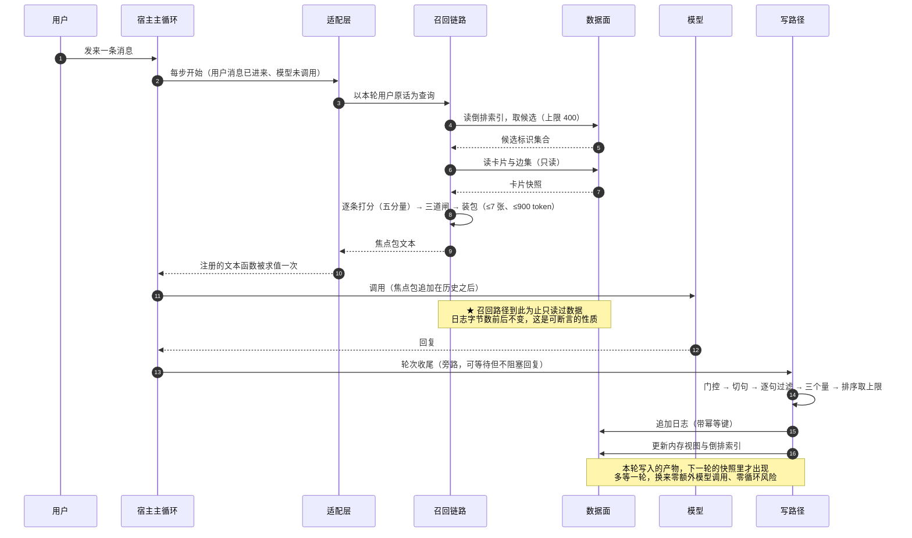

**读图要点**

- 两条竖线之间**没有等待**：模型调用与写路径是并列的两段，写路径慢不会拖慢回复。
- 收尾处**只写不改对话**。若在这里往本轮塞一条消息，宿主会为本轮再跑一步，
  成本翻倍，且塞进去的内容会作为真实历史留下，下一轮被当成用户原话。
- 「只读」不是靠自觉，是靠**日志字节数前后不变**这条可断言的观测。
  只有它没有配对观测（显式确认使用时字节数必须变大），「只读」可能只是因为整条链路没写成功。

---

### 图 11-2 夜整理的八步与三处顺序约束

**这张图回答什么**：八个步骤的真实顺序，以及**哪三处顺序不能换、换了会怎样**。

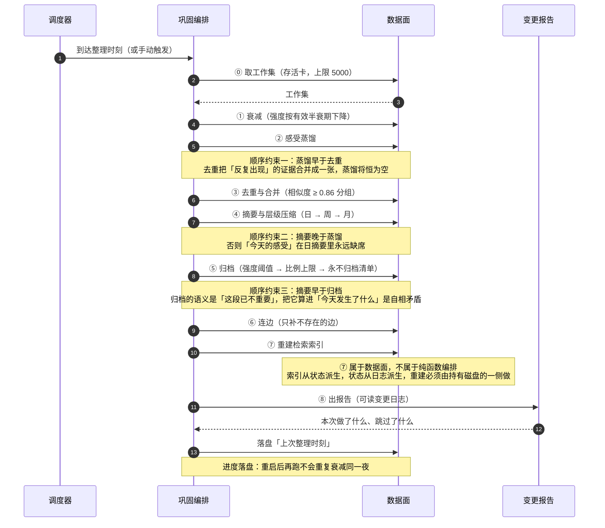

**读图要点**

- 三处约束**都不是风格问题**。换顺序的后果是「某个机制产出恒为零」，
  不报错、不崩溃、日志正常、测试可能全绿——这是最难发现的一类失效。
- ② 蒸馏早于 ③ 去重的理由可以一句话验证：把三张「上线又出问题」合并成一张，
  重复次数从 3 掉到 1，达不到「最少重复 2」的门槛，感受层一条都产不出来。
- ⑦ 的位置值得单独记：它**不在**纯函数编排里。纯函数层算不出索引，
  所以报告里的「重建了几条」不能由纯函数层给出——否则它会报一个没发生的动作。

---

### 图 11-3 上下文压缩与焦点包重建（含「没有钩子」这个缺口）

**这张图回答什么**：压缩发生时记忆插件**能做什么、不能做什么**，
以及「压缩后自愈」到底是机制还是形态。

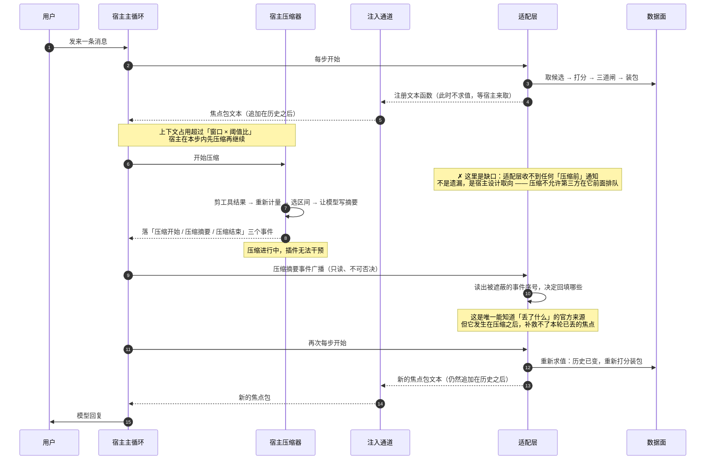

**读图要点**

- 图上那个「✗」是本篇最想让人看到的一处：**没有压缩前钩子**。
  任何「在压缩前把记忆抢救出来」的方案在架构上就不成立，不是没实现。
- 「压缩后自愈」不是新增能力，是**通道形态带来的性质**：注入文本是每轮重新求值的函数，
  压缩清空历史后，下一次求值自然产出新的焦点包。所以图上第二次求值不需要任何触发。
- 它成立有一个前提：**快照必须在历史的后面**。若快照在历史之前（写进系统提示词段），
  压缩之后那段内容还在，但它反映的是压缩前的世界，而系统不会报错。
  这类失败的特征是「每一层都正常，只有并排比较才看得出不一致」。
- 压缩摘要事件的回填**至今未实现**。图上画了这条通路，但它的状态是「已识别、未接线」，
  读图时不要把箭头当成已具备的能力。

---

### 图 11-4 到期提醒的自行唤醒

**这张图回答什么**：没有用户输入时，一轮对话是怎么被触发的，以及
「每日提醒为什么曾经永远停在第 N 天」。

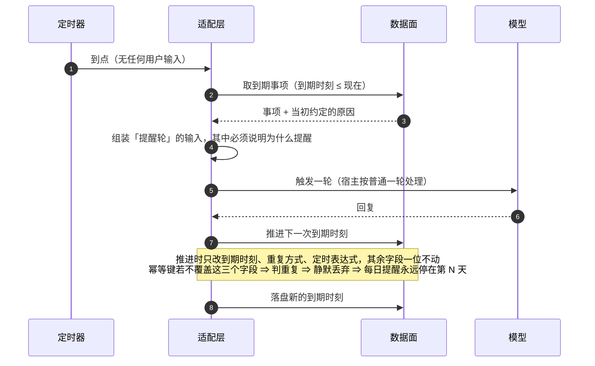

**读图要点**

- 「无用户输入」这一条是这张图的核心。宿主本身不会为提醒开一轮，
  所以唤醒必须由插件主动发起；发起之后它就走普通轮次的全套路径。
- 五种重复方式（一次性 / 每日 / 每周 / 定时表达式 / 表达式无法解析）在
  图 11-14 里展开，这里只画主干。
- 推进这一步的失败模式特别值得记：它是「只改一个字段」的路径，
  所以幂等键必须覆盖这个字段。同一个形状在写边、写卡、推进到期三处各犯过一次，
  每次的表现都是「改了但没生效」，而且几周都不出现。

---

### 图 11-5 崩溃到恢复

**这张图回答什么**：强杀之后重启，恢复动作的**顺序**，以及
「无半条记录」这半边为什么在本平台产不出来。

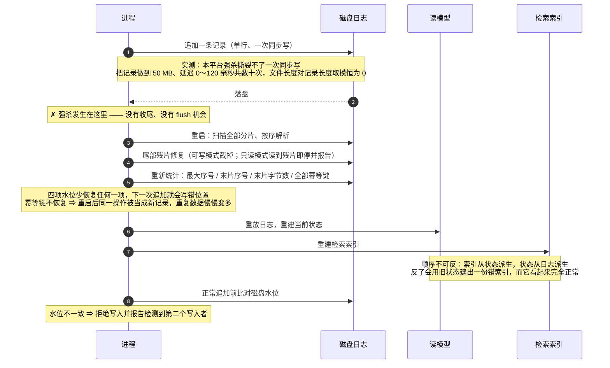

**读图要点**

- 修复之后必须**重新统计全部水位**，而不是「在残片前的位置继续」。
  少恢复一项，下一次追加就会写错位置，而错误会静默累积。
- 「无半条记录」这半边在本平台**不可能被观测到**：强杀撕裂不了一次同步写。
  所以这条验收口径必须改写成「磁盘自洽」——磁盘条数不少于已确认水位，
  且磁盘序号从 1 起严格连续。后一条才有判别力：丢会产生缺口，重写会产生重复。
- 「不多」这半边被明确放弃断言。强杀是异步的，存在「第 N+1 条已落盘、确认行还没被读到」
  的窗口，硬断言只会得到随负载飘的假红。**判据无法保证的时序，不该写进断言。**
- 残片修复这条路只能由手工构造的用例覆盖。它有一条断言守着：
  「本平台强杀产不出残片」。这条断言红了是好消息——说明撕裂可以复现，
  那时才应该把「无半条记录」加强成「必须有残片被修掉」。

---

### 图 11-6 影子模式下的召回

**这张图回答什么**：影子模式**算了什么、没改什么**，以及观察值从哪两个出口出去。

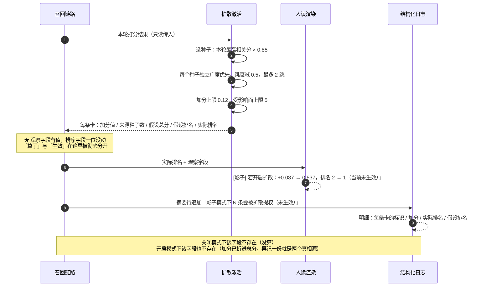

**读图要点**

- 影子模式必须**算真账**：种子集合与护栏必须与真实路径逐字相同，
  否则它预测的不是「打开后会怎样」，攒出的证据不足以支撑决策。
- 观察值**不许进可解释输出**。它会被人读渲染打印，假设值出现在那里，
  读者会以为它已经生效。所以它只有两个出口：人读渲染的独立「[影子]」行，与结构化日志的独立键。
- 上面那句「加 0.087 → 总分 0.537」是**示意值**，不是实测值。写具体数字是为了让人一眼看懂
  「加分」「原总分」「新总分」三者的关系；真实数值取决于当轮图谱与种子分布。
  **不要把这个数当成任何一篇里的标定结果。**
- 关闭与开启两种模式下**都不带这个字段**，哪怕是空数组也不行。
  带了空数组，运维看日志会以为当前跑的是影子模式。
- 「算出来没人看得见，等于没算」。这个字段加上之后曾经一个出口都没有：
  默认配置下每轮都在算，没有任何人能看到它算出了什么。
  **一个只有测试知道的机制，等于没有。**

---

### 图 11-7 写路径的门控与抽取

**这张图回答什么**：一轮对话为什么可能产出 0 张卡，以及 0 张**不是失败**。

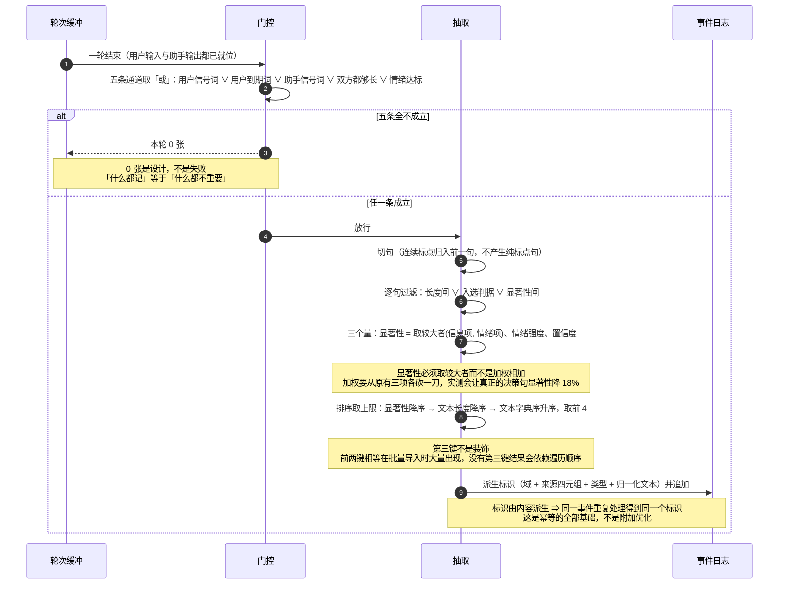

**读图要点**

- 门控是**整轮级**的，逐句过滤是**逐句级**的。两层不是重复，是不同粒度：
  门控回答「这一轮值不值得看」，逐句过滤回答「这一句值不值得记」。
- 五条通道取「或」而不是取「与」。取「与」会让「用户随口说了一句关键事实」
  这类最常见的场景全部落空。
- 情绪通道单列的理由在图上只是一条「∨」，但它背后是四道串联闸：
  门控、逐句过滤、长度闸、显著性。**任意一道恒假则整条路径恒假**，
  只修任何一道，最终出卡仍然是 0。修复前实测情绪句通过率 1/10，
  而且高情绪组 17% 低于低情绪组 43%——方向是反的。
- 前五个阶段全是纯计算，只有最后一步碰持久化。这让「同一轮输入两次得到逐位相同的草稿」
  成为可测试的性质，而不用模拟任何外部状态。

---

### 图 11-8 幂等：两条路径，一条必须不报错

**这张图回答什么**：重复提交时系统做了什么，以及为什么「静默丢弃」是这里唯一的失败模式。

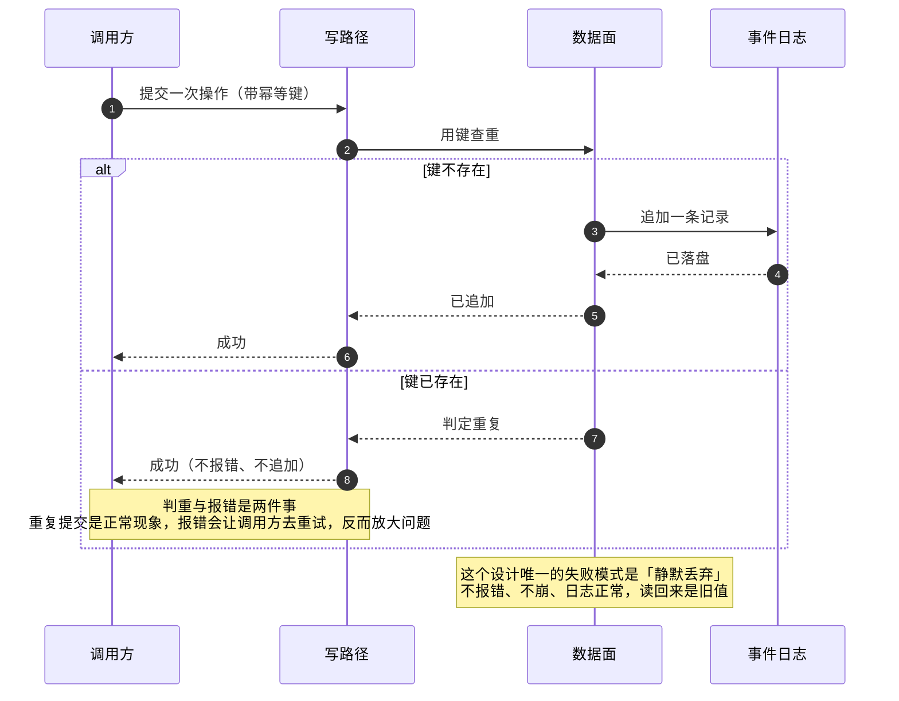

**读图要点**

- 两条路径都返回成功，所以**「成功」不能作为写进去了的证据**。
  唯一可靠的观测是磁盘上的记录条数与内容。
- 判据不是「同内容写两次只有一条」，而是「同标识不同内容写两次，读到的是新的」。
  只测前者等于只测了一半：前者绿的时候，后者可能根本不存在。
- 第二个方向**必须从磁盘重放验证**。幂等键影响的是「日志里有没有这条记录」，
  只看内存视图可能看不出差别——内存视图可能被另一条路径顺手改了。
- 键该包含哪些字段，判据是**字段的可变性分类**，不是「看起来重不重要」：
  可变字段全部要进键，因为它们可能单独变。按当前调用模式挑几个字段，
  得到的是「靠巧合安全」，不是「靠规则安全」。

---

## 三、B 组：状态图

### 图 11-9 记忆卡的生命周期

**这张图回答什么**：四个状态、哪些转移可逆、以及「已合并」为什么不是一个独立状态值。

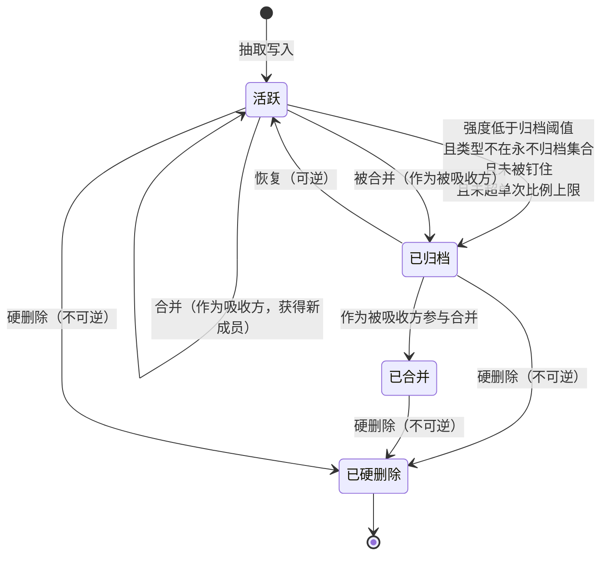

**读图要点**

- **归档不等于删除**。归档只是标记 + 压低强度 + 移出活跃集，字段全在，随时可恢复。
  这条性质让「遗忘」成为可逆操作，也正是「硬删除」必须独立成一个操作的理由。
- **合并是单向的**：图上没有「已合并 → 活跃」这条边，不是漏画。
  合并之后那几张卡的标识已经被新卡占用过，拆开会产生归属歧义。
- **「已合并」不是独立状态值**，它是「已归档 + 合并指向非空」的组合。
  用一个值表达两件事，就得在别处再存一次去向，于是同一个事实有两个存放位置。
  代价是：任何判断「这张卡是否存活」的地方都必须同时检查状态与合并指向，
  所以这条判断被收在一个地方，不允许各处自己写。
- 图上「活跃 → 已归档」有两条边，第一条写着四个条件。**四个条件里任何一个不成立，
  归档就不发生**——这也是为什么归档的实际条数常常远小于直觉。

---

### 图 11-10 扩散模式的三态

**这张图回答什么**：为什么是三个互斥的字符串而不是两个布尔，以及每个状态下观察字段的有无。

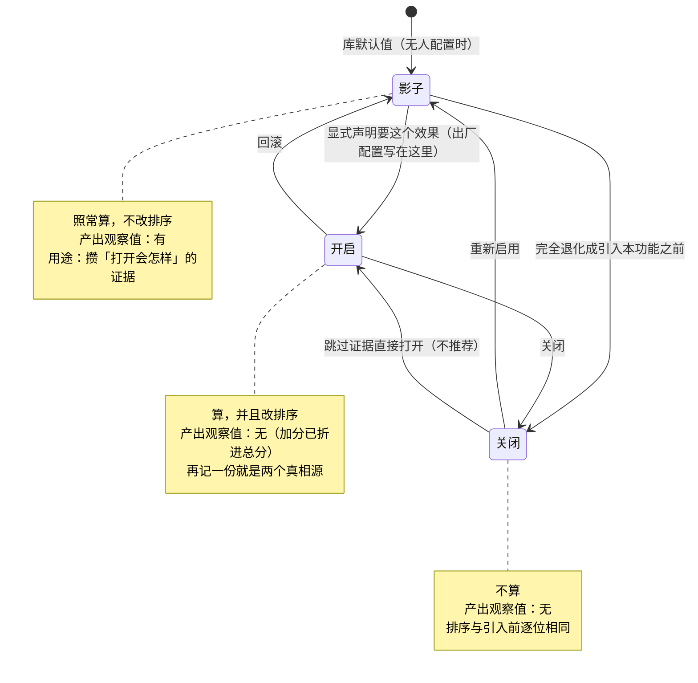

**读图要点**

- 用两个布尔（「启用」+「影子」）能表达出「关掉了但还在影子计算」这种自相矛盾的状态。
  互斥的三态从类型上就不允许这种组合，这比加一条校验更彻底。
- **库默认是影子，出厂配置写开启，这两件事不同且都是对的。**
  库默认回答「没人配置时该不该擅自改变每一次召回的排序」，答案是不该；
  出厂配置是显式意图，写在那里等于「我要」。
- 观察字段在**关闭与开启两个状态下都不存在**。关闭是没算，开启是已经折进总分。
  只有在影子里它才有值，因为那是它唯一的用途。

---

### 图 11-11 摘要卡的三级层级

**这张图回答什么**：日、周、月三级摘要怎么用**现有字段**表达层级，
以及为什么摘要卡不参与去重。

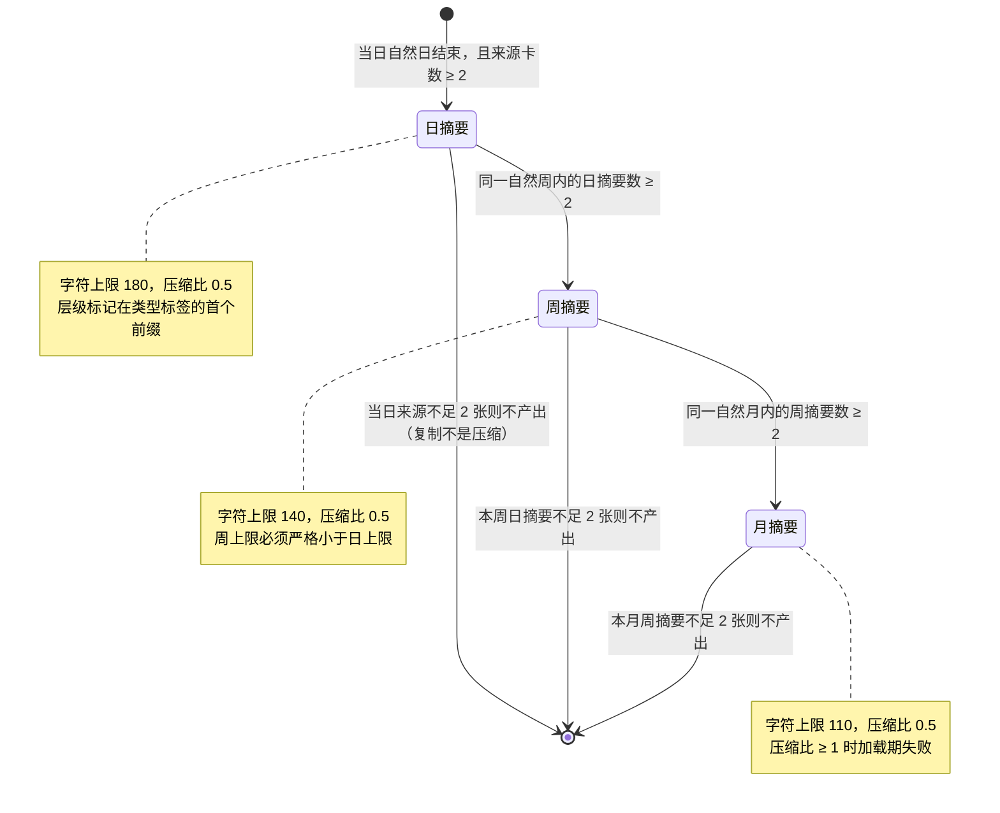

**读图要点**

- 层级**不新增字段**：是摘要由类型字段表示，哪一级由类型标签的首个前缀表示，
  时间键冗余在来源字段里，来源卡列表记在被压缩卡的清单里。
  为「摘要」再造一套数据结构，会让同一个事实有两处存放。
- 两道门禁缺一不可：**算术门**（预算 = 取较小者(层级上限, 向下取整(来源字符数 × 压缩比))，
  且实现从不拼接来源原文）+ **配置门**（压缩比 ≥ 1 直接校验失败、周月上限必须严格小于上一级、
  下级少于 2 张直接失败）。配置层拒绝比代码里自觉判断更硬——它让「假压缩」在配置层面不可能存在。
- **摘要卡不参与去重**。摘要文本是模板化统计句，任意两天的日摘要字面相似度极高，
  参与去重会被判重复合并掉，「每天一张日摘要」在去重后只剩一张，层级压缩被自己的去重逻辑毁掉。
  摘要的唯一性由日期键进标识来保证，不靠去重。
- 图上「来源不足 2 张则不产出」这条边容易被忽略。只有一个下级时，产出的是复制不是压缩，
  所以它被配置层直接拒绝，而不是靠代码自觉。

---

## 四、C 组：流程图

### 图 11-12 召回的七阶段与每一支的失败表现

**这张图回答什么**：从原始查询到焦点包，一共几道判据、每一支失败会怎样。

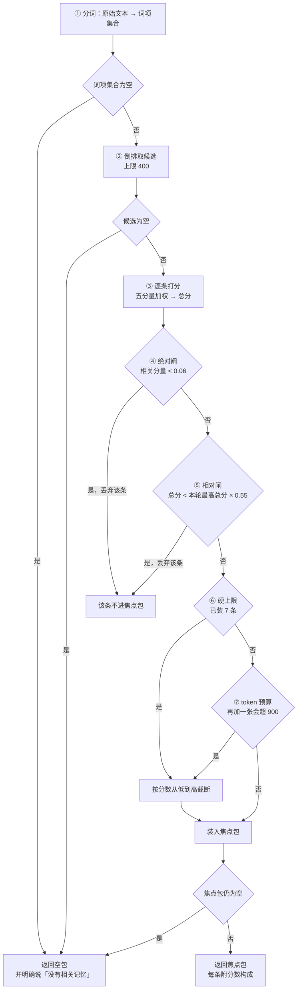

**读图要点**

- **绝对闸看的是相关分量，相对闸看的是总分，这是两把不同的尺子，不能统一。**
  总分里有 48% 的权重与查询无关（重要性、新鲜度、置信度），用它判断「够不够相关」，
  会把「不相关但很新」的卡放进来；而统一到相关分量又会误杀真正相关但旧的卡。
- 「丢弃」是逐条的，不是整轮的。一道闸不成立只影响那一张卡，不影响其他卡。
- 硬上限与 token 预算**都从低分端截断**。先按分数排序再截断，是因为截断必须
  在同样的输入下得到同样的结果——按集合遍历顺序截断会违反确定性。
- 空包必须带明确信号。**「没有相关记忆」和「没有记忆」是两句话**，
  前者是判据的结论，后者是库的状态。混在一起说，模型会开始编。

**表 11-2 每一支失败的后果与观测方式**

| 分支 | 判据 | 失败会怎样 | 怎么观测到它失败 |
|---|---|---|---|
| ① 分词 | 词项集合非空 | 空查询退化为「返回全库最新」 | 空查询的焦点包内容不是空 |
| ② 取候选 | 候选池非空 | 池外邻居永远进不来 | 池外候选的词项交集恒为 0（这是构造决定的，不是缺陷） |
| ③ 打分 | 五分量齐备 | 少算一个分量，排序静默偏移 | 每条卡的分数构成各项之和与总分不等 |
| ④ 绝对闸 | 相关分量 ≥ 0.06 | 不相关的卡被硬塞 | 无关查询的焦点包非空 |
| ⑤ 相对闸 | 总分 ≥ 最高 × 0.55 | 低分卡挤掉高分卡 | 焦点包内出现总分明显低于最高分的卡 |
| ⑥ 硬上限 | ≤ 7 条 | 焦点包过长，挤占上下文 | 条数超过上限 |
| ⑦ token 预算 | ≤ 900 | 注入被宿主截断，末尾卡半截 | 渲染长度超过预算 |

---

### 图 11-13 三闸漏斗

**这张图回答什么**：三道闸串起来之后，每一级还剩多少、瓶颈在哪一级。

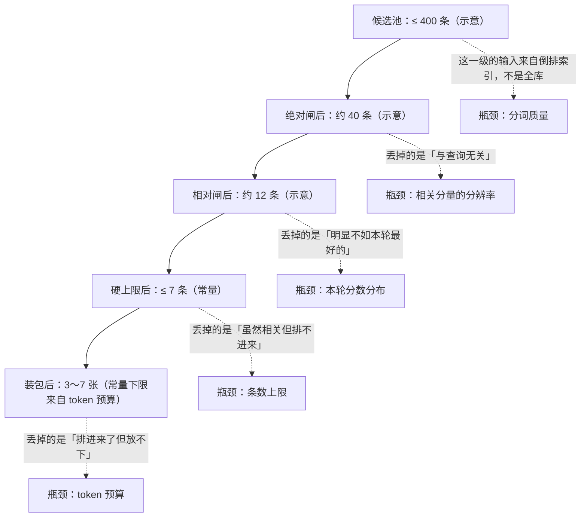

**读图要点**

- 三级丢的东西**不是同一类**：绝对闸丢「无关」，相对闸丢「明显差」，硬上限丢「次优」。
  把三级并成一级，就分不清一次空包是「库里没有」还是「都被阈值挡了」。
- 图上标「示意」的条数只表示相对大小。真实条数取决于语料，
  写死一个数会让读者以为那是设计目标。
- **两道截断的顺序很要紧**：条数上限先生效还是 token 预算先生效，取决于卡的文本长度。
  实测：短卡（≤ 100 字）时条数上限先生效，长卡（≥ 120 字）时 token 预算先生效。
  所以「焦点包一般几张」这个问题没有单一答案，要问「在什么文本长度下」。
- 密度与召回率是**权衡关系**，不是同时优化。这一处刻意牺牲召回率换专注：
  焦点包目标 3～7 张，而不是「尽量多给」。

---

### 图 11-14 到期推进的决策树

**这张图回答什么**：五种重复方式各自怎么算下一次，以及算不出来时怎么办。

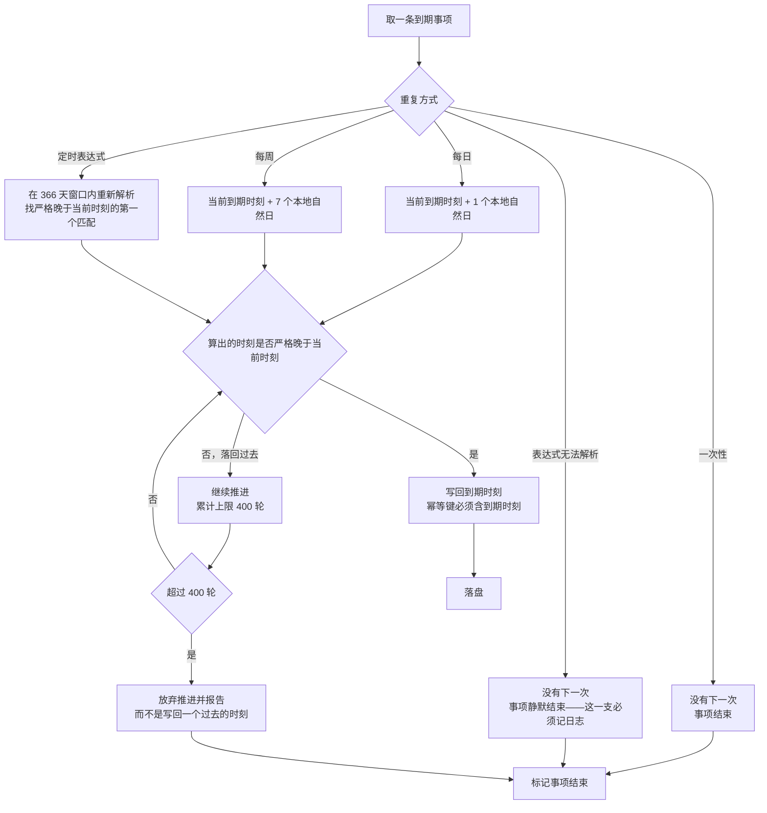

**读图要点**

- 「严格晚于当前时刻」这条不变量是防死循环的。设备休眠、时区跳变、手动改系统时间，
  都会让「加一天」落回过去，于是下一次检查立刻又到期——**表现为提醒连响几百次**。
- 400 轮上限是这条循环的硬护栏。超过就放弃并报告，而不是写回一个过去的时刻：
  写回过去的时刻会让这个事项永远卡在「已到期但推不动」的状态。
- 「表达式无法解析」这一支**没有下一次**，也就是事项静默结束。
  它必须记日志，因为「提醒再也不响」和「提醒还没到」在用户侧观测值完全一样。
- 推进只改到期时刻、重复方式、定时表达式三个字段。这正是幂等键必须覆盖这三个字段的理由：
  只改它们、别的字段一位不动，键若不含它们就与上次完全相同，写入会被判重复而丢弃。

---

### 图 11-15 归档的决策流程

**这张图回答什么**：一条卡要满足几个条件才会被归档，以及为什么「归档条数」常常远小于直觉。

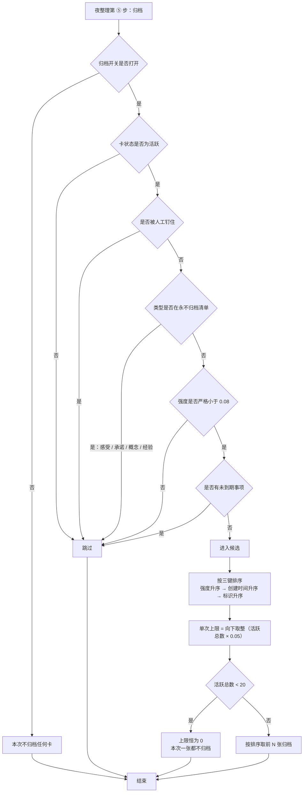

**读图要点**

- **五个条件取「与」**，任何一个不成立就不归档。所以「强度够低」只是必要条件之一，
  不是充分条件——这就是为什么归档条数常常远小于「低于阈值的卡数」。
- 单次比例上限（5%）是**向下取整**的，且活跃总数少于 20 张时上限恒为 0。
  这两条合起来的效果是：小库在早期**根本不会归档**，这不是 bug，是防止小样本下
  把整个库清空。
- 排序键有三个，第三键是标识升序。前两键相等的情况在批量导入时大量出现，
  没有第三键结果会依赖集合遍历顺序，直接违反「同一输入十次结果逐位相同」。
- 四类永不归档的理由各不相同，但指向同一件事：**归档它们等于把系统的产出删掉。**
  感受是记忆系统的最终产物，承诺是未来的义务，概念的价值不随时间衰减，
  经验的提炼成本高。此外任何被钉住的卡也不归档，不论类型。

---

### 图 11-16 去重与合并

**这张图回答什么**：一组相似卡怎么被找出、怎么选代表、合并时各字段怎么取值、溯源怎么留。

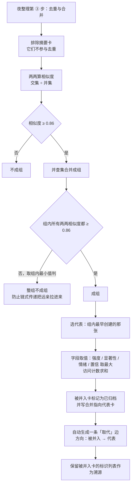

**读图要点**

- **组内相似度取最小值**，不是取平均、不是「有一条边够就成组」。
  用「有一条边够」会让 A 像 B、B 像 C 就把 A 和 C 拉进同一组，
  而 A 与 C 可能毫不相干。这是并查集在这种场景下最容易犯的错。
- 代表是**组内最早创建**的那张，不是最强的那张。理由是稳定性：
  「最早创建」不随强度变化而变，用它当代表，同样的输入永远得到同样的合并结果。
- 四个字段取最大、访问计数求和。取最大是「不因为合并而丢失最强的那一面」，
  求和是「使用频次是累加的，不是择一的」。
- 合并**保留溯源且是单向的**。从代表卡能查到它由哪些卡合并而来，从被并入卡能查到它去了哪里。
  系统不提供「拆开」操作，因为拆开之后那几张卡的标识已经被占用过，会产生归属歧义。

---

### 图 11-17 感受蒸馏

**这张图回答什么**：感受卡是怎么从一堆事件卡里被**产出**的，以及四个门槛各挡什么。

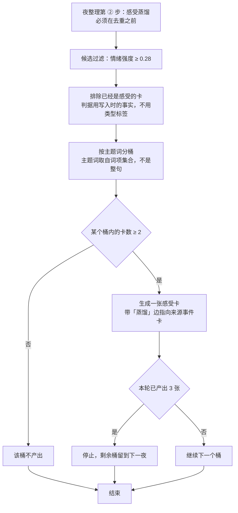

**读图要点**

- 这个机制曾经**产出恒为零**，而且有三个互相独立的原因，观测值完全一样（都是 0）：
  情绪句写不进来（没有原料）、主题词按空格切整句（桶数恒为 0）、
  判据读类型标签（原话卡被一并排除）。**同一个观测值背后可以是完全不同的根因**，
  只能靠逐层探针区分，不能靠看总数。
- 主题词必须取自**词项集合**，不能取整句。归一化会把标点全换成空格，
  按空格切出来的是整段长句，两张卡几乎不可能共享整句。
  但也不能直接对原文分词——二元组会跨标点生成假主题。
- 「排除已经是感受的卡」必须用**写入时确定的事实**（这张卡是不是由蒸馏产出的），
  不能用分类器的输出（类型是不是感受）。旧数据上两者恰好等价，
  修好情绪通道之后就不等价了：真实情绪句都被判成感受类型，原话卡被一并排除。
- 产出的文本**只说「这件事反复牵动情绪」，绝不说开心还是难过**。
  这是有意保留的局限：当前只度量强度、不度量极性。有一条测试故意断言这个局限存在，
  它的作用是防止有人把「能产出」误读成「能判断情绪好坏」。

---

## 五、D 组：结构图

### 图 11-18 四层的依赖方向

**这张图回答什么**：依赖只朝一个方向，以及「为什么内核层零 IO」是这条方向的必然结果。

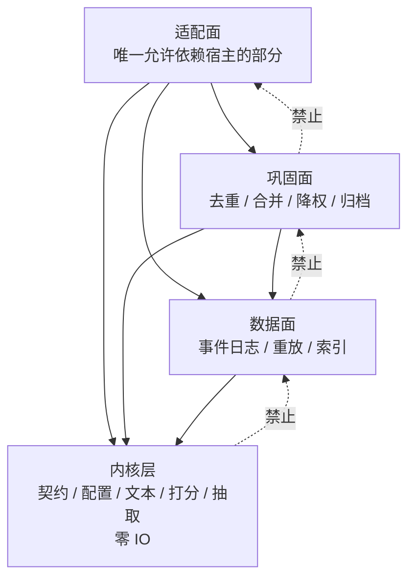

**读图要点**

- 实线是允许的依赖，虚线是**一律视为错误**的反向依赖。反向依赖为零，是
  「宿主升级只改适配层」这条可维护性要求的全部基础。
- 内核层零 IO 不是洁癖，是**可测试性**的直接来源：打分、去重、衰减是纯函数，
  所以「同一输入十次结果逐位相同」可以被断言，而不用模拟任何外部状态。
- 依赖方向还决定了**谁拥有真相源**：日志在数据面，读模型从日志派生，
  巩固面只通过数据面改状态。所以「投影层不得改写事实」是一条硬边界——
  一旦投影层开始「修正」不认识的值，日志写 A、重放成 B，确定性立刻消失。
- 适配面是**唯一**允许依赖宿主的部分。这条限制的代价是所有宿主差异都要在适配层收敛，
  收益是宿主预览版的破坏性变更不会渗透到数据面。

---

### 图 11-19 一条日志、两个视图、三个面

**这张图回答什么**：整个系统的一句话结构，以及哪些东西可以丢弃重建、哪些不可以。

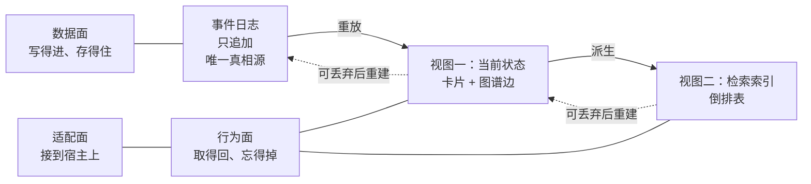

**读图要点**

- 箭头方向是**派生方向**，不是数据流方向。虚线表示「丢弃之后能重建回来」——
  这正是「索引可重建」这条要求的形状：删掉索引，系统自己从状态重建，不影响真相源。
- 三个面不是三个模块，是三个**关注点**：数据面关心「写得进、存得住」，
  行为面关心「取得回、忘得掉」，适配面关心「接到宿主上」。同一个模块可以同时服务两个面，
  但每个面出问题时该去哪里找，是明确的。
- 这张图解释了为什么「导出即导出真相源」：导出日志，就导出了全部信息；
  导出视图，导出的是某一时刻的派生结果，重建之后可能不同。

---

### 图 11-20 两条注入通道的差别

**这张图回答什么**：为什么只有一条通道可用，以及「用另一条会怎样」的具体后果。

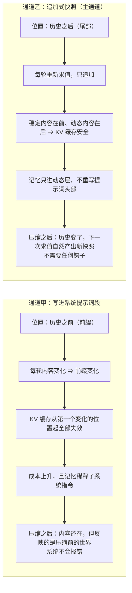

**读图要点**

- 两条通道的差别**不在内容，在位置**。同一个焦点包文本，放在历史之前会毁掉 KV 缓存，
  放在历史之后不会。这也解释了为什么「压缩后自愈」只在通道乙成立。
- 通道甲的问题在压缩场景下最隐蔽：内容还在、渲染正常、不报错，
  只是它指向的上下文已经不存在了。**每一层都正常，只有并排比较才看得出不一致。**
- 「稳定内容在前、动态内容在后」是一条硬约束，不是性能建议。它决定了记忆卡
  **绝不能进系统提示词**，只能进动态层。
- 通道乙有一个必须验证的前提：宿主是否真的每轮重新求值注入文本。
  如果它缓存了第一次的结果，那么「压缩后自愈」整条推论不成立。
  这一条至今**未经真实宿主验证**，是本篇最后要说的诚实边界之一。

---

### 图 11-21 影子观察值的两个出口

**这张图回答什么**：一个「算了但不生效」的机制，靠什么让人看见它算了什么。

```mermaid
flowchart TD
    A["影子模式：照常算扩散"] --> B["观察值<br/>加分 / 来源种子数 / 假设总分 / 假设排名 / 实际排名"]
    B --> C{出口}
    C -->|出口一| D["人读渲染：独立的「[影子]」行"]
    C -->|出口二| E["结构化日志：独立的键"]
    B --> F["禁止：可解释输出"]
    F --> G["原因：它会被打印给人看<br/>假设值出现在那里，读者会以为它已生效"]
    D --> H["必须明说「当前未生效」"]
    E --> I["摘要行写「影子模式下 N 条会被扩散提权（未生效）」<br/>明细给每条卡的标识与两个排名"]
    H --> J["人能看到：它改了什么"]
    I --> J
    J --> K["这才构成「打开它」的证据"]
```

**读图要点**

- 观察值**不许进可解释输出**，这是三条约束里最容易被违反的一条：把它加进分数构成看起来
  「信息更全」，实际效果是让人误读。
- 「总分」那一行必须仍显示**实际值**，假设值只能出现在独立的「[影子]」行。
  混在一行里，读者无法区分哪一个是生效的。
- 两个出口的措辞都要带「未生效」。这一行长得像分数的一部分，读者极易误读，
  所以措辞不是修饰，是判据的一部分。
- 这张图回答的是「算出来没人看得见，等于没算」这条判断的落地形态。
  同一个形状在别处也出现过：参数被声明但零读取、确认入口零调用方、
  配置项写了但生产代码从不读它——**代码写了、链路不通，等于不存在。**

---

## 六、图索引表

**表 11-3 本篇 21 张图的总索引**

| 编号 | 标题 | 类型 | 回答什么问题 | 对应篇目 |
|---|---|---|---|---|
| 图 11-1 | 一轮对话的完整时序 | 时序图 | 读写两段各在哪、谁阻塞谁、为什么本轮写入本轮用不上 | 03、05、06 |
| 图 11-2 | 夜整理的八步与三处顺序约束 | 时序图 | 八步真实顺序、哪三处不能换、换了会怎样 | 07 |
| 图 11-3 | 上下文压缩与焦点包重建 | 时序图 | 压缩时能做什么、不能做什么、「没有钩子」这个缺口在哪 | 02、03 |
| 图 11-4 | 到期提醒的自行唤醒 | 时序图 | 无用户输入怎么触发一轮、推进为什么会静默失败 | 07 |
| 图 11-5 | 崩溃到恢复 | 时序图 | 恢复动作的顺序、四项水位、「无半条记录」为什么测不到 | 04 |
| 图 11-6 | 影子模式下的召回 | 时序图 | 算了什么、没改什么、观察值从哪出去 | 03、06 |
| 图 11-7 | 写路径的门控与抽取 | 时序图 | 一轮为什么可能 0 张、0 张为什么不是失败 | 05 |
| 图 11-8 | 幂等：两条路径 | 时序图 | 重复提交做了什么、唯一的失败模式是什么 | 04 |
| 图 11-9 | 记忆卡的生命周期 | 状态图 | 四个状态、哪些可逆、「已合并」为什么不是独立状态 | 04 |
| 图 11-10 | 扩散模式的三态 | 状态图 | 为什么是三个互斥值、每个状态下观察字段的有无 | 03、08 |
| 图 11-11 | 摘要卡的三级层级 | 状态图 | 三级怎么用现有字段表达、为什么摘要不参与去重 | 07 |
| 图 11-12 | 召回的七阶段与失败表现 | 流程图 | 几道判据、每一支失败会怎样 | 06 |
| 图 11-13 | 三闸漏斗 | 流程图 | 每级还剩多少、瓶颈在哪一级 | 06 |
| 图 11-14 | 到期推进的决策树 | 流程图 | 五种重复方式各自怎么算、算不出来怎么办 | 07 |
| 图 11-15 | 归档的决策流程 | 流程图 | 几个条件取与、为什么归档条数远小于直觉 | 07 |
| 图 11-16 | 去重与合并 | 流程图 | 怎么分组、怎么选代表、字段怎么取值、溯源怎么留 | 07 |
| 图 11-17 | 感受蒸馏 | 流程图 | 感受卡怎么被产出、四个门槛各挡什么 | 07 |
| 图 11-18 | 四层的依赖方向 | 结构图 | 依赖只朝一个方向、零 IO 为什么是必然 | 03 |
| 图 11-19 | 一条日志、两个视图、三个面 | 结构图 | 哪些可丢弃重建、哪些不可以 | 04 |
| 图 11-20 | 两条注入通道的差别 | 结构图 | 为什么只有一条可用、用另一条会怎样 | 02、03 |
| 图 11-21 | 影子观察值的两个出口 | 结构图 | 算了但不生效的机制靠什么让人看见 | 03、06 |

**表 11-4 本篇图的四类用途**

| 用途 | 用哪几张图 | 什么时候看 |
|---|---|---|
| 接手实现 | 11-1、11-2、11-7 | 第一次读代码之前，先建立顺序感 |
| 排查「机制没生效」 | 11-6、11-12、11-17、11-21 | 有产出但不对，或产出恒为零 |
| 排查「数据不对」 | 11-5、11-8、11-9、11-16 | 条数不对、重复、读回旧值 |
| 评审架构 | 11-3、11-18、11-19、11-20 | 判断这套设计能不能承受宿主变更 |

---

## 七、本篇的诚实边界

**一、图上画了但未接线的通路，必须按「不存在」理解。**

最明确的一处是图 11-3 里的「压缩摘要事件回填」。箭头画出来了，
但它的真实状态是「已识别、未实现」。图上画出来是因为**通路本身是设计的一部分**，
不画会让读者以为设计里没有这条补偿手段；但读图时不能把箭头当成已具备的能力。
同类情况还有图 11-10 的边权可塑性：函数齐备、测试齐全、**生产代码零调用方**，
且打开开关会在加载期失败——这是有意的，不是遗漏。

**二、图不能替代验证，尤其不能替代真实宿主上的验证。**

本篇所有时序图都是**按宿主文档推断**的形状，没有一张是在真实宿主上录下来的。
具体有两条至今未验证：注入通道的文本是否真的每轮重新求值（若否，图 11-3 的整个
「自愈」推论不成立）；注入文本的位置是否真的稳定在历史之后（若否，KV 安全的理由不成立）。
这两条一旦不成立，受影响的不是本篇的图，而是 03 与 06 的结论。

**三、时序图的「顺序」是逻辑顺序，不是性能顺序。**

图上「写路径」画在模型回复之后，这只表示**逻辑上不阻塞**，不表示它在物理上一定后发生。
实际上写路径可能在回复之前就已经跑完了。把逻辑顺序读成时间顺序，会得出
「回复一定比写快」这类无法验证的结论。

**四、漏斗的量级是示意，不是承诺。**

图 11-13 标了「示意」的四个数只表示相对大小。真实的候选数、过闸数、
装包数取决于语料与卡文本长度，且已经知道「条数上限先生效还是 token 预算先生效」
会随文本长度翻转。任何按这四个数做的容量规划都是错的。

**五、本篇不引入新结论，因此也不能单独作为评审依据。**

一篇图集的权威性来自它所引用的正文，不来自它自己。若某张图与对应篇目的正文冲突，
**以正文为准，并应把图改掉**——图的错更难发现，因为它看起来更直观，
而直观的东西读者不会去核对。
