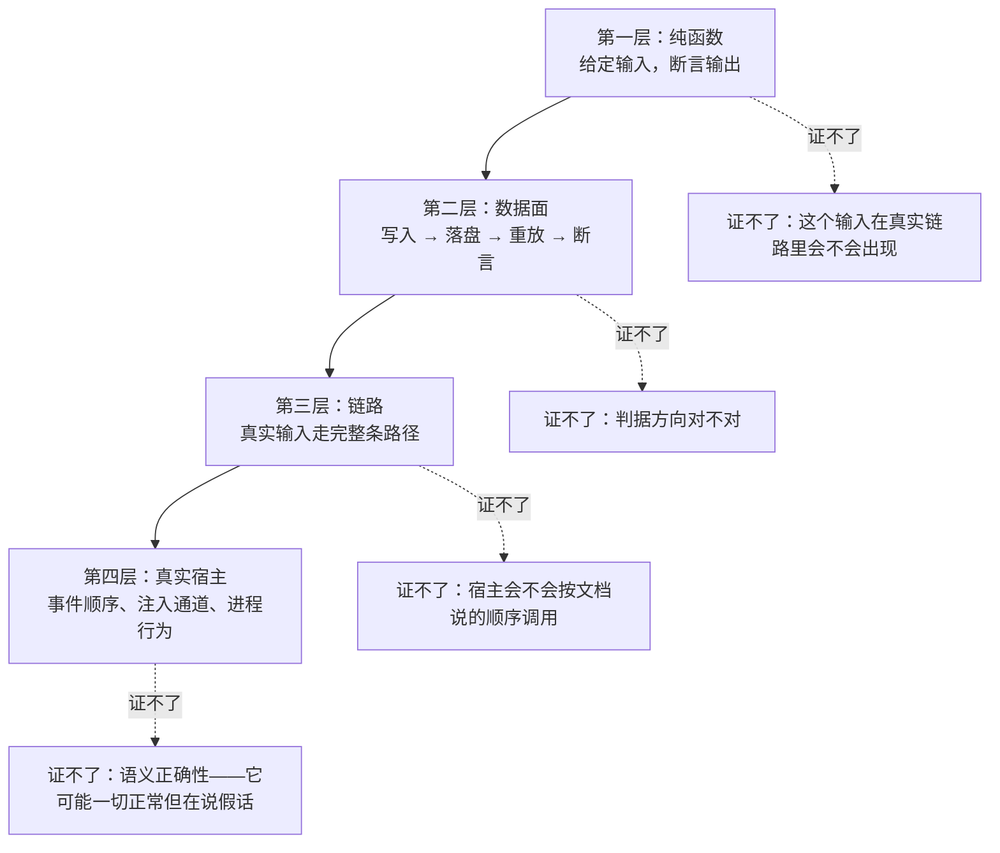
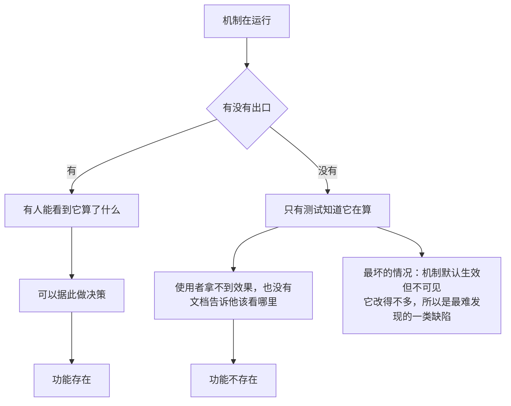
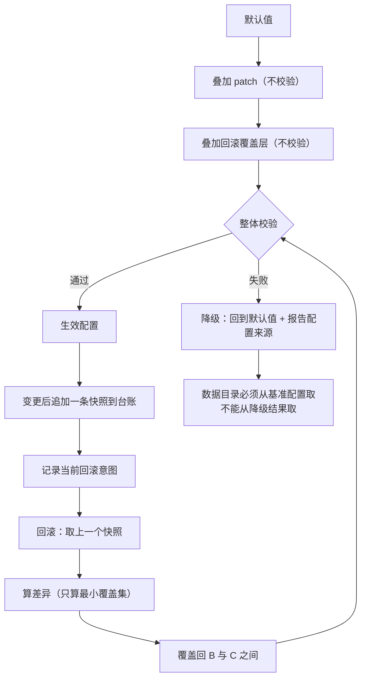
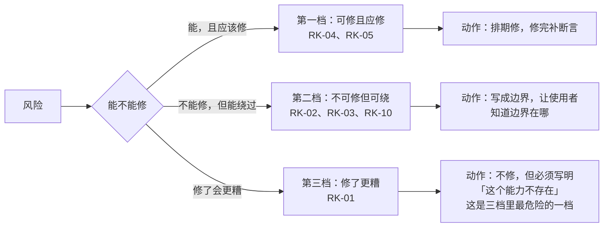

# 12 · 验收、可观测性与风险

> **本篇回答什么**：45 条验收到底怎么验、验到哪一层、哪几条永远验不到；
> 可观测性为什么不是「加日志」而是一条设计判断；配置版本化为什么不是「存个版本号」；
> 以及一张把「已知但没解决」的事全部摊开的风险登记表。
>
> **前置**：全部。本篇是全系列的收口——它不复述设计，只回答「凭什么说它成了」
> 与「哪些地方它其实没成」。

---

## 一、分母：45 是怎么数出来的

> 本篇只给**关键的表**编号（表 12-1 起）。行文里的小表不编号——
> 一张表被编号就等于被承诺「以后还要维护它」，而有些小表只是把一句话排开。
> 编号只给那些**读者会回头查**的表。

### 1.1 先把分母钉死

**表 12-1 验收分母的构成**

| 类 | 条数 | 编号范围 | 性质 |
|---|---|---|---|
| 功能需求 | **32** | FR-A1～A7、FR-B1～B7、FR-C1～C5、FR-D1～D4、FR-E1～E4、FR-F1～F5 | 做到算完 |
| 稳定性验收 | **8** | ST-1～ST-8 | 硬指标，可自动判定 |
| 场景验收 | **5** | SC-1～SC-5 | 需要人判断 |
| **合计** | **45** | | |

分组再核一遍：7 + 7 + 5 + 4 + 4 + 5 = **32**，加 8 加 5 得 **45**。

**这条加法必须写出来，因为它出过一次事。** 覆盖报告曾把分母写成 30。
30 与 45 的差别不是「少了 15 条」这么简单：**每一个百分比都错了，
而没有任何一条断言因此变红。** 覆盖率是算出来的数字，不是跑出来的断言；
分母错了它照样输出一个看起来很正常的百分比，没有任何机制会发现。

> **任何覆盖率报告必须写明分母是怎么数出来的。** 不写分母来源的百分比，
> 是一个无法被证伪的数字——它既不能被确认，也不能被推翻。

### 1.2 三条计数纪律

| 纪律 | 具体做法 | 违反的后果 |
|---|---|---|
| **分母必须可重算** | 报告里写出分类与条数，让读者能自己加一遍 | 分母错了没人发现 |
| **漏条目比写错条目更隐蔽** | 逐条对照编号清单打勾，不靠印象回忆 | 一条已完成的需求在审计里彻底不存在 |
| **汇总句必须与明细同批改** | 明细改了就立刻改小结；做不到就别写小结 | 明细修好后小结越拖越离谱 |

第二条值得展开：**写错一条，覆盖率会偏；漏掉一条，覆盖率既不会偏也不会正——那条需求直接消失了。**
曾有一次审计整条漏掉了两条已实现且有测试的需求，报告仍然给出了一个「看起来合理」的覆盖率。
**漏条目不会触发任何异常，这是它比写错更危险的原因。**

第三条的教训同样具体：三处「小结」句在明细修好之后没人回头改，
于是同一份文档里明细说「已补」，小结说「缺失」。读者只会读小结。

---

## 二、四个验证层次

### 2.1 层次不是「严格程度」，是「能证伪什么」

**图 12-1 四个验证层次与各自证不了的东西**

**这张图回答什么**：为什么「纯函数全绿」不能推出「功能成立」，以及每一层各自缺哪一块。

**读图要点**

- 层次越高，能证伪的东西越多，但**成本也越高**，所以不能全都堆到第四层。
  正确的做法是：能用纯函数证的用纯函数证，然后把「纯函数证不了的那一半」明确标出来。
- 第四层也证不了语义。一条格式完全正确、链路完全通畅、测试全绿的产出，
  可能在说假话——它只能靠**读产出内容**发现。这是本篇唯一一条无法自动化的验收手段。

### 2.2 四个层次各能抓到什么

**表 12-2 四个验证层次的能力边界**

| 层次 | 典型手段 | 能抓到 | 抓不到 | 成本 |
|---|---|---|---|---|
| **纯函数** | 给定输入断言输出 | 公式错、边界错、排序不稳定 | 输入在真实链路里是否会出现 | 极低 |
| **数据面** | 写入 → 落盘 → 重放 → 断言 | 幂等失效、重放不确定、水位不一致、更新被静默丢弃 | 判据方向对不对 | 低 |
| **链路** | 真实输入走完整条路径 | 「判据方向反了」「该更新的没更新」 | 宿主事件顺序、注入通道行为 | 中 |
| **真实宿主** | 起真进程、真插件 | 注入通道是否每轮求值、事件顺序、强杀行为 | 语义正确性 | 高 |

**第三层最关键的一句**：链路层能抓到「判据方向反了」。
纯函数层抓不到这个，因为纯函数测试的输入是**测试自己构造的**，
构造的时候已经默认了「这些输入应该被判为相关」。判据方向反了，
构造的输入也跟着反，测试照样全绿。

真实例子：冲突判据的方向曾经是反的——真正冲突的两条（相似度 0.524）被判为「不冲突」，
三对毫不相干的（相似度 0.15～0.19）被判为「冲突」。**纯函数测试全绿**，
因为测试构造的是「看起来像冲突」的输入，而判据的实现恰好也按那个方向理解。
这类缺陷只能靠**用真实语料跑一遍，然后读结果**发现。

### 2.3 为什么数据面必须能重放

幂等这类逻辑有两个方向，只测一个等于没测：

| 方向 | 断言 | 漏掉会怎样 | 看得见吗 |
|---|---|---|---|
| 该丢弃的丢弃 | 同内容写两次，库里只有一条 | 重复数据堆积 | **看得见** |
| **该更新的更新** | **同标识不同内容写两次，读到的是新的** | 更新被静默丢弃 | **看不见** |

第二个方向**必须从磁盘重放验证**。幂等键影响的是「日志里有没有这条记录」，
只看内存视图可能看不出差别——内存视图可能被另一条路径顺手改了。
同一个形状在写边、写卡、推进到期三处各犯过一次，每次的表现都是「改了但没生效」，
而且几周都不出现。

### 2.4 一个例子：判据方向反了，四层各自会说什么

冲突判据方向反了这件事，值得当成标本走一遍四个层次，因为它最清楚地说明了
「层次」不是一个抽象的严格度阶梯，而是四种**互相不可替代**的证据。

| 层次 | 会说什么 | 为什么这么说 |
|---|---|---|
| 纯函数 | **全绿** | 测试构造的输入是「看起来像冲突的两条」，而实现恰好也按那个方向理解——构造与实现同错，所以相消 |
| 数据面 | **全绿** | 写入、落盘、重放全都正常；冲突标记只是一个字段，它被正确持久化了，只是值不对 |
| 链路 | **可能红，也可能绿** | 取决于测试语料里有没有「真正冲突但相似度中等」的样本。若语料是测试自己写的，多半没有 |
| 真实宿主 | **红** | 用户说「我上次说的是 A 不是 B」，系统答不出来——这是语义判断，只能由人发现 |

**这张表最要紧的一行是第三行。** 链路层「可能绿」的意思是：**它有这个能力，
但不保证用上了**。要让它红，语料必须包含「真冲突但相似度不高」与
「不冲突但相似度高」这两种反直觉样本。构造语料时按直觉挑样本，
链路层和纯函数层会一起绿。

> **判据：一条测试的语料是谁写的？** 若语料和判据出自同一个人的同一种直觉，
> 那么这条测试验证的是「这个人前后一致」，不是「判据正确」。

---

## 三、32 条功能需求的验证矩阵

**表 12-3 32 条功能需求的验证矩阵**

> 「验证层次」这一列是本篇最有价值的东西：它告诉你**这条需求的证据有多强**。
> 标「纯函数」的，意味着它只在「测试自己构造的输入」下被验证过。

| 编号 | 一句话 | 验证方式 | 验证层次 | 反向测试 | 已知缺口 |
|---|---|---|---|---|---|
| FR-A1 | 轮次边界异步写卡，不阻塞回复 | 引擎层断言写卡不改变回复路径的返回值 | 链路 | 有 | 无 |
| FR-A2 | 幂等：重复处理不产生重复卡 | 重复导入同一会话，比卡数；再测「同标识不同内容」读到新值 | **数据面（重放）** | 有 | 无 |
| FR-A3 | 原子性：崩溃后无半条记录 | 真实子进程强杀 + 重启 | **真实宿主（进程）** | 有 | **「无半条」这半边测不到**，见 4.3 |
| FR-A4 | 来源指针：任意卡能定位回原文 | 抽样 100 张，逐字段核对四元组 | 数据面 | 有 | 「格式正确」与「内容真能对上」要分开断言 |
| FR-A5 | 修正留痕：旧版本可查 | 改一次再读历史 | 数据面 | 有 | 无 |
| FR-A6 | 全量导出与重建 | 导出 → 重建 → 逐字段抽查 | 数据面 | 有 | 100 条一致必须逐字段，不能只比数量 |
| FR-A7 | 索引可丢弃重建 | 删索引 → 重建 → 召回结果一致 | 数据面 | 有 | 无 |
| FR-B1 | 打分公式五分量加权 | 给定输入断言各分项与总分 | **纯函数** | 有 | 无 |
| FR-B2 | 三道闸，全低分不硬塞 | 无关查询得空包；三道闸各挡各的 | 纯函数 + 链路 | 有 | 无 |
| FR-B3 | 确定性：连续 10 次逐位相同 | 同进程 10 次 + **跨进程重放** 10 次 | 纯函数 + 数据面 | 有 | 跨进程那一半不可省 |
| FR-B4 | 可解释：每条附分数构成 | 断言渲染文本含各分项 | **纯函数** | 有 | 无 |
| FR-B5 | 冲突显式：标出并暴露双方 | 用真实语料跑冲突判定 | 链路 | 有 | **判据方向是反的**，见 RK-01 |
| FR-B6 | 不编造：空召回给明确信号 | 空库与无关话题各一次 | 链路 | 有 | 「无关」语料必须验零词项交集 |
| FR-B7 | 看到与使用分离：召回只读 | 召回前后日志字节数不变 **+** 确认使用时必须变大 | **链路** | 有 | 只有前者没有后者，「只读」可能只是整条链路没写成功 |
| FR-C1 | 夜整理最小集 + 报告 + 进度落盘 | 跑一遍夜整理，读报告；重启后再跑不重复衰减 | 数据面 | 有 | 无 |
| FR-C2 | 遗忘可逆：归档可恢复 | 归档 → 恢复 → 能正常召回 | 数据面 | 有 | 必须配「归档确实发生过」的前提断言 |
| FR-C3 | 阈值可配 + 永不归档类别 | 构造四类卡，断言全部不归档 | **纯函数** | 有 | 无 |
| FR-C4 | 库增长有界 | 连续多轮写入，观察活跃数是否趋于平稳 | 数据面 | 有 | 无 |
| FR-C5 | 感受必须被产出 | 从一批事件卡产出感受卡 + 带溯源边 | 纯函数 + 链路 | 有 | **只测强度不测极性**，见 RK-10 |
| FR-D1 | 绝对时间读数 | 新会话问时间 | 链路 | 有 | 依赖宿主时间上下文 |
| FR-D2 | 相对时间数值进入打分 | 断言时间项来自真实时间差 | **纯函数** | 有 | 无 |
| FR-D3 | 到期提醒四种重复方式 | 每种各跑一次，含「无法解析」这一支 | 链路 | 有 | 定时器在真实宿主上的可靠性见 RK-06 |
| FR-D4 | 日摘要按自然日聚合 | 断言日摘要与日期一一对应 | **纯函数** | 有 | 无 |
| FR-E1 | 只放卡片摘要 | 断言上下文里无分数、无来源指针、无候选池 | **纯函数** | 有 | 无 |
| FR-E2 | 追加式快照，KV 安全 | 断言注入位置在历史之后、前缀逐字节不变 | **真实宿主** | 部分 | **未在真实宿主验证**，见 RK-06 |
| FR-E3 | token 硬预算，超限截低分卡 | 断言装包后长度 ≤ 900，且截断从低分端 | **纯函数** | 有 | 条数上限与预算谁先生效随文本长度翻转 |
| FR-E4 | 压缩后自动重建焦点包 | 假宿主：文本函数被调用时仍返回完整焦点包 | **真实宿主** | 有 | **只覆盖了一半**：宿主压缩后是否真的重新调用，假宿主永远证不了 |
| FR-F1 | 结构化日志 | 跨进程：写一条 → 换进程读回 | 数据面 | 有 | 无 |
| FR-F2 | 查询命令 | 按域 / 类型 / 时间 / 关键词各查一次 | 链路 | 有 | 无 |
| FR-F3 | 指标与最小周报 | 从已落盘日志聚合，跨进程可用 | **数据面** | 有 | 零召回时必须报「无参考价值」 |
| FR-F4 | 参数版本化与一键回滚 | 改坏 → 回滚 → 配置回到改坏前 | 数据面 | 有 | 无 |
| FR-F5 | 健康检查 | 一条命令报健康 / 异常 | 链路 | 有 | 必须报配置来源，不只看库自洽 |

### 3.1 停在纯函数层的需求清单

**表 12-4 停在纯函数层的需求**

| 编号 | 需求 | 为什么停在这里 | 风险 |
|---|---|---|---|
| FR-B1 | 打分公式 | 公式本身是纯函数，链路会用到它 | 低 |
| FR-B4 | 可解释 | 渲染是纯函数 | 低 |
| FR-C3 | 永不归档类别 | 判据是纯函数，数据面只执行 | 低 |
| FR-D2 | 相对时间数值 | 时间差计算是纯函数 | 低 |
| FR-D4 | 日摘要聚合 | 分组是纯函数 | 低 |
| FR-E1 | 只放摘要 | 渲染是纯函数 | 低 |
| FR-E3 | token 预算 | 装包是纯函数 | 中（截断顺序的真实效果未验） |

**这张表要说明的事**：停在纯函数层**不一定是缺陷**，前提是「这条需求的性质就是纯函数」。
打分公式、渲染格式、分组规则，它们本来就是给定输入算输出，纯函数层是**正确的层次**。

真正的问题在另一种情况：**一条需求的本质是链路行为，却只有纯函数测试。**
这类情况下纯函数层给的是一种假的安全感——测试全绿，而它守的不是那件事。
FR-B5 就是这一类的反面教材：它有测试、测试全绿、覆盖率高，
但判据的方向从头到尾没被链路验证过。

> **判据：问「这条需求失败时，纯函数测试会不会红」。**
> 不会红 ⇒ 纯函数测试在这一条上不构成证据，无论它有多少条。

### 3.2 三条「看起来验过了」的形态

覆盖率与测试数都看不出下面这三种情况，而它们的共同点是**测试在执行、断言在成立，
但守的不是那件事**。

| 形态 | 表现 | 判据 |
|---|---|---|
| **无牙断言** | 断言「结果不超过上限」，而实测余量为 0 | 把上限改成 100 或让它失效，测试还绿 ⇒ 它守的不是上限 |
| **同义反复** | 断言「甲等于甲」「零等于零」「不抛异常」 | 换成空实现也成立 ⇒ 它守的不是实现 |
| **靠巧合绿** | 数值刚好过了阈值，余量 0.012 | 阈值动一动就翻红 ⇒ 它守的不是规则，是巧合还成立 |

**无牙断言最值得单独说，因为它看起来完全正常。** 「余量为 0」和「断言有牙」
是两件不同的事：余量 0 说明当前实现刚好贴在上限上，而断言有没有牙取决于
**上限失效时它会不会红**。实测过一个例子：某条上限断言在把上限改成 100 之后
依然全绿——因为它前面的另一道闸先把结果挡到了 0，那条断言守的分支根本没被执行。

**同义反复的典型是「不抛异常」。** 它对一个返回空串的实现同样成立，
而空串恰恰是要防的那种失败。所以这类断言必须配一个正向前提：
「返回的内容里必须包含真实记忆片段」。

**靠巧合绿的判据很好用**：问「这个数值离阈值有多远，阈值为什么是这个值」。
如果两个问题都答不上来，那条测试的颜色由参数巧合决定，不由代码决定。

### 3.3 反向验证：唯一能证明断言有牙的手段

反向验证（Mutation Testing，变异测试）的做法是：把实现改坏，确认断言**精确地**变红，
再还原。它的价值不在于「多一道检查」，而在于它是**唯一**能回答
「这条断言到底在守什么」的手段。

| 纪律 | 具体做法 | 违反的后果 |
|---|---|---|
| **必须真的改坏** | 改完先看差异，确认代码真的变了 | 锚点没命中时测试全绿，与「验证通过」观测值完全相同 |
| **期望值要推导** | 数「哪些断言依赖这条实现」，不数「我觉得该影响的」 | 数量不对时只看「有失败」会漏掉错误 |
| **输出必须含用例名** | 打印失败用例名，不只看失败数 | 名字不符预期时说明测的是别的东西 |
| **未命中必须报错** | 变异没命中就报失败，不静默继续 | 脚本会假装通过 |
| **不红先问层次** | 先问「这条断言守的是不是这个层次的事」 | 层次选错时加多少断言都没用 |

第二条来自一次真实误判：期望失败数连续猜错两次，都是靠**打印失败用例名、
发现名字不符预期**才发现的。第一次猜 2 实际 3，因为那条断言既是独立断言、
又是后两条的前提；第二次猜 3 实际 4，因为「恒返回空」会让四条全部失败。
**只看「失败数大于 0」就当通过，两次错误都会被漏掉。**

最后一条来自另一次误判：为了验证「召回链路不写边集」，在打分函数里注入了一次
强化调用，测试**没有变红**。原因不是测试弱，而是**断言选在了错的层次上**——
那个强化函数是纯函数、返回新对象，所以「输入数组未被修改」这个断言
即使接上了也永远成立。真正的断言只能放在引擎层（写边之后边集有没有变）。

> **反向验证不红时，第一反应「加断言」经常是错的。**
> 更常见的原因是断言守的不是那件事。

---

## 四、8 条稳定性验收

**表 12-5 八条稳定性验收一览**

| 编号 | 硬指标 | 判定方式 | 现状 |
|---|---|---|---|
| ST-1 | 连续 10 次召回结果完全一致 | 逐字段比对 | 已覆盖（含跨进程重放） |
| ST-2 | 重复导入同一会话，卡数不变 | 比卡数 | 已覆盖（含更新方向） |
| ST-3 | 强杀进程后重启无半条记录 | 磁盘自洽 | **部分覆盖，边界已写明** |
| ST-4 | 随机 100 张卡 100% 能定位回原文 | 逐字段核对 | 已覆盖 |
| ST-5 | 空库 / 无关话题明确回答「没有相关记忆」 | 人读回答 | 已覆盖 |
| ST-6 | 连续 50 轮注入 token 波动 ≤ ±10% | 序列统计 | 已覆盖（两个断言分开） |
| ST-7 | 归档的卡可恢复并正常召回 | 归档 → 恢复 → 召回 | 已覆盖（含前提断言） |
| ST-8 | 导出重建后抽查 100 条一致 | 逐字段比对 | 已覆盖 |

下面逐条说清「怎么算过」和「哪一半测不到」。

### 4.1 ST-1 连续 10 次完全一致

**怎么算过**：同一状态、同一参数、同一查询，连续 10 次召回结果**逐字段**相同。
只比条数不算过——顺序变了、分数末位变了，都算不一致。

**两条容易漏的前提**：一、只测同进程内的 10 次**不够**，必须测跨进程重放后的 10 次。
进程内 10 次一致可能只是因为内存里那份状态没被碰过；跨进程一致才证明「重放是确定的」。
二、这条要求排除三种东西：图遍历顺序、集合迭代顺序、浮点累加顺序。
三者都是「看起来无害、实际每次不同」的来源，而它们恰好都能通过「条数相同」这种弱断言。

### 4.2 ST-2 重复导入同一会话两次，卡数不变

**怎么算过**：卡数不变，且第二次导入读回的内容与第一次一致。

**只测「该丢弃的丢弃」是半个测试。** 必须测「该更新的更新」：
同标识不同内容写两次，读到的必须是新的。后一半漏掉时，症状是「改了但没生效」，
而它可能几周都不出现。而且后一半**必须从磁盘重放验证**——
幂等键影响的是「日志里有没有这条记录」，只看内存视图看不出差别。

### 4.3 ST-3 强杀进程后无半条记录

**这条是 45 条里唯一一条「有一半被明确放弃」的。**

先说怎么算过。判据换成了**磁盘自洽**，两条合起来：

| 断言 | 有判别力吗 | 说明 |
|---|---|---|
| 磁盘条数 ≥ 已确认水位 | 弱 | 只能抓到「丢了」 |
| **磁盘序号从 1 起严格连续** | **强** | 丢会产生缺口，重写会产生重复 |

第二条才有牙。第一条单独存在时，一个只写了一半的实现也能过。

再说哪一半测不到。**在主流桌面平台上，强杀撕裂不了一次同步写。**
这不是推理，是实测：把记录做到 50 MB、把强杀时机随机延后（覆盖 0～120 毫秒、
共数十次），文件长度对记录长度取模**恒为 0**，一次都没有落在记录中间。
所以「残片修复」这条路径在真实强杀场景下**产不出残片**，只能由手工构造的用例覆盖。

**「不多」这半边被明确放弃断言。** 强杀是异步的，存在「第 N+1 条已落盘、
确认行还没被读到」的窗口。硬断言「磁盘条数 = 确认条数」只会得到一个
随机器负载飘的假红——而这正是它曾经的真实故障：一个与崩溃路径毫无代码相交的变异
能让这条测试变红，说明**它的颜色不由被测代码决定**。

修好之后的纪律：**判据无法保证的时序，不该写进断言。**
同时保留一条断言「本平台强杀产不出残片」，把局限钉住。
它红了是好消息——说明撕裂可以复现，那时才应该把「无半条记录」加强成
「必须有残片被修掉」。

### 4.4 ST-4 随机 100 张卡 100% 能定位回原文

**怎么算过**：抽 100 张，每张都能定位回原始事件，且**逐字段**核对
会话、轮次、步骤、原文序号四项。

**要说明「能定位」是格式正确还是内容真能对上。** 这两件事的观测值不同：
格式正确只需四个字段非空，内容真能对上需要拿原文序号回查原文并比对文本。
前者能在十行代码里过，后者要真的把日志读回来。

### 4.5 ST-5 空库 / 无关话题时明确回答「没有相关记忆」

**怎么算过**：两种场景各一次，模型明确说「没有相关记忆」，不臆造内容。

**「无关」的测试语料必须验零词项交集。** 否则语料可能恰好共享一个词，
那一次召回本来就不该为空，测试红的是语料不是实现。
「看起来无关」和「零词项交集」是两件事，前者靠人的判断，后者靠断言。

### 4.6 ST-6 连续 50 轮注入 token 波动 ≤ ±10%，不单调增长

**波动与增长是两个断言，都要。** 只测波动，一个缓慢上升的序列也能通过
（如果窗口取得够短）；只测增长，一个剧烈震荡但不上升的序列也能通过。
两者的失败模式不同：波动超限说明预算控制失效，单调增长说明**固定开销没被计入预算**
或者旧内容没被替换。

### 4.7 ST-7 归档的记忆可恢复并正常召回

**必须配「归档确实发生过」的前提断言。** 否则一个从不归档的实现也能让这条测试全绿——
它「恢复」了一张本来就是活跃的卡，然后「正常召回」了它。
这类测试的危险在于它绿得毫无破绽，而它守的路径一行都没执行过。

### 4.8 ST-8 全量导出后重建，抽查 100 条一致，召回结果一致

**「100 条一致」必须逐字段，不能只比数量。** 比数量时，一个把全部文本
写成空串的实现也能过——条数一样。逐字段比对要覆盖文本、类型、域、
三个写入时算出的量、来源四元组、状态与合并指向。

### 4.9 八条里哪几条最容易假绿

| 编号 | 假绿方式 | 为什么会绿 | 补什么 |
|---|---|---|---|
| ST-2 | 只测「该丢弃的丢弃」 | 重复确实没产生，但更新也可能被静默丢弃 | 补「同标识不同内容读到新值」+ 磁盘重放 |
| ST-3 | 断言「磁盘条数 = 确认条数」 | 强杀是异步的，存在已落盘未确认的窗口 | 改判「磁盘自洽」，放弃「不多」这半边 |
| ST-4 | 只验四个字段非空 | 格式正确 ≠ 内容真能对上原文 | 拿原文序号回查原文并比对文本 |
| ST-6 | 只测波动或只测增长 | 缓慢上升的序列能通过波动检验 | 两个断言都要 |
| ST-7 | 没有「归档确实发生过」的前提 | 从不归档的实现也能「恢复」一张活跃卡 | 先断言归档确实发生，再验恢复 |
| ST-8 | 只比条数 | 空文本的卡数一样 | 逐字段比对 |

**ST-1、ST-5 相对不容易假绿**，因为它们的判据本身是逐字段比对与「明确说出没有相关记忆」，
没有可以偷懒的等号。但 ST-1 有一条隐蔽的假绿方式：只在同进程内跑 10 次——
内存里那份状态没被碰过，10 次一致说明不了「重放是确定的」。

**这张表要说明的事**：八条稳定性验收没有一条是「跑一遍看看」就能过的。
每一条都要问「什么样的实现能骗过它」，答出这个答案，才知道该补什么。

---

## 五、5 条场景验收

**表 12-6 五条场景验收一览**

| 编号 | 场景 | 怎么构造 | 怎么判过 | 为什么单元测试替代不了 |
|---|---|---|---|---|
| SC-1 | 次日问「我们昨天聊了什么」 | 第一天真实对话若干轮，第二天开新会话问 | 要点正确且**不编造** | 单元测试不知道「要点是什么」 |
| SC-2 | 提到「上次部署」能召回原因与结论 | 先聊一次部署，隔若干轮再提 | 召回内容含当时的原因与结论 | 需要判断「结论」的语义 |
| SC-3 | 问「距上次聊这个多久了」 | 隔一段时间再问同一话题 | 回答与代码计算一致 | 需要真实时间流逝 |
| SC-4 | 同一事实两种说法，标记冲突并能查历史 | 先说 A，后说非 A | 冲突被标出且双方可见 | **判据方向反了时它会红**，纯函数测试不会 |
| SC-5 | 到点无需用户输入触发一轮，并说明提醒原因 | 设一个几分钟后的提醒，不碰键盘等 | 自动开一轮且说明原因 | 需要真实定时器与真实宿主 |

### 5.1 这五条为什么必须是人判断

**表 12-7 机器判不了的四类判断**

| 判断对象 | 为什么机器判不了 |
|---|---|
| 「要点正确」 | 要点是什么，只有读的人知道 |
| 「不编造」 | 编造的内容与真实内容在格式上完全一样 |
| 「原因与结论」 | 需要理解因果 |
| 「说明提醒原因」 | 需要判断这句话是不是在解释原因，还是在复述内容 |

**这五条是本系列唯一无法自动化的验收。** 它们的价值也在这里：
其余 40 条都可以在 CI 里跑，而这 5 条必须有人真的用一次。
一个系统可以 40 条全绿，而在这 5 条上全线失败——那时它的所有指标都在说「正常」。

SC-4 值得单独提一句：它是**唯一一条能抓到「判据方向反了」的验收**。
真正冲突的两条被判为不冲突、毫不相干的两条被判为冲突，这件事在纯函数层
和链路层都可能漏过，但一个真实用户说「我上次说的是 A，不是 B」然后问「我到底说过什么」，
系统答不出来——那一刻就暴露了。

### 5.2 这五条的执行成本，以及为什么不能省

| 编号 | 需要的时间跨度 | 需要的人 | 一次够吗 |
|---|---|---|---|
| SC-1 | **跨自然日** | 读产出的人 | 至少两次（一次成功、一次故意问不存在的） |
| SC-2 | 若干轮对话 | 读产出的人 | 一次够，但要换话题再回来 |
| SC-3 | 真实时间流逝 | 读产出的人 | 一次够，但要覆盖「刚刚」与「很久以前」两端 |
| SC-4 | 一轮对话 | 读产出的人 | **必须两次**：真冲突一次、假冲突一次 |
| SC-5 | 几分钟等待 | 任何人（不需要操作） | 一次够，但要真的不碰键盘 |

**SC-1 的「跨自然日」是它最贵的地方**，也是它不可替代的地方。
所有其他验收都能在同一次运行里跑完，只有它必须等。而它测的恰恰是
整个系统最核心的那条承诺——「第二天还认得你」。

**SC-4 必须两次**，因为只有「真冲突被标出」和「假冲突没被标出」
两个方向都验过，才能说明判据有方向感。只验前者的测试，
在一个「永远标冲突」的实现下同样全绿。

**SC-5 的「真的不碰键盘」**是一条纪律而不是建议：一旦有人中途发了消息，
那一轮就变成了普通轮次，它测的「无用户输入能否唤醒」这个性质当场失效，
而结果看起来仍然正常——有回复、有内容。**这是最容易自我欺骗的一条。**

### 5.3 验收执行的推荐顺序

| 阶段 | 跑什么 | 为什么这个顺序 |
|---|---|---|
| 一 | 32 条功能需求里的纯函数与数据面部分 | 最快、最便宜，能在每次改动后跑 |
| 二 | 8 条稳定性验收 | 需要真进程，慢但可自动化，提交前跑 |
| 三 | 三条真实宿主项（FR-E2 / FR-E4 / FR-A3） | 需要真宿主，一次装好跑一遍 |
| 四 | 5 条场景验收 | 需要人、需要时间，按里程碑跑 |

**顺序的原则是「按发现问题的成本排」，不是按编号排。**
第一阶段的失败最便宜（几秒钟就知道），第四阶段的失败最贵（要等到第二天）。
所以能用第一阶段抓到的，绝不该留到第四阶段——不是因为它更严格，
而是因为**越晚发现的错误，修起来的代价越大**。

反过来也有一个陷阱：**只跑第一阶段会得到严重虚高的信心。**
第一阶段覆盖了 32 条里的大部分，全绿很容易，而它恰恰漏掉了
「判据方向对不对」这一类只能靠第三、四阶段发现的问题。

---

## 六、可观测性

### 6.1 核心判断：算出来没人看得见，等于没算

这条判断是本篇的中心。它的形式是：一个机制**照常运行、结果正确、测试全绿**，
但没有任何出口让人看到它算了什么——那么它对使用者**等于不存在**。

**图 12-2 有出口与没出口的分岔**

**这张图回答什么**：为什么「实现了」和「存在」是两件事。

**读图要点**

- 图上最后那一支是最危险的：**机制生效但不可见**。它不像「没实现」那样能被发现，
  也不像「报错」那样能被注意到，它只是让每一次输出都偏移一点点。
- 这条判断在本系列里出现过多次，形状完全相同：参数被声明但零读取、
  确认入口零调用方、配置项写了但生产代码从不读它、观察字段算了但一个出口都没有。
  **代码写了、链路不通，等于不存在。**

### 6.2 三类出口

**表 12-8 三类出口的分工**

| 出口 | 谁能看见 | 看到什么 | 延迟 | 缺点 |
|---|---|---|---|---|
| **人读渲染** | 用户本人 | 一条召回的分数构成、哪些卡被影子提权 | 即时 | 只有当前这一条，无法回溯；格式面向人，机器读不了 |
| **结构化日志** | 运维、后续分析 | 每次写入 / 召回 / 整理一条记录 | 落盘即达 | 需要工具才能读；条数有环形上限 |
| **命令与报告** | 任何人 | 最近 N 次召回、周报、健康检查 | 主动执行 | 只在有人执行时才有输出 |

**三类出口不是「三选一」，是三个不同的读者。** 用户看人读渲染，
运维看结构化日志，评审者看命令与报告。缺任何一类，就有一类读者被迫去读不属于他的出口——
那比没有出口更坏，因为他会读到为别人设计的信息并误读它。

**这条表最容易被误读的地方是「延迟」那一列。** 三类出口的延迟差异不构成优劣，
因为它们服务的问题不同：用户要知道「为什么想起这条」，运维要知道「最近有没有异常」，
评审者要知道「这周比上周好还是坏」。把三者合成一个出口，结果是三者都做不好。

### 6.3 一条召回在三类出口里的样子

**表 12-9 同一条召回在三个出口里的形态**

| 出口 | 它长什么样 | 它回答的问题 |
|---|---|---|
| 人读渲染 | 逐条列出：总分、各分项与权重、「[影子]」假设行、激活来自几张种子卡 | 「为什么想起这条」 |
| 结构化日志 | 摘要行：召回了几条、最高分多少、影子模式下几条会被提权（未生效）；明细：每条卡的标识、加分、实际排名、假设排名 | 「这一轮发生了什么」 |
| 命令与报告 | 按天聚合：召回次数、命中率、冲突数、库大小、注入 token 的均值与波动 | 「这周比上周好还是坏」 |

**三处必须一致，但表述不同。** 同一件事在三个出口里措辞不同是正常的
（人读要能看懂，日志要能聚合），但**数值必须来自同一处计算**。
两份实现算同一件事，迟早会漂——漂了之后，用户看到的是一个数，周报里是另一个数，
而两边都不报错。

### 6.4 两条真实教训

#### 教训一：指标只有 4 个，而且重启清零 ⇒ 周报在数学上不可能

原来的指标是进程内的计数器，只有 4 个字段，而且**进程重启就归零**。
后果不是「数据不准」，是**「周报」这件事在数学上不可能存在**：
周报要跨 7 天，而任何一个进程都活不过 7 天。

更严重的是它的表现形式：报告照样生成，数字照样有，只是那些数字只覆盖了
「本次进程启动以来的这段时间」。读者不知道这件事，会把它当成一周的数据。

修法不是「多加几个计数器」，是**换数据来源**：从已经落盘的诊断日志聚合，
并明确标出这份数字的来源是日志还是内存。这条修改带来三个连带要求：

| 要求 | 为什么 |
|---|---|
| 必须标出数字来源 | 内存来源的数字不能用于跨天比较 |
| 窗口必须是正整数 | 0 天窗口恒为空 ⇒ 永远得出「没有召回」这个看起来正常的错误结论 |
| 零召回必须说「无参考价值」 | 报「正常」等于用一个空样本证明系统健康 |

第二条特别值得记：**参数非法时不能静默产出一个合法但无意义的结论。**
0 天窗口不是错误输入，它算得出结果，只是那个结果永远说「什么都没有」。
这种「看起来正常的错误结论」比崩溃危险得多。

第三条同理：零召回的正确表述是「本次窗口内没有召回记录，此报告无参考价值」，
而不是「召回正常」。**空样本不能支持任何结论**，包括「一切正常」这个结论。

#### 教训二：健康检查只验库自洽，不验插件能不能加载

原来的健康检查做的是数据库完整性校验：表在不在、索引一致不一致。
它的输出是「健康：正常 / 索引：一致」，退出码 0。

问题在于：**它报「正常」的时候，恰恰是最需要它报异常的时候。**
配置非法导致插件根本加载不起来，数据库本身当然还是完好的——
一个从来没被打开过的库，一致性检查必然通过。

它还会报出更荒谬的东西：「配置来源：出厂默认值（补丁文件非法）」 后面跟着
退出码 0。这句话自己已经说了「你的配置非法，我用的是默认值」，
而它仍然判定为健康。

第二个层次更隐蔽：配置降级之后，健康检查去看的是**另一个库**——
默认数据目录下的空库，活跃卡 0 张。于是它对着一个空库做完整性校验，
结论是「一致」。**看错库比报错库更危险**，因为报错库至少会被人注意到。

两条修法，都不是「加个判断」：

| 修法 | 内容 | 为什么必须这样 |
|---|---|---|
| 报**配置来源**，不只报结果 | 输出里必须写明当前生效的配置是默认值、patch、还是回滚覆盖层 | 「结果正常」与「用错配置得出的正常」是两件事 |
| 数据目录必须从**基准配置**取 | 不能从降级后的合并结果取 | 否则配置一坏就换库，而换库之后一切「正常」 |

还有一条工程手段值得记：把「配置是否合法」做成**必填参数**。
这样「忘了判据」不再是运行时疏忽，而是编译错误——忘了传就编不过。
把一个纪律问题变成一个类型问题，比在文档里写「记得检查」有效得多。

同一件事还有一个反面教训：**有一条旧测试把缺陷固化成了契约**，
它的名字叫「配置读不到不该让健康检查失败」。这条测试当时是「合理」的
（配置读不到确实不该让一个只查库的命令失败），但它把两件事捆在了一起。
正确的做法是拆开：库自洽是一个结论，配置可用是另一个结论，两个都要报。

### 6.5 结构化日志的三条硬要求

日志人人会写，能支撑运维的日志有硬要求。下面三条都是从「它曾经不满足」倒推出来的。

| 要求 | 具体内容 | 不满足会怎样 |
|---|---|---|
| **必须落盘且跨进程可读** | 追加到文件，换一个进程能读回来 | 指标随进程重启归零，跨天统计在数学上不可能 |
| **必须有环形上限** | 默认保留最近 500 条，配 0 表示不限 | 长期运行会把磁盘写满，而写满的那一刻往往正是需要日志的时刻 |
| **写失败不能抛异常** | 记一条错误事件，继续正常业务 | 日志的可用性拖垮记忆写入，观测手段反过来成了故障源 |

第二条的默认值值得说明：500 条足够覆盖「最近发生了什么」，
又小到不会成为存储负担。**配 0 表示不限是一个刻意留下的口子**，
它让「我要完整历史」成为可能，代价由使用者自己承担。

第三条是一条**优先级判断**：记忆写入是主业务，日志是附属。
把附属的失败升级成主业务的失败，等于让观测手段成为故障源。
但「不抛异常」不等于「静默」——它必须发一条错误事件，否则日志坏了没人知道。

还有一条位置上的纪律：诊断日志**不进事件日志**。
事件日志是唯一真相源，它的每一条都会参与重放；把运维记录混进去，
重放出来的状态里会多出一堆与记忆无关的东西，而且它们的顺序会影响重放结果。
**两类数据的生命周期不同，就不该放在一起。**

这条纪律被一条真实约束强化过：日志文件最初写在数据目录根下，
撞上了一个「数据目录里只应有日志分片」的真实不变量。
正确的修法是把日志移到子目录，而不是放宽那条不变量——
**当观测需求与数据完整性约束冲突时，让步的应该是观测。**

---

## 七、配置版本化与回滚

### 7.1 为什么一个版本号等于没有回滚

「参数带版本」听起来像已经解决了问题。实际上一个数字**只能回答「配置变过没有」**，
它回答不了「变之前是什么」。所以「改坏能一键回滚」这条需求，
在一个只有版本号的实现里**根本不存在**——而它会因为「有版本号」而被认为已实现。

需要的是一本**快照台账**：每次配置变更追加一条，记录变更后的完整生效配置。
回滚 = 从台账里取上一个快照，算出它与当前的差异，把差异覆盖回去。

**图 12-3 配置从默认值到生效，以及回滚插在哪一步**

**这张图回答什么**：配置从默认值到生效的完整路径，以及回滚插在哪一步。

**读图要点**

- **顺序不变量**：默认值 → 叠加 patch（此时不校验）→ 叠加回滚覆盖层 → 最后整体校验。
  校验必须在最后，因为中间态可能不合法；如果在叠加过程中校验，
  一个暂时非法但最终合法的组合会被误判为非法。
- 回滚的基准是**未校验的合并结果**，不是校验通过后的结果。这一条最容易写错，
  写错的后果是差异恒为空——回滚「成功」了，而配置一个字都没变。
- 降级态（校验失败回到默认值）**不记快照**。它不是一个用户选择的状态，
  记进台账会让回滚目标变成一个用户从没要过的配置。

### 7.2 四个陷阱

| 陷阱 | 表现 | 修法 |
|---|---|---|
| 基准取成出厂默认值 | 差异恒为空，回滚「成功」但什么都没变 | 基准必须是**未校验的合并结果** |
| 整份写回而不是最小覆盖 | 覆盖层变胖，之后任何默认值变更都被它盖住 | 只写差异涉及的最小键集 |
| 自指 | 版本号、存储段被写进覆盖层，回滚把版本号也回滚了 | 明确排除这两段，**并把被排除的差异报出来** |
| 降级后数据目录跟着回默认值 | 健康检查去看另一个库，一切「正常」 | 数据目录必须从基准配置取 |

第一个陷阱值得再说一遍：基准取成出厂默认值时，差异 = 当前配置 − 默认值 = 当前配置，
看起来「差异不为空」；但如果回滚目标是「上一个快照」，而基准又被取成默认值，
算出的差异就变成了「上一个快照 − 默认值」，写回去之后当前配置根本没被覆盖到。
**它不报错，它只是什么都没做。**

第四个陷阱的严重性在于它是**静默换库**：配置一坏，数据目录退回默认值，
健康检查对着一个空库做完一致性校验，报告「正常」。
用户看到的是「一切正常」，而他的记忆全在另一个目录里。

### 7.3 两条与「删除」有关的诚实说明

**配置项的存在本身就是一种承诺。** 一个配置项被声明、被注释说明、
被写进校验，而生产代码从不读它——用户改了它，什么都不会发生，
而且不会报错。这种「死字段」比不存在的字段更坏，因为它会让人以为调整过它。
删除它时要连带升一次配置版本号，让「这个字段不再存在」成为一件可追溯的事。

**字段改名时旧配置必须被如实迁移。** 一个三态字段从布尔改成三态字符串时，
旧配置里的布尔值要按映射表转换：真值转「开启」、假值转「关闭」、未写保持默认、
非布尔值保持默认；显式写了新字段时以新字段为准，迁移后不把旧字段带进结果。
**这条映射表要写在文档里，因为它决定了「用户的旧配置会不会被静默改变行为」。**

### 7.4 一条关于报告的教训

夜整理报告里曾经有一个字段在报**一个没发生的动作**：纯函数层把它算成 0，
调用方再去回填。于是报告里写着「重建了 N 条索引」，而实际重建发生在别处。

判据是：**报告里的每个字段，必须由真正执行那个动作的一方填写。**
纯函数层算不出的东西，不能由纯函数层给一个默认值——那个默认值会被读成「实际结果」。

---

## 八、风险登记

**表 12-10 风险登记表**

| 编号 | 风险 | 触发条件 | 影响 | 现有缓解 | 残余风险 | 严重程度 |
|---|---|---|---|---|---|---|
| **RK-01** | 冲突判据方向是反的 | 任何真实语料 | 真冲突漏判、无关被判冲突；**修错的代价大于不修** | 判据与阈值已定位 | **修它需要先确定「什么算冲突」，而这一步没有可验证的判据** | **极高** |
| **RK-02** | 边权可塑性在数学上不可行 | 打开该开关 | 开关打开后什么都不会发生 | 校验强制拒绝打开，加载期失败 | 「一次使用」与「分辨率最高」互相排斥，非标定问题 | 高（已挡住） |
| **RK-03** | 实体边无度数上限 | 库规模增长 | 边数与耗时按平方增长；实测 5000 张卡产生 122500 条实体边、总边 130000、耗时 3621 毫秒 | 单次整理工作集上限 5000 | 上限只是推迟，不是解决 | 高 |
| **RK-04** | 候选池被死卡占满 | 库里有大量低分卡 | 真相关卡进不了候选池 | 候选池上限 400 | 池外卡与查询零词项交集，放开反而更差（已验证） | 中 |
| **RK-05** | 压缩回填未实现 | 发生压缩 | 压缩掉的历史内容没有回填成记忆 | 平时增量写已覆盖大部分场景 | 压缩摘要事件里的序号列表从未被读取 | 中 |
| **RK-06** | 五条待验证项未在真实宿主验证 | 部署到真实宿主 | 注入通道、事件顺序、定时唤醒、宿主升级都可能不符预期 | 适配层是唯一依赖宿主的部分 | **最大的一条：整套时序图的形状是推断的** | 高 |
| **RK-07** | 召回率被密度上限刻意牺牲 | 高召回需求场景 | 焦点包只有 3～7 张 | 这是刻意权衡 | 需要「更多」时没有配置项能突破 | 中（设计取舍） |
| **RK-08** | 相关分量取值范围被压缩 | 分数分布集中时 | 离散度实测只有 0.91～0.97，绝对闸的分辨力受限 | 绝对闸已换成相关分量 | 换尺子解决了方向问题，没解决分辨率 | 中 |
| **RK-09** | 多路径求和在图密集时塌缩 | 图密集 | 单卡加分上限 0.12 被多条路径同时顶满，区分度下降 | 受影响面上限 5、跳数 2 | 上限只是限制总量，没解决「谁该多」 | 中 |
| **RK-10** | 感受蒸馏只测强度不测极性 | 任何产出 | 产出的文本只说「反复牵动情绪」，说不出开心还是难过 | 有一条测试故意断言这个局限 | 需要情感极性判据，当前无可靠方案 | 中 |
| **RK-11** | 去重是两两比较 | 库规模增长 | 复杂度按平方增长 | 单次工作集上限 5000 | 同 RK-03，上限只是推迟 | 中 |
| **RK-12** | 内核层被侵蚀 | 后续开发 | 零 IO 被打破，确定性失去基础 | 依赖方向是硬约束 | 靠评审守，无自动检查 | 中 |

### 8.1 RK-01 单独说明：修它比不修更危险

这条风险的形状与其余十一条都不同，所以单独说。

**现象。** 冲突判据的方向是反的：真正冲突的两条（相似度 0.524）被判为「不冲突」，
三对毫不相干的（相似度 0.15～0.19）被判为「冲突」。
调阈值只会在错的路上更精确——把阈值调高，真冲突依然漏判；调低，无关的更多被判冲突。

**为什么「修」比「不修」危险。** 不修的时候，冲突标记基本不出现，
使用者不会依赖它。一旦「修好」，系统开始标冲突——而如果新判据仍然不对，
使用者会**信任一个错的标记**。**一个不存在的功能不会被误信，一个半对的功能会。**

这就是「修它比不修更危险」的确切含义：它不是「很难修」，是
**修完之后系统进入一个更坏的均衡**——表面上有这个能力，实际上给出错的结论，
而使用者因为「它开始工作了」而降低警惕。

**它最需要被记住的一点**：这类风险的危险性不体现在它自身，
体现在它**制造了一种假的安全感**。所以在风险分档里，它不属于「可修」也不属于「不可修」，
而属于**第三档：修了会更糟**。

### 8.2 风险三档

**图 12-4 风险三档与各自的处置动作**

**这张图回答什么**：三类风险的处置方式不同，而最危险的不是「修不了」那一档。

**读图要点**

- **第一档**（可修且应修）只需要排期。它们是工程问题，不是判断问题。
  候选池被死卡占满、压缩回填未实现，都属于「知道怎么做，只是还没做」。
- **第二档**（不可修但可绕）的正确处置是**把边界写清楚**，而不是硬修。
  边权可塑性在数学上不可行——这不是标定问题，是模型的分辨率上限：
  加性强化配乘性衰减、再量化到 0.01 格点之后，能分辨出的稳态个数受限于
  「一步增量」与「一步衰减」的比值。默认参数下只有 3 档，要 10 档需要
  半衰期短到 7.7 夜，与「长期记忆」的定位直接冲突。
  更根本的一层是：**强化增量与量化步长精确相等，导致「用一次」是零变化**——
  101 个格点里 75 个净变化为零、0 个上升。而那个增量恰好是档数最大化的唯一选择
  ⇒ 「分辨率最高」与「一次使用有效」互相排斥。
  这已经不是调参能解决的了，所以正确的动作是**让它打开就失败**，
  而不是让它打开后静默空转。
- **第三档**（修了更糟）**只有 RK-01 一条，而它是三档里最危险的**。
  前两档的失败是「没有这个能力」，第三档的失败是「有了一个错的能力」。
  前者使用者会自己补，后者使用者会依赖它。

**三档的判据不是「难度」，是「修完之后系统变好还是变坏」。**
用难度分档会得到一张没用的表：它把「很难但该做」和「很难且不该做」混在一起。

### 8.3 每条风险最先能看到的信号

风险登记表如果只写「影响」，它就只能用来汇报。要让它能用来运维，
每一行还得回答：**这条风险发作时，第一个看得见的信号是什么。**

| 编号 | 最先能看到的信号 | 从哪里看 | 容易误读成什么 |
|---|---|---|---|
| RK-01 | 用户说「我上次说的不是这个」而系统没标冲突 | 只能靠人 | 「用户记错了」 |
| RK-02 | 打开开关后边权与边数逐位不变 | 两夜整理报告对比 | 「样本不够，再等等」 |
| RK-03 | 夜整理耗时随库增长按平方上升 | 报告里的耗时与边数 | 「机器慢」 |
| RK-04 | 查询词明明在库里，焦点包却是空的 | 召回明细里的候选池快照 | 「这条没存进去」 |
| RK-05 | 压缩之后那段时间的事再也想不起来 | 只能靠人 | 「本来就没聊过」 |
| RK-06 | 插件装上了但一条记忆都没写进去 | 宿主里的注册情况 | 「还没到时候」 |
| RK-07 | 焦点包长期贴着 3 张的下限 | 召回明细里的张数分布 | 「最近没什么可记的」 |
| RK-08 | 绝对闸前后条数几乎不变 | 漏斗各级计数 | 「阈值调得好」 |
| RK-09 | 图密集时多张卡分数并列 | 焦点包里的分数 | 「它们确实一样重要」 |
| RK-10 | 感受卡说了情绪强度却说不出方向 | **读产出文本** | 「格式对就行」 |
| RK-11 | 与 RK-03 同一条曲线 | 报告里的耗时 | 「机器慢」 |
| RK-12 | 纯函数层出现了一次读文件 | 只能靠评审 | 「就这一次，方便」 |

**这张表最要紧的是最后一列。** 十二条里有十一条的「容易误读成」都是一个
**看起来正常的解释**——「机器慢」「最近没什么可记的」「它们确实一样重要」。
风险之所以长期存在，很少是因为没人看见信号，而是因为**信号有一个体面的解释**。

> **判据：一条风险如果没有「无法被误读的信号」，它就不在监控之下，
> 只是在文档里被记录过。**

其中 RK-10 那一行值得单独强调：它的信号是**读产出文本**。
强度指标会告诉你「产出了 3 张感受卡」，格式校验会告诉你「字段齐全」，
两者都正常，而文本可能在说假话。这类风险的唯一观测手段是人读一遍——
它也是本篇里唯一一条「自动化程度提高反而更难发现」的风险。

---

## 九、本篇的诚实边界

**一、45 条里，有 5 条永远无法自动化。**

SC-1 到 SC-5 需要一个真实的人读真实的内容。这不是「还没写测试」，
是这五条判的东西（要点正确、不编造、原因与结论、冲突是否被正确标出）
在原理上需要一个理解语义的读者。一个系统可以 40 条全绿而在这 5 条上全线失败，
那时它的所有指标都在说「正常」。

**二、验证层次表里标「真实宿主」的三条，实际证据比标签更弱。**

FR-E2、FR-E4、FR-A3 都依赖真实宿主行为，而其中前两条**至今没有在真实宿主上验证过**。
FR-E4 更特殊：它只覆盖了一半——「插件被调用时文本函数仍返回完整焦点包」已经测了，
「宿主压缩后**真的会**重新调用文本函数」用假宿主永远证不了。
**一个判据的「能不能测」答案取决于问的是哪一半**，所以同一份草案与优先级表
可以各自正确却互相矛盾。写结论时必须写明覆盖的是哪一半。

**三、可观测性的两条教训都是事后发现的，不是设计时想到的。**

指标重启清零、健康检查看错库——这两件事都不是「设计时漏考虑」，
而是「实现完了才发现出口不通」。这说明**「出口是否通」不能靠设计评审保证**，
只能靠「真的去用一次」发现。本篇给出的判断（算出来没人看得见等于没算）
是一个事后总结出来的检查项，不是一条能预防所有同类问题的原理。

**四、风险登记表里的「严重程度」是判断，不是测量。**

「高」「中」这样的评级没有可复现的算法。它反映的是写这张表的人对
「这件事坏了之后有多难发现」的估计，而这个估计本身可能错。
唯一有客观依据的两列是「触发条件」与「影响」——前者能复现，后者能测量
（例如边数与耗时的那两个数）。**读这张表时，请只信前两列。**

**五、本篇没有回答「这套系统好不好用」。**

45 条验收合起来回答的是「它有没有做到设计说要做的」，
不回答「它做的是不是用户想要的」。后者只能靠长时间真实使用回答，
而那是本篇之外的事。一个 45 条全绿的系统完全可能是「精确地实现了错的东西」——
本系列每一篇的诚实边界都在提示这个可能，本篇也不例外。

**六、这一篇的结论会随实现变化而过期。**

验证矩阵里每一格的「已覆盖 / 部分覆盖」，都是写这一篇时的状态。
它与实现不同步的风险，比别的篇更高，因为它记录的是**过程状态**而不是设计结论。
读到这里的人应当把它当成一次快照，而不是一份契约。
