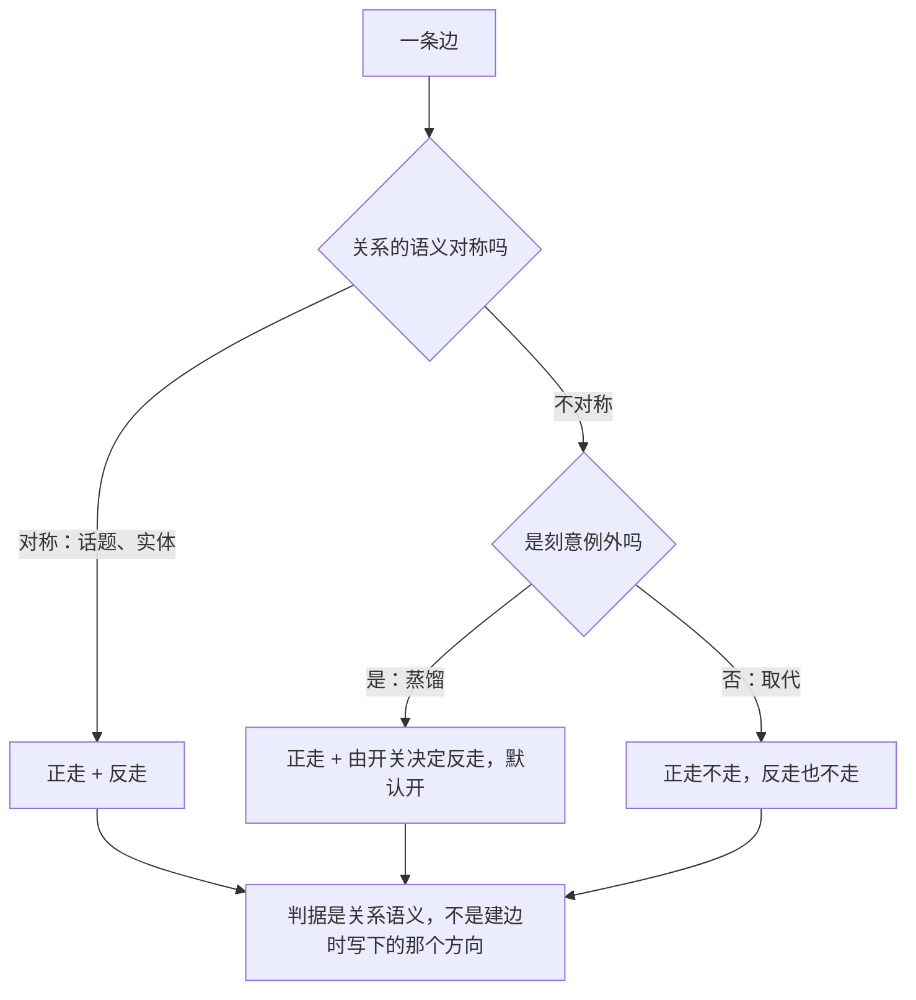
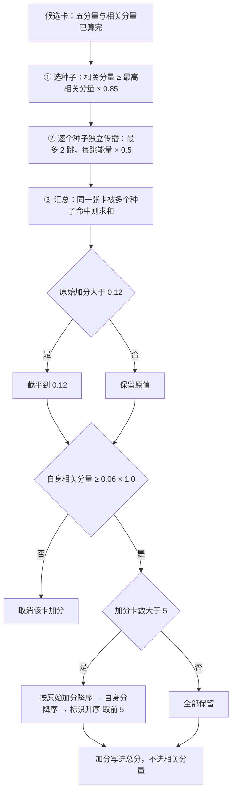

# 08 · 记忆图谱与扩散激活

> **本篇回答什么**：记忆之间**怎么连成一张图**（静态结构），
> 以及**能量怎么沿着这张图传**（动态过程）。这两件事合起来，
> 才是「我要类似神经的突触效果」这句补充诉求的可实现形态。
> 同时回答三个具体问题：四种边各自凭什么连、扩散加的分会不会溢出、
> 为什么它默认跑在「只算不生效」的模式里。
>
> **前置篇目**：04 篇（边的数据模型与事件日志）、06 篇（扩散在召回链路里的位置）。
>
> **后续篇目**：10 篇（开放问题，可塑性为什么至今没接线）。
>
> 本篇不含任何源代码，只含结构、判据、公式、框图与实测数据。术语与编号以 00 篇为准。

---

> **本轮修订口径**：第 4～9 章保留历史机制与局部观测；第 5.10 节给出推荐的有界扩散契约，第 4.3 节给出有界实体投影方案。二者均为【设计决策·待验证】，不表示实现已切换，也不沿用旧探针结果证明新方案有效。

## 一、图谱在系统里的位置

### 1.1 一句话

**图谱不是一张另存的图，而是卡片之间的派生关系；它不进归一化分子，只在打分之后加一笔。**

这句话包含三个必须先立的边界，否则后面全部会读错：

| 边界 | 含义 | 反例（不做的事） |
|---|---|---|
| 图是**派生**的 | 节点就是卡，边由卡的内容推导出来；删一张卡，相关边一起失效 | 另存一份邻接表当第二真相源 |
| 图**不进归一化分子** | 边权不参与「这张卡自己匹配得如何」的计算 | 把邻居相似度折进语义分 |
| 图**只在打分之后生效** | 扩散发生在五分量算完之后，加分只加在总分上 | 让扩散影响相关分量、影响绝对闸 |

### 1.2 为什么它不在主链路上

```text
                                  写路径（每轮一次，回复之后）
                                  │
                                  ▼
                    ┌──────────────────────────┐
                    │ 卡片（节点）             │
                    └─────────────┬────────────┘
                                  │
                                  夜整理（每晚一次，可以很慢）
                                  │
                                  ▼
                ┌───────────────────────────────────┐
                │ 建图（第 4 章）                   │
                │ 话题边 / 实体边 / 取代边 / 蒸馏边 │
                └─────────────────┬─────────────────┘
                                  │  边集（派生数据，可从日志重放）
                                  ▼
──────────────────────── 读路径 ────────────────────────
                                  │
                                  ① 取候选 → ② 打分（五分量）
                                  │
                                  ▼
                   ┌────────────────────────────┐
                   │ 扩散激活（第 5 章）        │
                   │ 选种子 → 逐种子传播 → 加分 │
                   └──────────────┬─────────────┘
                                  │  只改总分
                                  ▼
                                  ③ 三道闸 → ④ 装包 → ⑤ 渲染
```

**建图与用图被时间彻底分开**：建图在夜里，用图在每一轮。这条分离带来两个直接后果：

1. **建图可以很慢**（分钟级），因此可以用需要多次比较的算法（近邻检索、两两比对）。
2. **用图必须很快**（毫秒级），因此扩散的传播必须有一个硬上界——不能「一直传下去」。

> **这是本篇最重要的一条结构约束**：图谱的计算成本可以花在建图上，
> 但不能花在用图上。所有「让扩散更聪明」的想法，第一个要过的关是「它会不会让每轮变慢」。

### 1.3 图谱承担哪条需求

| 需求 | 原话出处 | 图谱怎么承担 | 边界 |
|---|---|---|---|
| R5 图谱与跨层次关联 | 源-U5「我需要一种建立记忆图谱的方法，且跨层次关联」 | 四种边、两个层次轴 | 三种语义边**明确不实现**（见 3.3） |
| 「类似神经的突触效果」 | 后来补充，非原始诉求 | 扩散激活：想起 A 能带出 B | 只能重排，不能扩召回（见 5.7） |
| R2 专注当前位置 | 源-5 | 扩散加分**不进**相关分量，绝对闸不受影响 | 联想永远不能放行一张不相关的卡 |

**R2 与「突触效果」是这篇里唯一真正的冲突**，01 把它列为「冲突一：联想只加分不放行」。
本篇第 5 章会把这条取舍在数学层面落到底。

---

## 二、节点与两个层次轴

### 2.1 节点就是卡，没有别的节点

图上的节点只有一种：**记忆卡**。没有「主题节点」「实体节点」「会话节点」。

这是一个刻意的限制，代价与收益都很明确：

| 方案 | 收益 | 代价 | 结论 |
|---|---|---|---|
| 只让卡当节点 | 节点集与卡集**一一对应**，删除、合并、归档的语义自动一致 | 无法表达「两张卡都属于同一个主题」这种高阶结构 | **采用** |
| 引入主题节点 / 实体节点 | 能表达「同一个主题下有哪些卡」 | 引入第二类需要独立生命周期、独立去重、独立归档的对象；删卡时主题节点悬空 | 不采用 |

**为什么「一一对应」值这么多**：因为图谱是派生数据，它必须能从卡片状态**重新推导**。
一旦有第二类节点，就必须回答「主题节点什么时候该被删」「两张主题节点是否重复」
「主题节点能不能被合并」——每一个都是新的缺陷面，而收益只是「查询方便一点」。
**图谱是用来溯源的，多一类节点就多一类会说谎的东西。**

### 2.2 两个层次轴

「跨层次关联」（源-U5）里的「层次」不是抽象说法，是两条具体的轴：

```text
        时间轴（取代边）                     抽象轴（蒸馏边）
   ─────────────────────────►        ─────────────────────────►
   旧 ──── 取代 ────► 新              感受 ──── 蒸馏 ────► 来源事件
   （后者纠正前者）                    （前者从后者提炼）

        ▲                                     ▲
        │                                     │
   同一件事的两个版本                  细节 ──► 感受
   只有新的算数                        细节会被忘记，感受留下
```

| 轴 | 边 | 方向语义 | 扩散能走吗 | 为什么 |
|---|---|---|---|---|
| **时间轴** | 取代 | 旧 → 新 | **不走**（正向反向都不走） | 把废弃内容推上台面等于让模型看见已被纠正的旧结论 |
| **抽象轴** | 蒸馏 | 提炼物 → 来源 | **正走 + 反走**（可配置） | 「想起细节唤起感受」是刻意的例外（源-U3：细节会忘、只留感受） |

**为什么这两个轴必须分开，不能合成一个「相关」轴**：

- 合成之后，图谱上无法区分「被取代」与「被提炼」——两者都是「A 与 B 有关系」。
- 而这两种关系的**处置方式相反**：取代边要阻止扩散（旧的别上台面），
  蒸馏边要允许反向扩散（从细节回到感受）。
- 如果合成一条轴，那么「阻止」和「允许」就成了同一个开关的两半，
  **必然有一半是错的**，而错的那一半不会报错。

### 2.3 为什么蒸馏边的方向是「反的」

这是全篇唯一一个需要专门辩护的方向决定。

```text
取代：  旧卡 ──────► 新卡        时间方向：新的取代旧的
蒸馏：  感受卡 ────► 来源事件卡    抽象方向：提炼物指向材料
```

如果两者同向（都「旧 → 新」），那么图谱上就**无法区分「被取代」与「被提炼」**：

| 读法 | 同向时的判断 | 正确判断 | 后果 |
|---|---|---|---|
| 「B 是 A 的后续」 | 取代 | 取代 ✓ | 正确 |
| 「B 是 A 的后续」 | 蒸馏 | **错**：蒸馏边上是「A 从 B 提炼」，B 才是材料 | 溯源时读反 |

**这类错误的特征：不报错，只会让人在审计时得出相反的结论。**
一张感受卡「来自」三条事件，读反之后变成「三条事件来自这张感受」——
字面上都通顺，含义完全相反。

### 2.4 反向遍历只对蒸馏边开放

这是「对称 / 单向」这条判据的完整答案：

| 关系 | 正向 | 反向 | 依据 |
|---|---|---|---|
| 话题 | 走 | **走** | 对称关系：A 与 B 相似 ⇔ B 与 A 相似 |
| 实体 | 走 | **走** | 对称关系：共享实体是无向事实 |
| 蒸馏 | 走 | **由开关决定**（默认开） | 「想起细节唤起感受」是刻意的例外 |
| 取代 | **不走** | **不走** | 已被纠正的内容不该被联想推上台面 |

**关键判据是「关系的语义是不是对称」，不是「建边时写下的方向」。**

这条区分曾经出过一次很难发现的错：话题边与实体边在语义上对称，但建边时必须写一个
具体方向，那个方向来自候选池的排序——**与「谁是本轮种子」毫无关系**。
而遍历器当时只对蒸馏边开放反向，于是对称关系被当成严格单向。

```text
后果：激活是否传得出去取决于建边排序；没有给出排序的概率模型，不能把它说成“一半概率”。

实测（21 张卡 / 10 条实体边）：
    查询「某个数据库名」
    唯一种子是**日摘要卡**（它含全部关键词，分数最高）
    4 条相关边的方向全是「普通卡 → 摘要卡」
    正向传播：**0 条**（摘要卡没有出边，激活出不去）
    把同样这 4 条边反向：**4 条**
    21 个查询整体：修复前 4 个生效 → 修复后 6 个生效
```

**这个缺陷的形态值得记住：机制是对的，方向是随机的，于是效果一半靠运气。**
它不报错、不崩溃，日志里只写「本次无扩散」——看的人无从判断是
「数据确实没有关联」还是「方向恰好反了」。

> **而「一半靠运气」的机制比「完全不工作」更难发现。**
> 完全不工作时有人会去查；时灵时不灵时，人会以为是自己查询写得不好。

修法的形状是：**把「哪些关系对称」这条知识收在一个判据里**，
并让测试遍历全部关系类型、校验分类完整。新增关系时必须**显式**决定它算不算对称，
而不是让它默认落进「单向」里静默出错。



---

## 三、四种边

### 3.1 总表

| 边 | 方向 | 产出点 | 权重量纲 | 每卡边数上限 | 状态 |
|---|---|---|---|---|---|
| **话题** | 双向（对称） | 夜整理 | 文本相似度（0.08～1.00） | 近邻数 3 | **在产出** |
| **实体** | 双向（对称） | 夜整理 | 共享实体占比（0～1） | **无上限** | **在产出** |
| **取代** | 旧 → 新 | 合并路径 | 恒 1.00 | 无 | **在产出** |
| **蒸馏** | 提炼物 → 来源 | 蒸馏路径 | 恒 1.00 | 无 | **在产出** |

### 3.2 逐条说明

**话题边**：两张卡文本高度相似但**不是重复**。相似度低于下限不连，每张卡按最近邻封顶。

这里的关键是「高度相似但非重复」——重复的卡会被去重吃掉，不会留下两条。
所以话题边连的是「同一件事的两种说法」或者「同一主题的不同侧面」。

**实体边**：两张卡共享实体锚点（同一个人、同一个项目、同一个库名）。
权重是共享实体占全部实体的比例：

```text
边权 = |A 的实体 ∩ B 的实体| / |A 的实体 ∪ B 的实体|

例：A 有 {缓存, 过期时间}，B 有 {缓存, 过期时间, 索引}
    交集 2，并集 3 ⇒ 边权 0.667
```

**取代边**：修正后的关联。旧卡被新卡取代，权重恒为 1.00。
它不参与扩散（正反都不走），只用于**溯源与展示**：看到新卡时能指出它纠正了哪张旧卡。

**蒸馏边**：从事件里提炼出感受。权重恒为 1.00，方向是「感受 → 来源事件」，
且**允许反向遍历**。

### 3.3 三种明确不实现的边

图谱的七种关系里，有三种**有枚举值、有类型、但没有产出点**：

| 关系 | 为什么不做 | 处置 |
|---|---|---|
| **因果** | 语义判断（「A 导致 B」），规则做不出来 | 保留枚举值，明确不实现 |
| **组成** | 语义判断（「A 是 B 的一部分」），同上 | 保留枚举值，明确不实现 |
| **对比** | **不是没做，是用别的方式做了**：冲突检测走打分里的冲突惩罚，结论落在卡片分数上而不是边上 | 保留枚举值，明确不实现 |

**为什么保留枚举值不删掉**：日志是只追加的。删掉一个枚举值不等于删掉死代码，
而是让**已经写在日志里的边**在重放时无处安放。两种处置都更糟：

| 处置 | 后果 | 为什么糟 |
|---|---|---|
| 反序列化时**拒绝**未知关系 | 整个日志打不开 | 一条边读不出来，全部记忆陪葬 |
| 反序列化时**透传**未知关系 | 内存里出现类型系统不认识的值 | 类型开始撒谎：分支判断静默走默认、穷尽性检查失效 |

两难的正解是**保留枚举值**：合法的未知值必须在类型里有位置，这才叫前向兼容。

**为什么明确不实现而不是「以后做」**：这三种关系都是语义判断，用关键词硬凑会产出**假边**。
而图谱是用来溯源的：

> **假边比没有边更糟。** 没有边时你知道「这里没有信息」；
> 假边会让你把溯源指向错的地方，而且**无从发现**。

「对比」还要单独说明：它不是没做，是用别的方式做了。再实现一个对比边，
等于把同一个判断做成两份真相源——而两份真相源迟早会不一致。

---

## 四、建图

### 4.1 话题边：k 近邻，不是绝对阈值

这是建图里唯一一个「必须解释为什么不用更直观的做法」的地方。

**历史基线单靠相似度下限选边。** 原稿给出 99.9 分位为 0.275，但它不能推出最高值低于 0.45；下表的 0.45 档仍有 22 条边，更不能宣称“图恒空”。0.45 是历史误借的关联判据，不是本篇当前去重阈值 0.86。

阈值可以标定。相似度分布没有天然谷也不意味着下限无意义，只意味着这是质量、连通性和成本的决策边界，不能从一个分位数推出唯一值。以下表格保留原稿局部扫描，供说明这种取舍，不把它当作所有语料的保证。

**实测标定**（真实中文语料，300～280 张卡量级）：

| 连边下限 | 边数 | 平均度数 | 评价 |
|---|---|---|---|
| 0.45（历史误借的关联判据） | 22 | **0.15** | 图谱几乎不存在 |
| 0.20 | 86 | 0.57 | 太疏 |
| 0.12 | 224 | 1.49 | 仍偏疏 |
| **0.08** | **563** | **3.75** | **采用** |
| 0.05 | 1513 | **10.09** | 比较值更密；是否过密还需看连通性与召回质量 |

历史提名基线是：**每张卡主动选至多 k 个邻居，再要求相似度不低于下限**；它只限主动提名数。推荐改用下一节的双端限度，勿把两者混称。

| 参数 | 值 | 作用 |
|---|---|---|
| 近邻数 k | **3** | 历史基线限每张卡主动提名至多 3 个，不限制别人选它 |
| 连边下限 | **0.08** | 过滤掉「最近但依然无关」的邻居 |

**两个参数分工不同，缺一个都不行：**

| 只有 k | 只有下限 | 两个都有 |
|---|---|---|
| 至少有 3 个可比邻居时会提名 3 个，即使最相近者只有 0.01，也可能引入弱边 | 边数完全由分布决定，无法预测规模 | 主动提名有界，且弱边被过滤；总度数另见双端限度 |

**为什么必须配下限：假边比孤立卡糟得多。**

```text
孤立卡：不参与扩散。它只是一张没被联想的卡——损失是「少一条线索」。
假边：  参与扩散，把能量传到不相干的地方。损失是「传错地方」，
        而且**无从发现**——图谱上它和真边长得完全一样。
```

**同量级边数下的对照**（280 张卡）：

| 方案 | 边数 | 精确率 | 孤立卡 |
|---|---|---|---|
| 绝对阈值 ≥ 0.12 | 290 | 50.7% | **143** |
| **k 近邻 k=3、下限 0.08** | **320** | **57.5%** | **62** |
| k 近邻 k=5、下限 0.08 | 745 | 55.7% | 11 |

k=3 相比绝对阈值：**精确率高 6.8 个点、孤立卡少 81 张**。
而 k=5 虽然把孤立卡压到 11 张，边数却翻到 745、精确率反而降到 55.7%——
**多出来的那些边是噪声**。所以取 k=3，不取 k=5。

**相对排名与绝对下限解决不同问题。** 近邻排名控制规模，绝对下限避免“最近但仍无关”；两者组合也需要校准。换语料并不必然使绝对阈值失效，近邻方法也不保证质量稳定。

### 4.2 三种近邻契约不能混称

| 构图规则 | 单点度数上界 | 无向边数上界 | 代价 |
|---|---|---|---|
| 每点提名 k 个，再取并集 | 节点数减一 | 节点数乘 k | 热门节点可被所有其他点选中 |
| 两点相互提名才保留 | k | 节点数乘 k 再除以二 | 稀疏区更容易出现孤点 |
| 相似度排序后，双端均未满 k 才取边 | k | 节点数乘 k 再除以二 | 只保证确定的可行解，不保证全局最大总相似度 |

**推荐采用第三种，并称“双端限度贪心选边”，不再把它等同于普通 k 近邻。** 候选对先规范成无序唯一对，排除自环，按“相似度降序 → 两端稳定标识升序”定序；两端均未满额才接受。已有边、失活节点和卡片变更后的重建也必须遵守同一个度数口径。

设节点数为 n、上限 k=3，则每节点度数 ≤3，边数 ≤⌊3n/2⌋。因此“平均度数 3.75、10.09”的旧观测不可能来自同一双端限度图；它们只可说明限度前的阈值候选图，不能拿来证明限度后图的度数。新规则仍可能有孤立卡，需要在连通性与质量验收中披露。

### 4.3 实体边：没有度数上限，这是已知的规模风险

实体边与话题边有一条关键的不对称：

| | 话题边 | 实体边 |
|---|---|---|
| 度数上限 | 有（k = 3） | **无** |
| 原因 | 相似度是稠密量，人人都有近邻 | 共享实体是稀疏事实，**有就一定有，不该被截断** |
| 代价 | 可能漏掉第 4 近的邻居 | **规模随实体流行度平方增长** |

**为什么当初不加度数上限**：共享实体是一个**确定的事实**——两张卡都提到同一个项目名，
这个关系不该因为「这张卡已经连了 3 条边」而被丢掉。截断它等于让图谱对热门实体视而不见。

**代价是实测出来的**（每卡 3 个实体、实体池固定 40，只放大卡数）：

| 卡数 | 实体边 | 话题边 | 总边数 | 单卡最大度数 | 边数增长 |
|---|---|---|---|---|---|
| 50 | 138 | 74 | 212 | 10 | — |
| 100 | 579 | 150 | 729 | 15 | ×3.44 |
| 200 | 2400 | 300 | 2700 | 27 | ×3.70 |
| 400 | 9800 | 600 | 10400 | 52 | ×3.85 |
| 800 | 39600 | 1200 | 40800 | **102** | ×3.92 |

**注意「话题边」那一列是线性增长（74 → 150 → 300 → 600 → 1200），
而实体边是四倍增长。** 同一个图里两种边、两种复杂度，差别只来自「有没有度数上限」。

生产规模下（实体池随语料增长而变大）：

| 卡数 | 实体池 | 实体边 | 总边数 | 建图耗时 |
|---|---|---|---|---|
| 500 | 50 | 12250 | 12999 | 85 ms |
| 1000 | 100 | 24500 | 26000 | 223 ms |
| 2000 | 200 | 49000 | 52000 | 761 ms |
| 3000 | 300 | 73500 | 78000 | 1526 ms |
| **5000（单次上限）** | 500 | **122500** | **130000** | **3621 ms** |

第一组固定实体池观测接近平方增长；第二组实体池随规模变化的边数则与卡数成正比，500→1000 时为 12250→24500，不能把这张表说成“四倍增长”。输出边数与建图耗时还要分开：即使输出线性，若仍枚举所有卡对，计算仍可能是 O(n²)。

```text
实体边数（横轴卡数，纵轴按对数刻度看）

  ▲
  │                                              ╱
  │                                          ╱      ← 每翻一倍卡数，边数 ×3.44 → ×3.92
  │                                      ╱
  │                                  ╱
  │                             ╱
  │                       ╱
  │                 ╱
  │           ╱
  │     ╱
  └──────────────────────────────────────────────────► 卡数
     50   100   200   400   800                  5000

话题边是线性的（近邻数恒为 3），实体边是平方级的——两者在同一张图上，
所以总边数由实体边主导，这就是第 4 章那条规模风险的来源。
```

**为什么是 4 倍而不是 2 倍**：共享实体的对数与「同实体卡数的平方」成正比，
而卡数翻倍时同实体卡数也大致翻倍 ⇒ 对数涨 4 倍。

**极端场景**：若实体池缩到 5（所有卡共享同一批实体），400 张卡时单卡最大度数到 **242**，
接近完全图。**这时候图谱已经失去「关联」的含义**——所有卡都是邻居，等于没有邻居。

**这条风险的准确表述**：

> 实体边在建图阶段是 O(n²)，5000 张卡要 3621 ms。**建图在夜里，所以现在不是问题。**
> 但夜整理如果跑不完，第二天醒来记忆就没被整理，而这件事**不会报错**。
> 所以真正的问题不是「每轮卡多久」，而是**「它会不会在某一天忽然跑不完」**。
>
> **而且这个数字还低估了真实风险**：它假设实体分布相对均匀。真实的实体分布是长尾的
> （少数热门项目被几百张卡提到），长尾会抬高最热实体的常数项，但单一实体涉及的唯一卡对最多为 n(n−1)/2，不能声称“远超平方”。多个实体重合时，同一卡对还要去重。

**【推导】更准确的规模界。** 令实体 e 出现在 dₑ 张卡中；枚举实体内卡对的工作量为 Σₑ dₑ(dₑ−1)/2，而去重后的实体卡对总数不超过 n(n−1)/2。实体倒排表可免去无共享实体卡对的比较，却不能消掉热门实体的平方枚举。

**【设计决策·待验证】推荐保留“卡片—实体”的成员关系，按候选池按需投影。** 原始共享实体事实无需全部持久化成卡片两两边。对每次召回，只在已限量的存活候选之间计算实体杰卡德权重，再按“双端限度贪心选边”生成瞬时实体图；实体图先复用话题图的每端 3 条预算作为起始假设，不另引入一套未标定参数。话题图与实体图各自有界，二者合并后每卡至多 6 条，再加显式的取代和蒸馏关系。

这牺牲了“所有共享事实均变成传播边”，但没有删除成员事实；可解释输出应显示“共享实体但因图预算未投影”。若候选池 m≤400，按需投影比较至多 m(m−1)/2=79800 对，仍须计量实际时延；不能把这个上界当作满足主路径延迟的实测证明。显式来源关系数量也须单独计入遍历预算。

### 4.4 建图的四个不变量

| 不变量 | 内容 | 违反了会怎样 |
|---|---|---|
| **幂等** | 同一份卡片状态重放两次，边集逐位相同 | 图谱每次重启都不一样，ST-1 直接失败 |
| **派生版本一致** | 文本、实体或存活状态改变后，使受影响旧派生边失效并按同一规则重建 | “只增不改”会留下过期相似度、超度数或指向失活卡的边；可塑性与派生重建是两件事 |
| **方向由关系语义决定** | 不由建边时的遍历顺序决定 | 激活一半靠运气（见 2.4） |
| **排序键完整** | 截断边时必须用「相似度降序 → 起点 → 终点」这样的完整复合键 | 并列时退化成按标识，选择变成随机的 |

**第四条特别值得说**，因为它和扩散里的截断是同一个坑的两处出现：

```text
✗ 只用「相似度降序」
   —— 相似度大量并列（尤其当相似度被截平、或者多对卡共享同一邻居结构时）
   —— 并列时排序结果由底层遍历顺序决定 ⇒ 每次不同

✓ 「相似度降序 → 起点标识升序 → 终点标识升序」
   —— 前一个键承载相关性，后两个键只负责在真正并列时给出稳定顺序
```

> **一个键不能同时承担「相关性」和「稳定性」**——它只能承担一个。
> 想让排序既相关又稳定，必须有两个键。

---

## 五、扩散激活

### 5.1 六步

```text
                    候选卡（已算完五分量与相关分量）
                              │
                              ▼
   ① 选种子
      本轮最高相关分量 × 0.85 = 种子门槛
      相关分量 ≥ 门槛的卡 = 种子
      种子的能量 = 该卡的总分
                              │
                              ▼
   ② 逐个种子独立传播（每个种子单独跑一遍广度优先遍历）
      最多 2 跳，每跳能量 × 0.5
      沿途按关系语义决定能不能走（第 2.4 节）
                              │
                              ▼
   ③ 汇总原始加分
      同一张卡被多个种子 / 多条路径命中 ⇒ **求和**
                              │
                              ▼
   ④ 单卡封顶
      原始加分 > 0.12 ⇒ 截平到 0.12
                              │
                              ▼
   ⑤ 护栏
      自身相关分量 < 绝对阈值 × 自身分护栏比例 ⇒ **取消该卡加分**
                              │
                              ▼
   ⑥ 受影响面截断
      加分卡数 > 5 ⇒ 按「原始加分降序 → 自身分降序 → 标识升序」取前 5
                              │
                              ▼
                     加分写进总分（不进相关分量）
```



### 5.2 参数表

| 参数 | 值 | 它约束什么 | 为什么是这个值 |
|---|---|---|---|
| 种子比例 | **0.85** | 谁有资格撒能量 | 相对量，自动跟随本轮分数分布（见 5.3） |
| 最大跳数 | **2** | 能量能走多远 | 初始工程预算；可感知性取决于排序分差，不能仅由跳数推出 |
| 跳衰减 | **0.5** | 每跳损失多少 | 一半，使 2 跳后剩 25% |
| 单卡加分上限 | **0.12** | 一张卡最多被联想抬高多少 | 历史局部扫描未发现最优档；推荐方案将它改作全轮预算（5.10） |
| 受影响面上限 | **5** | 最多几张卡能拿到加分 | 与焦点包容量同量级 |
| 自身分护栏比例 | **≥ 1.0**（校验强制） | 拿加分的卡自身必须多强 | 护栏门槛 ≥ 绝对阈值 |
| 蒸馏反向 | **开** | 蒸馏边能不能反着走 | 刻意例外（见 2.3） |

### 5.3 种子：判据看相关分量，能量看总分

```text
种子门槛 = 本轮最高相关分量 × 0.85
种子集合 = { 卡 | 该卡相关分量 ≥ 种子门槛 }
种子能量 = 该卡的总分            ← 注意：不是相关分量
```

**为什么判据和能量用不同的量**，这是本篇最容易被读成「又一处尺子错配」的地方：

| 用途 | 问的问题 | 该用什么 | 理由 |
|---|---|---|---|
| 判据（谁是种子） | 「这张卡够不够格撒能量」 | **相关分量** | 资格问题，只该看与查询有关的量 |
| 能量（撒多少） | 「这个种子有多强」 | **总分** | 强度问题，该看完整度量（含重要性、新鲜度） |

一句话：**判据问资格，能量问强度。两个用途不同，用不同的量是刻意的。**

**用错会怎样**（实测过，两种错法症状完全不同）：

| 错法 | 后果 | 观测 |
|---|---|---|
| 判据用总分 | 在这两批历史样本中，总分最小/最大比为 0.91～0.97（0.48 是查询无关贡献上界，不是共同地板），而门槛是 0.85 ⇒ **所有卡都是种子** ⇒ 受益者恒为空 ⇒ 扩散恒空 | 三种模式总分**逐位相同**，观察值 0 条 |
| 能量改用相关分量 | 可能变大也可能变小，不能仅因不含新鲜度就断言更小；例如 R=1 而 T=0.52 | 改变模型语义，需重新标定 |

**第一种错法为什么能藏几个月**：它的观测值是「什么都没发生」。
不报错、不崩溃、日志正常、单元测试全绿。而「什么都没发生」最像正常工作。

### 5.4 传播：两跳，每跳衰减一半

设种子能量为 `s`（该卡的总分），边权为 `w`，跳衰减为 `0.5`。

**第一跳**（种子直接邻居）：

```text
原始加分₁ = s × w × 0.5
```

**第二跳**（邻居的邻居，经过两条边）：

```text
原始加分₂ = s × w₁ × w₂ × 0.5² = s × w₁ × w₂ × 0.25
```

**边权相同时**（`w₁ = w₂ = w`）：

```text
原始加分₂ = s × w² × 0.25
```

**算例**（`s = 0.5`）：

| 边权 w | 原始加分₁ = 0.5·w·0.5 | 原始加分₂ = 0.5·w²·0.25 | 两跳是否都可见（相对上限 0.12） |
|---|---|---|---|
| **1.00** | 0.250 | 0.125 | **都撞上限**（两个都截平到 0.12） |
| **0.30** | 0.075 | **0.01125** | 是：0.075 < 0.12，0.01125 明显更小 |
| **0.10** | 0.025 | **0.00125** | 是，但两跳都极小 |

**注意第一行**：边权 1.00 时，第一跳原始加分 0.250 和第二跳原始加分 0.125 **都超过上限 0.12**，
于是两个都被截平到 0.12 ⇒ **两跳的结果完全相同** ⇒ 「最大跳数 = 2」这个参数
在这条路径上**完全观测不到**。

> 这解释了一件事：**为什么「最大跳数」不能靠「看效果」来标定。**
> 在权重高的图上，1 跳和 2 跳给出的加分一样；只有在中低权重（w ≤ 0.5 左右）时，
> 两跳的差别才可观测。而真实图谱里取代边和蒸馏边的权重恒为 1.00。
>
> **一个参数在部分输入上不可观测，不等于它没生效**——但它意味着
> 「调这个参数看效果」这种标定方法是错的。

### 5.5 汇总：求和，不是取最大

一张卡可能被多个种子、多条路径命中。汇总规则是**求和**：

```text
某张卡的原始加分 = Σ（来自每个种子的原始加分）
最终加分 = min( 原始加分, 0.12 )      ← 求和之后再封顶
```

**为什么是求和而不是取最大**：取最大意味着「只认最强的那个来源」，
那么一张被 3 个种子同时命中的卡，与只被 1 个种子命中的卡拿到相同的加分——
而「被多个独立来源同时指向」本身就是更强的关联证据。

**求和的代价必须写清**：它让加分**随路径数线性增长**，于是「一张卡有多强」
变成了「这张卡有多少条路径能到达」。在稠密区域，这会系统性地偏向枢纽卡。

单卡上限 0.12 就是为这个代价设的：**它把「路径数」这个维度的表达力截断了。**

### 5.6 上限 0.12 是怎么定的

**它经过局部参数扫描，但扫描未证明 0.12 优于其他档。** 用原稿称为“严格判据”的规则测（诱饵 = 与查询不共享任何实体，
例如「约定下周三去看牙医」这类完全无关的卡），20 张技术卡 + 4 张严格诱饵、12 个查询：

| 单卡加分上限 | 内容变化 | 顺序变化 | 可感知合计 | 污染 |
|---|---|---|---|---|
| 0.06 | 7/12 | 3/12 | 10/12 | **0** |
| **0.12（采用）** | **7/12** | **3/12** | **10/12** | **0** |
| 0.18 | 7/12 | 3/12 | 10/12 | **0** |
| 0.20 | 7/12 | 3/12 | 10/12 | **0** |
| 0.30 | 7/12 | 3/12 | 10/12 | **0** |

**这批代理标签下效果不随上限增大而提升，观测污染为 0** ⇒ 没有证据支持调大它，也没有证据排除更小的 0.06。这是本节最重要的结论：
一个「调大了应该更明显」的参数，实测在五倍区间内完全不动。

**但这个标定有一个必须记住的教训：诱饵卡的定义改过一次，结论就反了。**

```text
第一版诱饵：「含某个热门实体的卡」（例如「决定把某本旧书拿去卖废纸」）
    → 0.2 时「引入 4 张诱饵」
    → 结论：上限不能超过 0.12

第二版诱饵：「与查询不共享任何实体的卡」（严格判据）
    → 0.06～0.30 五档，可感知合计恒为 10/12，污染恒为 0
    → 结论：这个参数在很宽的区间内不敏感
```

**不能仅凭“共享实体”把第一版诱饵改判为相关。** 同一实体可以涉及完全不同的任务；“提到某本书”并不保证“出售旧书”的记忆与查询有关。共享实体只能作代理信号，是否污染仍需人工相关性标签。第二版剔除了更难的同实体负例，因此零污染不能证明场景已经干净。

> **教训：参数扫描只有在标签契约明确时才可比较。** 不能因为一批负例挑战了机制，就按机制使用的同一实体特征把它们改成正例；否则评价只会证明模型符合自己的代理定义。

### 5.7 加分只进总分

```text
新总分   = clamp01( 旧总分 + 加分 )
相关分量 = 不变
```

**这一条是 R2（专注当前位置）的唯一数学实现。** 因为绝对闸架在相关分量上，
而扩散改不了相关分量，所以：

> **联想只能把「本来就相关、但排序靠后」的卡拉上来，
> 不可能把一张不相关的卡拉进包。**

**代价**：联想的表达力被限制在「重排序」而不是「扩召回」。真正意义上的
「因为想起 A，所以第一次想起了完全不相干的 B」——**做不到**。

**为什么接受**：R2 是最硬的一条（源-5 是起源里唯一带否定语气的诉求之一），
而 R5 的验收词是「效果」不是「算法」。重排序已经能产生可感知的联想效果，
而扩召回会直接违反源-U6（污染上下文）。

> **可迁移的原则：护栏不能和它要守的判据走同一个通道。**
> 如果护栏改的是判据读的那个量，那它就不是护栏，是后门。

**扩散还能改变焦点包成员。** 它可使卡越过总分相对闸，也可通过排序改变条数截断和长度装包的结果；即使相对闸看相关分量，后两条路径仍存在。这条路曾经断过两次，两次症状完全一样
（扩散算了但什么都没变）：

| 断法 | 为什么断 |
|---|---|
| 相对闸也挪到相关分量 | 不再经由相对闸改变去留；仍能经由硬上限和长度预算换人 |
| 种子判据用总分 | 种子集合恒等于全集 ⇒ 没有受益者 ⇒ 加分恒为空 |

### 5.8 逐种子计算是归因选择，不是唯一可确定的算法

历史基线逐种子计算，以便保留“哪个来源贡献多少”的归因，再按固定顺序归约。这个选择需要承担种子数乘图扫描量的成本。来自不同种子的贡献也可能内容同源或相互依赖，不能仅因种子标识不同就叫“独立证据”。

同步迭代同样可以保留来源维度，固定每跳输入、归约顺序和停止条件后也可以确定重放；独立遍历也需要显式规定种子、邻边、并列路径和浮点归约顺序，不能天然保证确定性。两者的性能取决于图结构与归因信息的保存方式，不能笼统断言某一种一定更快或无法解释。

第 5.10 节保留逐种子最强路径以便解释，去掉同一种子内的路径重数奖励，并把所有种子的总贡献限制在一轮预算内；这是推荐取舍，不宣称所有替代形式都不可行。

### 5.9 受影响面截断

最多 5 张卡能拿到加分。超出时按这个键排序后取前 5：

```text
原始加分（截平前）降序 → 自身分降序 → 标识升序
```

**为什么第一个键必须是「截平前的原始加分」**：

```text
✗ 用「截平后的加分」当排序键
   —— 多张卡几乎必然全部撞在 0.12 上
   —— 比较恒等 ⇒ 退化成按标识升序 ⇒ 而标识是内容哈希
   —— **谁被留下完全由哈希决定**

实测：14 张卡获得加分，**11 张的原始加分完全相同（0.272258）**
      ⇒ 截断退化成「按内容哈希取 5 张」
```

**这个缺陷的形态与本篇 2.4 节那个是同一个**：**机制在跑，但选择是随机的。**
它不报错、不崩溃，日志里只写「本次 14 张卡获得加分」——看的人无从判断
「这 5 张是按相关性选的，还是按哈希选的」。

修好之后（15 个查询的对比）：

| 观测 | 修前 | 修后 |
|---|---|---|
| 扩散新增的诱饵卡 | 2 | **0** |
| 扩散新增的相关卡 | 3 | **4** |

**注意这两个数字的方向**：修好之后新增的卡**变少了**（2+3=5 → 0+4=4），
但其中相关卡的比例从 60% 升到 100%。
**「效果变强」和「效果变对」是两件事**，而只有后者值得优化。

---

### 5.10 推荐契约：最强路径、种子归一、全轮有界

**【设计决策·待验证】** 目标是消除重复路径放大、种子数放大和加分总量失控；不声称它已经优于基线。令 C 为已通过授权与存活检查、并按本轮内容域策略取出的有限候选，τ=0.06、ρ=0.85、护栏倍数 a≥1、最大跳数 H=2、跳折扣 γ=0.5、全轮预算 b=0.12、受益数上限 M=5。

$$E=\{v\in C:R_v\ge\tau\},\quad S=\{s\in E:R_s\ge\rho\max_{u\in E}R_u\},\quad V=\{v\in E\setminus S:R_v\ge a\tau\}.$$

E 为空时不取最大值，直接返回无扩散；S 为空、总种子能量为零或 V 为空时同样返回。种子均为并列最相关卡时，所有合格卡都可能是种子，V 为空是合法结果，不应用标识任意删种子来伪造收益。非种子受益区间必须满足 aτ≤Rᵥ<ρ max R；区间没有交集时，应报告“受益区间为空”。

对同一种子 s、同一目标 v，只保留长度 1～H 的最强可走路径：

$$L_{sv}=\max_{p:s\leadsto v,\ 1\le |p|\le H}\left(\gamma^{|p|-1}\prod_{e\in p}w_e\right),\qquad L_{sv}=0\ \text{（无路径）}.$$

边还必须携带源卡修订和关系依据，读取时验证当前修订仍支持该关系；仅端点存活与有权访问不足以证明旧边仍相关。依据失效或版本不匹配的边先排除并待重建。所有权重在 [0,1]；同方向的平行关系取最大有效权，避免同一事实因边类型多就重复计证。只在 C 的诱导图内传播，方向遵守关系契约；目标为种子时不加分。每跳从上一跳的冻结结果更新，不能把本轮最终加分再作为传播输入。

$$\alpha_s=\frac{T_s}{\sum_{u\in S}T_u},\qquad r_v=\sum_{s\in S}\alpha_s L_{sv}\in[0,1].$$

从 V 中按“r 降序 → 相关分量降序 → 未扩散总分降序 → 稳定标识升序”选最多 M 个正收益目标，记为 Q⊆V；再分配预算：

$$\Delta_v=\begin{cases}\displaystyle\frac{b\,r_v}{\max(1,\sum_{u\in Q}r_u)}&v\in Q\\0&\text{其他}\end{cases},\qquad T'_v=\min(1,T_v+\Delta_v),\qquad R'_v=R_v.$$

**【推导】** 0≤Δᵥ≤b，且 ΣᵥΔᵥ≤b，因此真实总分增量之和也不超过 b；单卡不会因多路径、多种子数或图密度增长而无限加分。重复同一条边不会改变结果。复制全部种子且保留成对相同的路径贡献时，加权平均不变；只复制某一个种子会改变权重，不能声称对任意重复都不敏感，重复卡应先在上游去重。全轮预算会使受益者互相竞争，这正是有限联想预算的代价。

**算例（全部推导）**：两个等能量种子，目标甲的路径强度分别为 0.6、0.2，目标乙为 0.4、0.4，则 r 皆为 0.4，Δ 皆为 0.048，总加分 0.096。若两个目标的 r 都为 1，则各得 0.06，总加分仍为 0.12。对单种子链且两边权均为 1，第一跳 L=1、第二跳 L=0.5；两目标并存时分别加 0.08、0.04，跳差不会被同一单卡封顶抹掉。

**计算界**：在固定 H 的诱导图上，逐种子、逐跳进行最大乘积松弛，时间 O(H·|S|·(|C|+|边|))、工作空间每种子 O(|C|)，另计构建投影、排序与归因输出。因 γw≤1，绕环不能增强路径，可用此松弛得到相同的有界最强路径值；不能仅凭“两跳”断言线性于节点数，稠密图的边数本身可为平方级。浮点归约按稳定种子序进行，并持久化算法版本。

**与召回衔接**：相对闸基准冻结为 E 中未扩散最高总分的 0.55 倍；扩散后重新排序，再做条数与长度预算。推荐方案先跑影子，对照相关性人工标签、同实体难负例、成员变化、时延和最终长度，达标后才可生效。0.12 在这里换成了全轮预算，旧上限扫描不构成新预算的标定。

## 六、多路径塌缩：一个必须知道的数学事实

### 6.1 现象

在一张「环」或「完全图」上跑扩散，结果会塌缩：

| 图的形状 | 节点数 | 边数 | 观测到的不同原始加分值 |
|---|---|---|---|
| 环 | 10 | 10 | **2 个** |
| 环 | 20 | 20 | **2 个** |
| 完全图 | 8 | 28 | **1 个** |
| 完全图 | 12 | 66 | **1 个** |

```text
环（10 个节点，每节点连前后两个邻居）：

    a ── b ── c ── d ── e
    │                   │
    j ── i ── h ── g ── f

    从 a 出发：
      1 跳：b、j       原始加分₁ = s·w·0.5
      2 跳：c、i       原始加分₂ = s·w²·0.25
      ⇒ 只有两种值（1 跳的和 2 跳的）

    换种子位置会改变每个节点的值；只可在给定种子、跳数和等权条件下描述这些层次


完全图（12 个节点，每对都相连）：

    每个节点都是其他所有节点的直接邻居
    ⇒ 所有人都在 1 跳内
    ⇒ **只有一种加分值**
```

**对称三角形反例（推导）**：边权全 1、种子 a、能量 0.5，上限暂为 1。若真把长度至多两跳的简单路径全部求和，b 有 a→b 与 a→c→b，c 有 a→c 与 a→b→c，两者都得到 0.25+0.125=0.375。只给 c 算第二条而遗漏 b 的对应路径，不是路径求和的数学性质，是遍历或记账不对称。

若“每种子每目标只记首次发现”，两者都只能得 0.25；它又不是“全部路径求和”。普通广度优先遍历只保证最少边数的到达，不保证带权路径乘积最大。历史探针若没有说明访问集合和重复到达规则，只能报告输出，不能据它宣称实现了哪一种聚合契约。

### 6.2 为什么会塌缩

在这个等能量、等权重的单路径示例中，加分只取决于跳数；一般图还取决于路径乘积、种子布局和聚合规则：

```text
原始加分 = 种子能量 × 路径权重之积 × 跳衰减 ^ 跳数
              ▲              ▲                  ▲
              │              │                  └── 跳数：在这个图里所有节点都相同
              │              └───────────────────── 路径权重：在均匀图里所有路径都相同
              └──────────────────────────────────── 种子能量：所有种子都一样
```

**三条都相同时，结果必然相同。** 这不是 bug，是公式的直接后果。

### 6.3 这意味着什么

| 结论 | 含义 |
|---|---|
| **对称证据必须产生对称输出** | 保持种子、边权、方向的图对称变换下，对应节点应同分；均匀边权本身不保证全图同分 |
| **区分度来自有效证据差异** | 距离、边权、种子布局或节点自身相关性均可提供差异；真实图不保证每轮都可区分 |
| **同分不等于求和失效** | 对称输入并列是正确性质；路径条数奖励是否合理，应以独立语义标签判断 |

**这条事实的实际影响**：如果有人在合成数据（均匀图、等权边、同分种子）上测扩散，
他会观测到「所有卡加分相同」，然后合理地怀疑「扩散是不是没生效」。
真实语料可能提供非均匀性，但不能保证每次局部图都有区分度，需要同时报告局部图和种子条件。

**而它还有一个直接后果，与 5.9 节的截断缺陷是同一件事**：

```text
完全图上所有受益卡的原始加分完全相同
        ⇒ 受影响面截断的排序键全部并列
        ⇒ 排序退化成按标识（内容哈希）取前 5
        ⇒ **谁被留下与相关性无关**
```

也就是说：**多路径塌缩是「截断退化」的上游原因之一。**
修截断（换成完整排序键）只保证「并列时有确定的顺序」，
它**不能**把「并列」变少——减少并列要靠图本身有区分度。

> **两个问题必须分清**：排序键不完整会导致顺序不受契约控制；保持种子、权重、方向的对称证据理应并列，不能制造假差异。
> 把后者当前者修，会去改一个正确的排序键。

> **合成图适合验证数学不变量，真实语料适合验证任务效果。** 对称图应给对称节点相同分数；异权图应验证最强路径、环与重复边。前者非常有价值，只是不能单独证明实际召回质量提高。

---

## 七、三种运行模式

### 7.1 三态，不是两个布尔

| 模式 | 算不算扩散 | 改不改排序 | 产出观察值 | 用途 |
|---|---|---|---|---|
| **关闭** | 不算 | 否 | 无 | 完全退化成引入本功能之前 |
| **影子** | **照常算** | **否** | **有** | 攒「打开会怎样」的证据，但不影响召回 |
| **开启** | 算 | **是** | 无（已折进总分） | 真实参与排序 |

不用「启用开关 + 影子开关」两个布尔，是因为那能表达出「关掉了但还在影子计算」
这种自相矛盾的状态。互斥的三态从类型上就不允许这种状态存在。

### 7.2 库默认影子，出厂配置开启

这两个值分工不同，**都不撒谎**：

| 位置 | 值 | 谁在表态 | 理由 |
|---|---|---|---|
| 库的默认值 | **影子** | 「没人配置时」的行为 | 算法未在真实数据上验证，不擅自改变每次召回的排序 |
| 出厂配置文件 | **开启** | 发布者/用户的显式意图 | 出厂状态下扩散每轮都在算却不改排序，用户拿不到「突触效果」，也没有文档说怎么打开 |

**推荐发布门槛与库默认一致，保持影子。** 出厂开启只能说明发布者的意图，不能替代算法和场景验收。新方案未通过同实体负例、预算与时延检查前，不能为了“用户能感知”直接生效；可由明确选择并可回滚的实验启用。

### 7.3 一个 YAML 陷阱：裸 `on` 是布尔值

出厂配置里写的是 `on`，但**裸写 `on` 会被 YAML 1.1 解析成布尔真值**。

```text
✗  扩散模式: on           ← YAML 1.1 解析为布尔真值
                          宿主拿到 true ⇒ 加载期失败（类型不对）

✓  扩散模式: 'on'         ← 引号包起来，才是字符串
```

**这个陷阱曾经被一个「看起来通过」的测试放过**：解析器的第一版把裸 `on`
当字符串放过去了，于是测试全绿。直到**反向验证时把解析器改坏、测试没变红**，
才发现解析器根本没模拟 YAML 语义。

> **教训：一个「模拟外部格式」的组件，必须模拟那个格式的怪癖，而不只是它的语法。**
> 只模拟语法的解析器在正常输入上永远正确，在怪癖输入上静默放过——
> 而怪癖恰好是它存在的理由。

现在这个出厂配置文件有 5 条测试守着。**它值得被专门守，因为它是用户唯一会改的东西**：
拼错键名不报错、只静默退回默认值。

### 7.4 观察值必须有出口

**算出来没人看得见，等于没算。**

影子观察值加上之后，曾经**一个出口都没有**：分数解释里不许放（语义不同），
注入文本里更不能放（源-U6）。结果是扩散在默认配置下每轮都在算，
但没有任何人能看到它算出了什么——**一个只有测试知道的机制，等于没有。**

现在有两个出口，且**三种模式各自带不带观察字段**是明确的：

| 模式 | 结构化日志里有影子段吗 | 人读渲染里有影子行吗 | 为什么 |
|---|---|---|---|
| 关闭 | **没有** | 没有 | 根本没算扩散 |
| 影子 | **有**（有观察值时） | **有** | 这是它唯一的出口 |
| 开启 | **没有** | 没有 | 加分已折进总分，再记一份就是两个真相源 |

**若「关闭」与「开启」也带这个字段（哪怕空数组），运维看日志会以为当前跑的是影子模式。**
所以日志明细必须**条件展开**，而不是恒给一个键。

**还有一个更隐蔽的变体**：影子模式曾经照搬了「开启」模式的加分字段，于是同一张卡上
同时有「加分（已生效？）」与「假设加分（未生效）」两个值，且它们**可能不同**。

| 消费方读到 | 会以为什么 | 实际是 |
|---|---|---|
| 加分字段 | 加分已经生效 | 影子模式不改变任何排序 |
| 两个值 | 该信哪个 | 一个是原始值、一个是截平后的假设值 |

修法是把对面语义的字段**摘掉**再返回，而不是赋空值——
「有键但值为空」和「没有这个键」是两件事。

> 这条长期没被发现，是因为那个字段此前**没有在类型上声明**，于是谁都读不到它。
> 也就是说，**「类型没声明」这个缺陷顺手把下一个缺陷挡住了**——
> 而挡的方式是让功能不可用，不是让功能正确。
>
> **推论：补类型声明会顺带暴露运行时缺陷。** 类型不是文档，是接口；
> 没有接口的字段等于没有出口，而「没有出口」会掩盖「出口输出的是错东西」。

---

## 八、为什么「最大跳数」和「上限」都调不动

### 8.1 参数标定的三种失败形态

这一章是全篇最「不体面」的部分，但它必须写——因为这三个失败形态会重复出现。

| 失败形态 | 表现 | 本节例子 |
|---|---|---|
| **区间不敏感** | 参数在很宽的区间内效果完全相同 | 单卡上限 0.06～0.30 五档效果一样（5.6） |
| **观测不到** | 参数生效了，但结果被别的机制截断，看不出差别 | 边权 1.00 时 1 跳与 2 跳都被截平到 0.12（5.4） |
| **均匀图上无区分** | 参数确实在起作用，但数据本身没有区分度 | 完全图上所有卡加分相同（第 6 章） |

### 8.2 参数值相同与输出不可观测不是一回事

**【推导】** 种子能量 1、权重全 1 时，旧公式第一、二、三跳原始加分分别为 0.5、0.25、0.125；上限 0.12 时都撞顶。上限改成 0.15，第三跳 0.125 反而低于上限，因此更容易区分第二与第三跳；不能写成“0.15 时第三跳也撞顶”。

即使某条链的一跳与两跳加分同为 0.12，H=1 时两跳目标根本不可达，H=2 时该目标可得 0.12，所以“数值都撞顶”也不等于“跳数参数失效”。低权边两跳值 0.00125 也可能跨过小于它的排序分差；是否改变结果取决于分差、受益截断和装包，不能只看绝对量级。

参数扫描应同时记录可达目标、原始贡献、预算后贡献、排序与成员，避免只看一种最终输出就宣布参数“无意义”。第 5.10 节的推荐归一预算仍须检验这些现象。

## 九、可塑性为什么不做

### 9.1 一句话

**边权从建立那一刻起就不再变化。** 「边权随使用增强」这件事**没有接线**，
而且打开它会加载期失败。

| 层 | 状态 |
|---|---|
| 实现 | 强化、衰减、剪枝三个纯函数**全部实现，逻辑正确** |
| 测试 | 55 条单元测试**全绿** |
| 配置 | 5 个字段**齐备，有默认值** |
| 校验 | 有一整块子参数校验，**能精确报错** |
| **生产调用** | **零调用方** |

实测：打开与关闭各跑 10 夜，**边权与边数逐位相同**。

```text
关闭模式第 1 夜  = 0.110000,0.120000,0.500000,0.500000,1.000000
关闭模式第 10 夜 = 0.110000,0.120000,0.500000,0.500000,1.000000
开启模式第 1 夜  = 0.110000,0.120000,0.500000,0.500000,1.000000
开启模式第 10 夜 = 0.110000,0.120000,0.500000,0.500000,1.000000
两种模式结果是否相同：完全相同
```

**「代码里有」+「测试里有」+「配置里有」+「校验里有」≠「生产路径会走到」。**

### 9.2 第一层：没有合法的共激活信号

可塑性需要知道「哪两条记忆被一起用到了」。五个候选信号全部被否决：

| 候选信号 | 数据可得吗 | 为什么不行 |
|---|---|---|
| 被一起召回 | 可得 | 召回是「看见」不是「使用」，会让焦点包自我固化，违反源-5（专注当前位置） |
| 夜整理同批 | 可得 | 同批只是「同一天」，日摘要一晚处理几百张卡，一次拉满 |
| 上轮焦点包重叠 | 可得 | 召回变成有状态的，「看见」间接影响「看见」，违反源-5 |
| 扩散传播过这条边 | 可得 | 正反馈闭环：边权大 ⇒ 传得多 ⇒ 边权更大；且种子来自打分，等于让「排得前」加固「为什么排得前」 |
| **同一轮抽出的多张卡** | 可得 | 见下 |

**第五个信号最值得记**，因为它看起来最干净：数据完全拿得到、密度健康、接线代码一个字都不提召回。

实测结果：

| 观测 | 数值 |
|---|---|
| 命中密度 | **1.67 对/夜** |
| 比「夜整理同批」低 | **36.6 倍**（密度确实健康） |
| 连续 3 夜触及的边占比 | 8.2% |
| 命中的已连边对中，**依赖助手侧卡片**的比例 | **100%**（关掉助手侧输入后精确归零） |
| 逐轮复合的后果 | 嵌套深度 1 → 5，边数 61 → 172 |
| 其中嵌套的 41 条边（23.8%） | **全部是「取代边 @ 权重 1.00」** |

**结论：它不是「共激活」，是「召回 → 复述 → 抽取 → 强化」的间接闭环。**
助手把召回到的内容复述出来，抽取器又把复述抽成新卡，新卡与旧卡共享内容 ⇒ 被判为共激活。
而它还会逐轮复合——因为复述的内容里已经包含了上一轮的复述。

**「污染伪造出取代边 @ 权重 1.00」这一条尤其值得看**：一个本意是「加固关联」的机制，
在生产数据上产出的却是「新卡取代旧卡」的假关系。**机制不但没起作用，还产出了假边。**

窄化到「两侧都是用户侧卡片」之后，源-5 干净了，但真实语料实测 **0.00 对/夜**——
接上去就是「空操作」的形态。

> **这条的教训：一个信号「数据可得」「密度健康」「语义上不违反任何原则」三条都满足，
> 仍然可能是错的。** 必须去测「它实际命中的是什么」。

### 9.3 第二层：即使有信号，默认参数也分不出使用频率

这一层比第一层更根本，而且它是**追查第一层时意外发现的**。

衰减是乘性的（每夜 × 0.98），强化是加性的（每次 +0.01），量化到 0.01 格点。
真实的记忆边可能周期性使用。下面两个式子只描述未截顶、未量化的均匀每夜输入近似，n 为每夜平均强化次数；周期脉冲的峰谷不能由时间平均单独决定，更不能直接用于离散格点结论：

```text
不动点带的中心 = n · delta · f / (1 − f)
不动点带的宽度 = 1 / (100 · (1 − f))       ← 恰好是一个衰减步长
```

**档数实测**（固定初值 0.5，扫「一夜里共激活几次」，各自迭代到稳态，数能到达多少个不同终值）：

| 强化量 delta | 衰减因子 f | n=1 | n=2 | n=5 | n=10 | 能分出的档数 |
|---|---|---|---|---|---|---|
| 0.05 | 0.98（修复前的默认） | 0.98 | 0.98 | 0.98 | 0.98 | **1** |
| 0.02 | 0.98 | 0.74 | 0.98 | 0.98 | 0.98 | 2 |
| **0.01** | **0.98（当前默认）** | **0.50** | **0.74** | **0.98** | **0.98** | **3** |

**修复前的默认值恰好是全场最坏的一组：只能分出 1 档。**
也就是说「每夜用一次」和「每夜用一百次」最终都是同一个值。

**衰减因子是唯一的杠杆**（delta 固定 0.01，扫共激活次数到 30）：

| 衰减因子 f | 能分出的档数 | 半衰期 |
|---|---|---|
| 0.995 | 2 | 138.3 夜 |
| 0.99 | 2 | 69.0 夜 |
| **0.98（当前默认）** | **3** | **34.3 夜** |
| 0.95 | 6 | 13.5 夜 |
| 0.93 | 8 | 9.6 夜 |
| **0.914** | **10** | **7.7 夜** |
| ≤ 0.914 | 10（饱和，不再增加） | — |

**这批固定初值与次数范围的扫描，在 f=0.914 时得到 10 档、连续因子半衰期约 7.7 夜。** 这暴露了粗格默认家族的取舍，不能证明所有参数或所有可塑性模型都必须作同样选择。
当前默认 0.98 的半衰期是 34.3 夜，只够分出 3 档。

> 这是已测粗量化参数家族的分辨率证据，不是任意强化增量、初值、使用时序与隐藏精度模型的普遍上界。所以不能靠「等真实数据再调参」绕过。

**这张表还有一个必须随表读的限定**：「档数」指**可达终值的个数**，它依赖三件事——
初值、扫的是哪个维度、扫到多大范围。同一个系统 `f = 0.98` 时，扫共激活次数得 3 档，
**扫初值却得 74 档**（差 25 倍），两个数都「实测正确」。漏掉任何一个限定，
读者复现会得到完全不同的数，然后误判这张表错了。（第十章第 10 条会再说一次。）

**饱和式也不是出路**：把加性改成「向 1.0 指数逼近」。它的五个采样点
（delta = 0.02 / 0.05 / 0.10 / 0.20 / 0.30）在 $f = 0.95$ 上恰好都是 5 档，
我曾据此写成「**档数恒为 5**，对 delta 完全不敏感」——**这句是错的**。
把那五个点换成从 0.01 到 0.30 全 30 个格点，取值集合是 $\{2,4,5,6\}$、
极差 **4**、相邻下降 4 处 ⇒ **它对 delta 敏感，只是非单调**。

站得住的结论要换个说法：每个 $f$ 下把 delta 全扫一遍取**最好**档数，
饱和式相对加性在 150 个采样点上 **85 点持平、7 点高 1、58 点更低**，
**没有系统性地抬高上限**——它被量化格与衰减步长的耦合卡住，
而不是被 delta 卡住。**「换公式没换掉真正的约束」成立，但证据不是「恒为 5」。**

**这一层里还有一个更根本的问题，它把上面的档数结论整个翻过来了**：`delta = 0.01` 与衰减的线性地板步长 `0.01` **精确相等**，
于是「强化一次 + 衰减一次」的净变化为零：

```text
w = 0.10
  → 强化 +0.01 = 0.11
  → 衰减 ×0.98 = 0.1078 → 量化 = 0.11（不小于 0.11，不走地板）
  → 走地板步长 0.11 − 0.01 = 0.10   ← 回到原值

原稿报告默认参数下 101 个格点里 75 个净变化为零、0 个上升；精确边界受舍入规则影响，09 第 10.2 节给出整数格点推导，不能把二进制浮点舍入差异当成数学定理。
```

**这是“强化后这一夜没有净增长”，不是“每夜用一次与完全不用无法区分”。** 完全不用仍执行衰减，常会下降一格，而强化一次恰好维持原值；维持本身就与下降不同。
而边的初始权重来自相似度（常见 0.1～0.3，正落在地板区间）⇒
**新建边若每夜只共激活一次，权重永不增长。**

**在原稿已扫描的家族里，delta = 0.01 提供较多终值档数** ⇒
**该家族的档数与单夜净增长存在取舍，不能推成所有模型互相排斥。** 取 0.02 能让抵消消失，但档数立刻从 3 降到 2。

> 真正要解耦的是「强化步长」与「衰减地板步长」，不是「精度取多少」。

### 9.4 第三层：指数移动平均的均值与峰值必须分开

指数移动平均（Exponential Moving Average，按固定比例混合新旧观测）满足 wₜ=f wₜ₋₁+(1−f)uₜ。周期输入通常收敛到周期轨道，不是常数不动点。设每 K 夜出现一次幅度 A 的脉冲，则：

$$w_{\max}=\frac{(1-f)A}{1-f^K},\qquad w_{\min}=f^{K-1}w_{\max},\qquad \overline{w}=A/K.$$

**【推导】** 若 A=0.1、K=30、f=0.98，则峰值约 0.004400，均值约 0.003333；若 A=1，同参数峰值约 0.04400、均值约 0.03333。两种输入尺度不能混写。二值输入的均值 1/30 不能推导出“每周需要 4 次才能超过 0.05”：均值要求仅为每周平均超过 0.35 次；每周一次均值为 1/7≈0.1429。

更不能声称“任意 f 下月用一次必被剪”。例如 A=1、f=0.5，月用一次的峰值接近 0.5，虽均值仍为 1/30。是否剪枝取决于检查时刻、低值持续时间及保护规则，不等于把时间平均与阈值比较。

语义边界仍成立：频率估计不是重要性估计。罕见但重要的明确偏好或承诺应由内容重要性和保护机制负责，不能仅由使用均值决定存亡。推荐把稳定内容证据与可审计使用证据分开，使用通道缺失时保持静态证据，不伪造共激活。

### 9.5 已经有一个更好的信号，而它同生同死

本系统里已经有一个「使用频次」信号，且**已经进了打分**：

```text
重要性分 = 显著性 × 0.55
         + 情绪强度 × 0.25
         + min(1, log1p(访问次数) / log1p(12)) × 0.20
```

其中「访问次数」就是使用频次。实测它的影响力：

| 变化 | 总分变化 |
|---|---|
| 访问次数 0 → 12 | 0.5824 → 0.6184（**+0.036**） |
| 显著性 0 → 1 | 0.5824 → 0.6814（**+0.099**） |

**静态重要性是使用频次的 2.75 倍**，且访问次数在 **12 次就饱和**（12 次与 50 次总分逐位相同）。

**这意味着两件事**：

1. **卡片级的访问次数已经在承担「用得多的记忆更重要」这件事**，不需要边权再来一次。
2. **而它和边级可塑性同生同死**——两者都依赖「确认这条记忆真的影响了输出」这个信号，
   而那个入口**零调用方**，且被有意暂缓。

> **所以「边权可塑性」这条路，即使技术上做通了，也只会与一个已有机制重复。**
> 而重复的代价是两份「重要性」会互相打架，且没有人能解释它们为什么给出不同的答案。

### 9.6 处置：不接线，让打开它响亮失败

候选共激活信号不能满足“专注当前位置”的约束，
唯一合法入口零调用方。所以处置不是接线，而是**让空操作变成加载期失败**：

```text
「可塑性尚未接线，打开它不会产生任何效果。
 已实现的只有扩散激活。接线前提是确认信号有可审计来源。」
```

**静默接受一个打开了也没用的开关，比拒绝它更坏**——它让人以为突触学习已经生效，
从而永远不去查它从未生效。

**顺带修掉一整块不可达的校验**：四个可塑性参数的校验原本包在「开关打开时」这个条件里，
注释写的是「关着的时候配错值不该拦住整个配置」。那个理由本身没错。
但开关一旦**必须为关**，整块校验就变成了**不可达代码**——
`校验写了` 和 `校验会执行` 成了两件事，而它们看起来完全一样。

| 配置 | 修复前 | 修复后 |
|---|---|---|
| 开关关闭 + 衰减因子 1.5（非法值） | 通过 | **拒绝** |

### 9.7 一条必须保留的记录：注释是怎么替实现撒谎的

字段注释原文：

```text
「是否启用边权可塑性。
  关掉时边权停在建立时的初始值，只有扩散生效。」
```

**「关掉时边权停在建立时的初始值」——这句话在两个状态下都成立。**
它读起来像「打开时边权会变化」，但那件事从未发生。

> **一个字段的注释和它唯一可能的语义互相矛盾，说明它从来没人真正想过要它干什么。**

这也是为什么需要一条验收纪律：**注释声称的行为，必须有一条测试真的去验它。**
否则注释会持续替实现撒谎，而且**比沉默更能阻止别人发现问题**——
因为读到注释的人会以为已经修好了。

---

## 十、诚实边界

| # | 边界 | 性质 | 代价 |
|---|---|---|---|
| 1 | **边权永不变化** | 已知缺口，明确不做 | 「用得多的关联变强」这件事**没有发生**。图谱是静态的 |
| 2 | **扩散只能重排，不能扩召回** | 设计取舍（保 R2） | 「因为想起 A 所以第一次想起不相干的 B」做不到 |
| 3 | **三种语义边不实现** | 明确判定 | 因果、组成、对比三类关系在图上不存在 |
| 4 | **实体边无度数上限，建图 O(n²)** | 已知规模风险 | 5000 张卡 3621 ms；规模再上一个量级会变成分钟级 |
| 5 | **对称输入不能凭空创造区分度** | 数学不变量 | 合成图用于检验对称性，不能单独证明任务收益 |
| 6 | **单卡封顶可能抹平数值差** | 局部现象 | 不等于跳数参数失效；须同时检查可达目标与成员变化 |
| 7 | **单卡上限在 [0.06, 0.30] 内不敏感** | 标定结论 | 这个参数几乎调不动，也不必调 |
| 8 | **冲突惩罚的判据方向是反的** | 已知缺陷（未修） | 真冲突判漏、无关对判冲突。而它影响的是排序，不影响扩散本身 |
| 9 | **被扩散加分的卡不可全量审计** | 可观测缺口 | 只能看到「最终拿了加分的 5 张」，看不到「被截断掉的那些」 |
| 10 | **「档数」这个词本身有歧义** | 表述风险 | 它指「可达终值个数」，不是「带宽个数」；且依赖初值、依赖扫的是哪个维度 |

**第 10 条值得单独展开**，因为它是一个纯表述问题，却已经造成过实际误判：

```text
同一个系统、同一组参数（f = 0.98）：
    扫「共激活次数 n」 → 3 档
    扫「初值 w0」      → 74 档

两个数都「实测正确」，差 25 倍。
```

所以报这类结论时必须同时写明：**定义、初值、上限、以及扫的是哪个维度。**
漏掉最后一项，读者按自己的理解去复现，会得到完全不同的数，然后误判「结论错了」。

第 1 条描述静态基线，第 2、3 条是当前范围取舍。有界投影与预算扩散只形成推荐契约，尚未获得真实质量、延迟和跨进程验收证据；新方案不能借用旧结果宣称已验证。

最后一条留给架构师：

> 这一篇里出现次数最多的失败形态，不是「机制写错了」，而是**「机制在跑，但什么都没发生」
> 或者「机制在跑，但选择是随机的」**。两者都不报错、不崩溃、日志正常。
>
> 所以图谱这一层的全部设计重心不在「让联想更强」，而在**让每一条路径都能被观测**：
> 种子是谁、传了几跳、原始加分多少、被谁截断、为什么这张卡没拿到加分。
>
> **在一个静默失效的领域里，可观测性就是正确性。**
